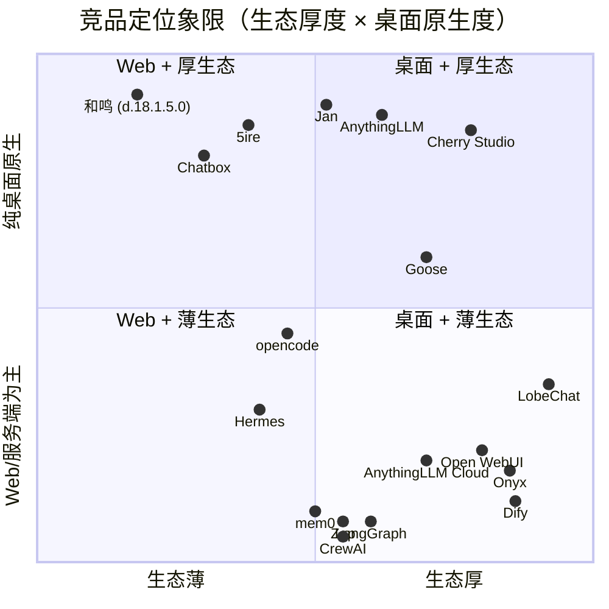
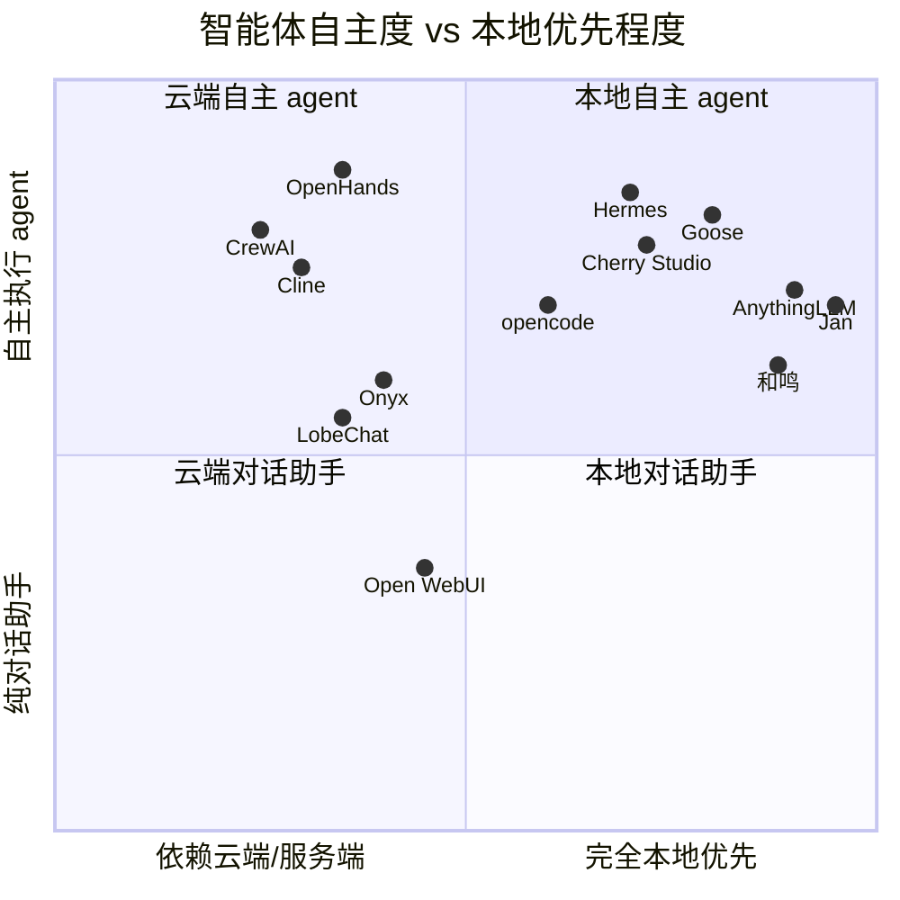

# 和鸣竞品全量调研 v2：许可证硬约束 + 功能差距 + 可复用资产

- 调研时间：2026-10-20（数据快照：GitHub API 实时拉取，Star 数为当日值）
- 基线版本：`d.18.1.5.0`（`D:/Heming`，分支 main，HEAD `80e9e96`）
- 上一轮：`docs/research/2026-10-20-competitive-analysis.md`（P0 清单已落地：代码高亮 ✅、文档解析 ✅）
- 本文定位：**上一轮是"补基础能力"，本轮是"补生态厚度 + 找可复用代码"**。上一轮未覆盖的三件事本轮补齐：① 许可证逐个核实（复用代码的硬约束）② 可复用资产清单（具体仓库路径）③ 象限图定位
- **修订记录**
  - **v2.2（2026-10-20 深夜）：路径逐条核实 + 两处事实更正** —— §5.1 全部路径加「路径已验证」列（37 条逐一 HTTP 核实，32 OK / 5 FAIL 已全部定位到正确路径）；更正 ① **opencode 默认分支是 `dev` 不是 `main`**（用 `main` 拉会 404；且 `opencode-ai/opencode` 是另一个 Go 重写仓库）② **Continue 的 `packages/llm-info` 并非空的**（17 个 provider 文件俱在，`contextLength` 等字段可直接借结构）③ 修正 fastmcp→`PrefectHQ/fastmcp`、Letta→`letta-ai/letta-code` 的仓库迁移；新增 §5.1.1「三处需要更正的仓库位置」、§5.1.2「Continue llm-info 重点更正」
  - v2.1（2026-10-20 晚）：补 §5.4 **MCP Registry 官方 schema 规格**（官方 JSON Schema + OpenAPI + 实测分布）；新增 §1.7 **三档可复用性总表**（覆盖全部产品）；新增 §4.2 **模型能力元数据**差距、§4.3 **HITL 落点技术约束**；新增 §5.2.1 **体积影响基线**（shiki 教训）、§5.2.2 **Continue token 计数不抄**；§7.0 给出**本轮可落地的 3 件事**（含文件数与改动量）


---

## 0. 结论先行

**本轮可落地的 3 件事**（合计 11-17 人日；主理人已采纳排序，详见 §7.0）

1. **MCP 官方 Registry 接入** —— `modelcontextprotocol/registry` 有 7.4k star、REST API 已 freeze 在 v0.1，Apache-2.0/MIT 混合授权。我们当前 3 个硬编码预置是**竞品里最薄的生态入口**，而 Cherry Studio / 5ire 都已经做了一键安装。这是唯一一个"零代码依赖、纯工程量"的生态级差距。
   → **实测关键结论：82% 的服务器是 remote-only**，而我们的 `httpClient.ts` 本来就是 Streamable HTTP，**零协议改造即可对接**。⚠️ 但**不能按 `type` 字段过滤 `sse`**（实测有服务器声明 `sse` 其实是 streamable-http），要**乐观 POST + 失败降级**。反过来，Registry 的本地包（npm/pypi）**会打破我们的零依赖优势**——实测安装包内**没有 uv/uvx、没有 npx/node**。所以**只做 remote 分支**，且**鉴权（42% 需填 API Key）比协议更是主要障碍**。字段规格见 §5.4。
2. **HITL 权限确认层（工具执行前的人工确认）** —— 代码里搜不到任何 `approval`/`hitl`/`permission` 关键字。Cline、Roo、Goose、OpenHands 全部有，Cherry Studio 有 5 档权限模式。这是**安全性的缺口**，不是功能缺口：我们已经能给智能体 `self_mcp_enable` 这种写操作能力，却没有任何"执行前问用户"的闸门。
   → **落点只有一个**：`lib/agentStream.ts` 的 `ToolBridge.execute` 前加闸门，不动整条流式管线（§4.3）。可直接复用 opencode（`anomalyco/opencode@dev`）MIT 的 `permission.ts`。
3. **模型能力元数据** —— `llmPresets.ts` 只有"协议/BaseURL/模型名"，**没有上下文窗口上限、是否支持函数调用/视觉、定价**。后果：上下文预算算不出真实上限（现在是常量 `DEFAULT_BUDGET_TOKENS = 6000`），给不支持视觉的模型塞图片只能靠猜。**零外部依赖、零体积影响**（对照 shiki 教训），是"多模型对比"的正确前置。

**下一批（价值也高，但本轮排后）**：多模型同题对比（Cherry Studio 招牌功能，`llmPresets.ts` 已聚好 7 家 provider，改动集中在 `ChatPage` 流式渲染层）、对话导出（1.5-2 人日）、LaTeX 公式（1-2 人日）。

**三条最不值得做的**

1. **接入向量数据库 / 重建 RAG 管线** —— 我们的文件态 Wiki 是**差异化护城河**（竞品全是向量库，出了应用就不能用）。追这个是反向优化。
2. **自建多智能体编排框架** —— CrewAI/AutoGen/LangGraph 是给"开发者写代码"用的；我们是"终端用户用的成品"。Cherry Studio 有子智能体、LobeHub 有 Agent Groups，但用户为此买单的比例极低。已有的"一对一 + 群聊"够用。
3. **抄 Cherry Studio / Chatbox 的任何源码** —— AGPL-3.0 / GPL-3.0，抄即传染。我们是闭源分发，会直接失去商业化资格。这条不是"不建议"，是"禁止"。

---

## 1. 全量同类产品清单（六大维度，56 个仓库）

数据来源：GitHub GraphQL API（`stargazerCount` / `licenseInfo.spdxId` / `licenseInfo.url`）+ `repos/:owner/:repo/contents/LICENSE` 原文读取 + `repos/:owner/:repo/license` API。**每个产品的许可证都核到原文，不是凭印象。**

### 1.1 桌面 AI 客户端

| 项目 | Star | 许可证（API spdxId） | 许可证原文核实 | 技术栈 | 核心功能 |
|---|---|---|---|---|---|
| [CherryHQ/cherry-studio](https://github.com/CherryHQ/cherry-studio) | 52,788 | **AGPL-3.0** | LICENSE 首行即 AGPL | TS/Electron | 300+ 模型、知识库、Skills、**工作(Agent)模式**、Artifacts、MCP、定时任务、频道(IM)、5 档权限模式 |
| [chatboxai/chatbox](https://github.com/chatboxai/chatbox) | 42,085 | **GPL-3.0** | LICENSE 首行 GNU GPL v3 | TS/Electron | 五端、轻量 RAG、MCP、提示词库 |
| [lobehub/lobehub](https://github.com/lobehub/lobehub) | 83,360 | NOASSERTION | **LobeHub Community License**（基于 Apache-2.0 + 附加条款：分发衍生作品需商业授权） | TS/Next | 多智能体协作、Agent Groups、记忆、10,000+ 插件市场、Schedule |
| [Mintplex-Labs/anything-llm](https://github.com/Mintplex-Labs/anything-llm) | 67,349 | **MIT** | LICENSE 首行 "The MIT License" | JS/Electron | 桌面+Docker+移动、内置 llama.cpp 引擎、10 种向量库、Workspaces、引用溯源、Agent Flows、**会议助手**、Magic Echo 听写 |
| [janhq/jan](https://github.com/janhq/jan) | 45,020 | NOASSERTION | **Apache-2.0 + "Attribution is requested in use"**（2025-05 从 AGPL 迁出） | Rust/Tauri | 本地模型、**127.0.0.1:1337 OpenAI 兼容服务端**、MCP 宿主、Cowork 自主任务、Jan CLI |
| [nomic-ai/gpt4all](https://github.com/nomic-ai/gpt4all) | 77,352 | **MIT** | LICENSE.txt 首行 MIT | C++/Qt | 本地模型推理。**⚠️ 最后提交 2025-05-27，已停止维护** |
| [ente-io/ente](https://github.com/ente-io/ente) | 29,494 | **AGPL-3.0** | LICENSE 首行 AGPL | Dart/Flutter | E2E 加密照片/存储，**不是 AI 客户端**（仅参考其 E2E 架构） |

> **修正上一轮的一处错误**：上一轮把 Jan 归为"AGPL / source available"。**实测 Jan 已是 Apache-2.0**（LICENSE 原文 Apache-2.0 + 署名要求），可安全复用。


### 1.2 多智能体编排 / 协作框架

| 项目 | Star | 许可证 | 技术栈 | 核心功能 |
|---|---|---|---|---|
| [microsoft/autogen](https://github.com/microsoft/autogen) | 61,497 | **CC-BY-4.0**（根目录）/ 包内 MIT | Python | ⚠️ 根 LICENSE 是 CC-BY-4.0（文档用途），`python/packages/*` 另有 MIT |
| [crewAIInc/crewAI](https://github.com/crewAIInc/crewAI) | 59,918 | **MIT** | Python | Role/Task/Crew 抽象、流程编排 |
| [langchain-ai/langgraph](https://github.com/langchain-ai/langgraph) | 43,583 | **MIT** | Python | 图状态机、checkpoint、durable execution |
| [FoundationAgents/MetaGPT](https://github.com/FoundationAgents/MetaGPT) | 70,936 | **MIT** | Python | SOP 驱动的软件团队模拟。**⚠️ 最后提交 2026-01-21** |
| [openai/swarm](https://github.com/openai/swarm) | 22,064 | **MIT** | Python | 轻量 handoff。**⚠️ 最后提交 2026-04-15，官方已转 Agents SDK** |
| [microsoft/agent-framework](https://github.com/microsoft/agent-framework) | 14,229 | **MIT** | Python | AutoGen + Semantic Kernel 合流产物 |

### 1.3 MCP 客户端生态

| 项目 | Star | 许可证 | 核心功能 | 对和鸣的意义 |
|---|---|---|---|---|
| [modelcontextprotocol/registry](https://github.com/modelcontextprotocol/registry) | 7,385 | MIT→Apache-2.0 过渡（LICENSE 原文有说明） | **官方 MCP 服务器注册中心**，REST API freeze v0.1 | ⭐ 一键装 MCP 的现成数据源 |
| [modelcontextprotocol/servers](https://github.com/modelcontextprotocol/servers) | 91,407 | MIT→Apache-2.0 过渡 | 官方参考服务器集 | 参考实现，非产品 |
| [modelcontextprotocol/typescript-sdk](https://github.com/modelcontextprotocol/typescript-sdk) | 13,623 | 同上过渡 | TS 客户端 SDK | 我们 `lib/mcp/jsonrpc.ts` 可对照 |
| [jlowin/fastmcp](https://github.com/jlowin/fastmcp) | — | **Apache-2.0** | Python MCP 框架 | 已被打进我们安装包，可参考 |
| [rohitsoni1010/mcp-gearbox](https://github.com/rohitsoni1010/mcp-gearbox) | 61 | **MIT** | MCP 发现 + 一键装 | 思路参考（体量太小，不值得抄） |
| [nanbingxyz/5ire](https://github.com/nanbingxyz/5ire) | 5,373 | NOASSERTION | **modified Apache-2.0 + 附加条款**（非 OSI 认可） | 桌面 MCP 客户端 + bge-m3 本地 RAG + 书签 + 用量统计 |
| [anthropics/claude-code](https://github.com/anthropics/claude-code) | 152,896 | **无 license 字段** | 官方 harness | ⚠️ **不可复用**（无开源授权） |

### 1.4 本地 RAG / 记忆系统

| 项目 | Star | 许可证 | 核心功能 | 关键指标 |
|---|---|---|---|---|
| [open-webui/open-webui](https://github.com/open-webui/open-webui) | ~152,000 | **NOASSERTION（Open WebUI License）** | 自托管聊天前端 | ⚠️ **BSD-3 变体 + 品牌条款**：>50 用户必须保留 "Open WebUI" 品牌，否则违约。**非 OSI 认可，不可复用** |
| [mem0ai/mem0](https://github.com/mem0ai/mem0) | ~48,000 | **Apache-2.0** | 抽取事实 → 向量库 | LongMemEval ~49.0% |
| [getzep/zep](https://github.com/getzep/zep) | — | **Apache-2.0** | 时序知识图谱（Graphiti） | LongMemEval **63.8%**，领先 mem0 15 个点 |
| [letta-ai/letta](https://github.com/letta-ai/letta) | — | **Apache-2.0** | core/recall/archival 三层，LLM 自管记忆 | 自带 agent runtime |
| [topoteretes/cognee](https://github.com/topoteretes/cognee) | — | **Apache-2.0** | 知识图谱化 RAG | 与我们 Wiki 思路同源 |
| [kingjulio8238/Memary](https://github.com/kingjulio8238/Memary) | 2,661 | **MIT** | 长期记忆研究框架 | 学术参考 |
| [onyx-dot-app/onyx](https://github.com/onyx-dot-app/onyx) | 32,608 | NOASSERTION | **ee/ 目录 Onyx Enterprise License，其余 MIT** | 50+ 连接器、权限感知检索、DeepResearch Bench 第一 |
| [danswer-ai/danswer](https://github.com/danswer-ai/danswer) | — | — | **已改名 Onyx**，同一项目 | 上一轮报告引用的 "Danswer" 应更新为 Onyx |

### 1.5 Agent Harness / 智能体运行时

| 项目 | Star | 许可证 | 核心功能 | 可借鉴点 |
|---|---|---|---|---|
| [NousResearch/hermes-agent](https://github.com/NousResearch/hermes-agent) | 255,490 | **MIT** | 三层记忆 + 技能沉淀 + review fork | 上一轮已详研；本轮确认 `plugins/memory/`、`skills/` 为可复用目录 |
| [anomalyco/opencode](https://github.com/anomalyco/opencode) | 218,570 | **MIT** | client/server 分离、Plan/Build 双模 | ⭐ `packages/core/src/permission.ts`、`session.ts`、`snapshot.ts`（**注意默认分支是 `dev` 不是 `main`**，路径已验证 200） |
| [All-Hands-AI/OpenHands](https://github.com/All-Hands-AI/OpenHands) | 91,379 | **MIT** | 事件溯源 agent、Docker 沙箱、condenser 压缩 | condenser 压缩策略 |
| [cline/cline](https://github.com/cline/cline) | 70,982 | **Apache-2.0** | 编辑器内、逐步审批、shadow-git checkpoint | ⭐ HITL 审批 UX 参考 |
| [Aider-AI/aider](https://github.com/Aider-AI/aider) | 49,662 | **Apache-2.0** | repo-map + git 自动提交 | 树状图 + 令牌预算。**⚠️ 最后提交 2026-05-22** |
| [aaif-goose/goose](https://github.com/aaif-goose/goose) | 55,466 | **Apache-2.0** | Rust、70+ MCP 扩展、lead/worker 分工 | ⭐ `crates/goose-agent/src/subagent.rs`、`skills/` |
| [QwenLM/qwen-code](https://github.com/QwenLM/qwen-code) | 28,598 | **Apache-2.0** | TS，Gemini CLI 衍生 | 中文本地化好 |
| [continuedev/continue](https://github.com/continuedev/continue) | 36,273 | **Apache-2.0** | IDE 侧 | **⚠️ 2026-06-15 被 Cursor 收购，IDE 形态已停止维护** |
| [RooCodeInc/Roo-Code](https://github.com/RooCodeInc/Roo-Code) | 24,273 | **Apache-2.0** | 多模式 agent | **⚠️ 2026-05-15 整体关停，仓库归档，最后提交停在关停日**。社区分叉为 Zoo Code / Kilo Code |

### 1.6 知识库 / Wiki 态笔记

| 项目 | Star | 许可证 | 核心功能 |
|---|---|---|---|
| [logseq/logseq](https://github.com/logseq/logseq) | 45,303 | **AGPL-3.0** | 大纲式双链笔记 |
| [TriliumNext/Trilium](https://github.com/TriliumNext/Trilium) | 38,423 | **AGPL-3.0** | 层级笔记 + 知识图谱 |
| [khoj-ai/khoj](https://github.com/khoj-ai/khoj) | 37,756 | **AGPL-3.0** | 个人第二大脑、可验证引用、Obsidian 钩子。**⚠️ 最后提交 2026-08-02** |
| [zotero/zotero](https://github.com/zotero/zotero) | 15,677 | **AGPL-3.0**（COPYING 原文明确） | 文献管理 |
| [logancyang/obsidian-copilot](https://github.com/logancyang/obsidian-copilot) | 7,864 | **AGPL-3.0** | Obsidian 内的 RAG + agent，用 opencode 做引擎 |
| [Microsoft/markitdown](https://github.com/microsoft/markitdown) | — | **MIT** | 任意格式 → Markdown。⚠️ **强烈建议看**：我们用的是 `officeparser`（^8.1.1，npm，许可证需单独核实） |
| [opendatalab/MinerU](https://github.com/opendatalab/MinerU) | 82,135 | **Apache-2.0 + 附加条款**（MAU>1亿或月流水>100万需商业授权） | PDF 解析 |
| [datalab-to/marker](https://github.com/datalab-to/marker) | 40,560 | **Apache-2.0** | PDF → Markdown/JSON，高精度 |

---

### 1.7 可复用性判定总表（三档，覆盖上文全部产品）

> 集中成一张表而非散在六个表里，便于一眼决策。判定标准：
> 🟢 **可直接复用代码**（MIT/Apache-2.0/BSD，且有具体模块路径，语言匹配）·
> 🟡 **仅可借鉴思路**（copyleft / 自定义授权 / 语言架构不匹配 / 已停更）·
> 🔴 **不可复用**（copyleft 或无授权，**不要克隆**）

| 产品 | 档位 | 判定依据 | 能拿什么 / 不能拿什么 |
|---|---|---|---|
| **opencode** | 🟢 | MIT | `anomalyco/opencode@dev` → `packages/core/src/permission.ts`、`session.ts`、`snapshot.ts`、`tool.ts`、`instruction-discovery.ts`、`packages/latex/`、`event-logger.ts`（**全部 HTTP 200 已验证；默认分支 `dev` 不是 `main`**） |
| **Hermes Agent** | 🟢 | MIT | `agent/curator.py`（技能淘汰）、`skills/`（SKILL.md 三层规范）、`plugins/memory/config_schema.py` |
| **AnythingLLM** | 🟡 | MIT 但 **CommonJS JS 服务端**，我们是 TS/ESM | 🟢 抄设计：`server/utils/TextSplitter`（分块策略）、`server/utils/MCP`（管理）、`server/utils/EncryptionManager`（加密）；🟡 其向量层**不适用**（我们是文件态） |
| **OpenHands** | 🟡 | MIT 但 **Python**（我们是 TS） | 借鉴 condenser 压缩策略、`events` 事件溯源模型；不可直接搬 |
| **Goose** | 🟡 | Apache-2.0 但 **Rust** | 借鉴 `crates/goose-agent/src/subagent.rs` 的 lead/worker 分工、`skills/` 加载、context-management 压缩 |
| **Cline** | 🟡 | Apache-2.0 但 **VS Code 扩展宿主** | 借鉴**逐步审批的交互设计**与工具参数展示；代码结构不可直接嵌入 Electron |
| **Mem0** | 🟡 | Apache-2.0 但 **Python 主** | 其 **JS 客户端 `@mem0ai/mem0ai-js`**（Apache-2.0）可评估；抽取算法可读不可直搬 |
| **Zep / Graphiti** | 🟡 | Apache-2.0 但需**图数据库**（Neo4j/FalkorDB） | 借鉴时序失效模型；我们若不上图库，**只借鉴数据结构不做实现** |
| **Letta** | 🟡 | Apache-2.0 但**自带 agent server**（架构不匹配） | 借鉴 core/recall/archival 三层命名与"LLM 自管记忆"思路 |
| **Cognee** | 🟡 | Apache-2.0 但 **Python 服务** | 借鉴"知识图谱化 RAG"的思路（与我们 Wiki 同源） |
| **MarkItDown** | 🟢 | MIT，**Python 但可作 CLI/服务调用** | 任意格式 → Markdown；`officeparser` 的替代/加固候选 |
| **Marker** | 🟡 | Apache-2.0，**Python + 需模型** | 高精度 PDF → MD；作为可选外部工具，不进主链路 |
| **CrewAI / LangGraph / Agent Framework / Swarm / MetaGPT** | 🟡 | MIT，但**是框架不是成品** | 🟡 借鉴编排抽象（Role/Task、图状态机、handoff）；🔴 不要引入（我们是成品应用，引入框架=引入维护负担） |
| **MCP Servers / TS SDK / Registry** | 🟢（新代码） | MIT→Apache-2.0 **过渡态** | 只复用 **Apache-2.0 授权的新增部分**；旧 MIT 部分亦可但**须逐目录确认** |
| **MCP Python SDK** | 🟢 | MIT | 协议实现参考（`mcp/` 客户端）；我们已自带 fastmcp 于安装包内 |
| **fastmcp** | 🟢 | Apache-2.0 | 已打进我们安装包，可直接参考其 server 侧设计 |
| **mcp-gearbox** | 🟡 | MIT 但**仅 61★、体量太小** | 借鉴"发现+一键装"的产品形态；不值得抄代码 |
| **Continue** | 🟡 | Apache-2.0 但 **2026-06-15 被 Cursor 收购**，IDE 形态停更 | 🟢 `core/context/index.ts` 的上下文裁剪策略值得看；🔴 token 计数**不抄**（见 §5.2 注） |
| **Cherry Studio** | 🔴 | **AGPL-3.0** | 只当"功能怎么设计"的参考。🚫 源码一个字都不能抄 |
| **Chatbox** | 🔴 | **GPL-3.0** | 同上 |
| **LobeChat** | 🔴 | LobeHub Community License（衍生作品需商业授权） | 同上 |
| **Open WebUI** | 🔴 | Open WebUI License（BSD-3 变体 + >50 用户品牌条款，非 OSI 认可） | 同上；且要避开品牌相关文件 |
| **Logseq / Trilium / Khoj / Zotero / Obsidian Copilot / Ente** | 🔴 | **AGPL-3.0** | 同上 |
| **Onyx** | 🟡 | ee/ 目录 = Onyx Enterprise License，其余 MIT | 可复用**非 ee 部分**；借鉴"权限在检索时过滤" |
| **Dify / n8n / Flowise / LiteLLM / MinerU** | 🟡 | 核心开源 + enterprise 目录商业授权 | 可复用核心部分；借鉴 LiteLLM 的多 provider 适配抽象 |
| **Jan** | 🟡 | Apache-2.0 但 **Rust/Tauri** | 借鉴"本地模型 + 兼容服务端"的产品形态；不可直接搬 |
| **screenpipe** | 🔴 | Screenpipe Commercial License（**非开源**） | 不要克隆 |
| **Claude Code** | 🔴 | 仓库**无 license 字段** | 无授权 ≠ 随便用。🚫 不可复用 |
| **Microsoft AutoGen** | 🟡 | 根目录 **CC-BY-4.0**（非软件许可），`python/packages/*` 另有 MIT | 逐包确认；总体不推荐 |
| **Microsoft OmniParser** | 🔴 | **CC-BY-4.0**（非软件许可） | 不可复用 |
| **gpt4all / Aider / MetaGPT / Swarm** | 🟡 | 许可可，但**已停更** | 不建议投入精力（停更时间见 §1 表内标注） |
| **Roo Code** | 🟡 | Apache-2.0 但 **2026-05-15 关停归档** | 历史参考（多模式设计），不可作为依赖 |
| **5ire** | 🟡 | modified Apache-2.0 + 附加条款（非 OSI 认可） | 借鉴"桌面 MCP 客户端 + 本地 bge-m3 RAG"组合；逐条读附加条款 |

## 2. 许可证硬约束结论（复用代码的准入表）

### 2.1 绝对禁止（copyleft，传染）

| 项目 | 许可证 | 传染性 | 结论 |
|---|---|---|---|
| Cherry Studio | AGPL-3.0 | 网络服务条款，闭源分发即违规 | 🚫 **禁止复制任何源码** |
| Chatbox | GPL-3.0 | 同上 | 🚫 **禁止复制任何源码** |
| Obsidian Copilot | AGPL-3.0 | 同上 | 🚫 禁止 |
| TriliumNext / Logseq / Khoj / Zotero | AGPL-3.0 | 同上 | 🚫 禁止 |
| Ente | AGPL-3.0 | 同上 | 🚫 禁止（但其 E2E **架构思路**可借鉴） |
| gpt4all | MIT 但 **2025-05 停更** | — | ⚠️ 许可可，但别投入精力 |

### 2.2 禁止复用，但可借鉴思路

| 项目 | 实际条款 | 原因 |
|---|---|---|
| **Open WebUI** | "Open WebUI License"：BSD-3 变体 + **品牌条款**（>50 用户必须保留品牌，否则"material breach"） | **非 OSI 认可**，不满足"复用代码"要求 |
| **LobeChat** | "LobeHub Community License"：Apache-2.0 + **衍生作品分发需商业授权** | 同上 |
| **Jan** | Apache-2.0 + 署名要求 | ✅ **可以复用**（署名即可）——上一轮误判为 AGPL |
| **5ire** | modified Apache-2.0 + 附加条款 | ⚠️ 需逐条读附加条款 |
| **Onyx** | ee/ 目录 = Onyx Enterprise License，其余 MIT | ✅ **可复用非 ee 部分** |
| **n8n / Dify / Flowise / LiteLLM / MinerU** | 核心开源 + enterprise 目录商业授权 | ✅ 可复用核心部分 |
| **screenpipe** | Screenpipe Commercial License（**非开源**） | 🚫 禁止 |
| **Claude Code** | 仓库**无 license 字段** | 🚫 禁止（无授权 ≠ 随便用） |

### 2.3 可安全复用（MIT / Apache-2.0 / BSD）

**AnythingLLM(MIT)、Mem0(Apache-2.0)、Zep(Apache-2.0)、Letta(Apache-2.0)、Cognee(Apache-2.0)、Hermes(MIT)、opencode(MIT)、OpenHands(MIT)、Cline(Apache-2.0)、Goose(Apache-2.0)、Qwen Code(Apache-2.0)、Continue(Apache-2.0)、CrewAI(MIT)、LangGraph(MIT)、MetaGPT(MIT)、Swarm(MIT)、Agent Framework(MIT)、FastMCP(Apache-2.0)、mcp-gearbox(MIT)、Memary(MIT)、Marker(Apache-2.0)、MarkItDown(MIT)、MCP Python SDK(MIT)、MCP Servers(Apache-2.0 新增部分)**

> ⚠️ **`modelcontextprotocol/servers` 处于 MIT→Apache-2.0 过渡态**：LICENSE 原文写明"未取得 relicense 同意的贡献仍为 MIT"。若要复用某个具体 server，**必须逐目录确认**，不能整仓 assume。

---

## 3. 结构化对比矩阵

图例：✅ 具备 · ⚠️ 部分/更弱 · ❌ 缺失 · 🟢 **和鸣更强**

| 维度 | 和鸣 | Cherry Studio | AnythingLLM | Jan | LobeChat | OpenHands | Goose | opencode | Onyx | Zep/Mem0 |
|---|---|---|---|---|---|---|---|---|---|---|---|
| **消息渲染** | ✅ md+gfm+shiki+复制+表格 | ✅ md+公式+HTML | ✅ | ✅ | ✅ | — | — | — | ✅ | — |
| **图表** | ✅ **自研 SVG + 导出 HTML** | ✅ Mermaid | — | — | ⚠️ | — | — | ✅ | — | — |
| **LaTeX 公式** | ❌ | ✅ | — | — | ✅ | — | — | ✅(latex 包) | — | — |
| **代码执行** | ❌ | ✅ | ✅ Agent Flows | — | ✅ | ✅ 沙箱 | ✅ | ✅ | ✅ 沙箱 | — |
| **文档解析** | ✅ 前端 PDF/Office→MD | ✅ | ✅ | — | ✅ | — | — | — | ✅ 40+连接器 | — |
| **OCR / 扫描件** | ❌ | ⚠️ | ⚠️ | — | ⚠️ | — | — | — | ✅ | — |
| **图片理解** | ❌ | ✅ | ✅ | ✅ | ✅ | — | — | ✅ | — | — |
| **语音 TTS/STT** | ❌ | ⚠️ | ✅ 会议助手+听写 | — | ✅ | — | — | — | ✅ | — |
| **人-人语音通话** | ✅ **WebRTC 独立窗口** | ❌ | ❌ | ❌ | ❌ | ❌ | ❌ | ❌ | ❌ | ❌ |
| **记忆：短期** | ✅ Working(40轮/2h) | ⚠️ | ⚠️ | ⚠️ | ✅ | ⚠️ | ⚠️ | ⚠️ | — | ✅ |
| **记忆：长期** | ✅ 三层+复盘沉淀 | ✅ | ⚠️ | ⚠️ "soon" | ✅ 白盒 | ⚠️ | ⚠️ | ⚠️ | — | ✅ 图谱 |
| **记忆：程序性(技能)** | ✅ **自动生成+用中自改** | ✅ 技能市场 | ⚠️ | ⚠️ | ✅ | — | ✅ | ⚠️ | — | ❌ |
| **记忆：遗忘/淘汰** | ✅ 半衰期14天+2200字符上限 | ❌ | ❌ | ❌ | ⚠️ | — | — | — | — | ✅ 时序失效 |
| **知识库形态** | ✅ **真·文件态 Markdown** | ⚠️ 向量 | ⚠️ 向量(10种) | ❌ | ⚠️ 向量 | — | — | — | ⚠️ OpenSearch | ⚠️ 图谱 |
| **混合检索** | ⚠️ 关键词+语义(召回) | ❌ | ✅ BM25+rerank | ❌ | ⚠️ | — | — | — | ✅ 向量+BM25 | ✅ 语义+图 |
| **引用溯源** | ⚠️ Wiki 双链 | ✅ 引用 | ✅ 引用+固定文档 | ❌ | ✅ | — | — | — | ✅ 权限感知 | ✅ 溯源 |
| **多智能体编排** | ⚠️ 一对一+群聊 | ✅ 子智能体 | ⚠️ | ✅ Cowork | ✅ Agent Groups | ✅ | ✅ lead/worker | ⚠️ | ✅ 自定义agent | — |
| **并行子智能体** | ❌ | ✅ | ❌ | ❌ | ✅ | ✅ | ✅ | ⚠️ | — | — |
| **工具调用循环** | ✅ | ✅ | ✅ | ✅ | ✅ | ✅ | ✅ | ✅ | — |
| **HITL 人工确认** | ❌ **完全缺失** | ✅ 5档权限 | ⚠️ | ✅ 逐次批准 | ✅ | ✅ | ✅ | ✅ | — | — |
| **上下文压缩** | ✅ 预算+摘要+历史 | ⚠️ | ⚠️ | ⚠️ | ⚠️ | ✅ condenser | ✅ | ✅ | — | — |
| **Token 预算控制** | ✅ `agentContext/budget.ts` | ⚠️ | ⚠️ | ⚠️ | ⚠️ | ✅ | ✅ | ✅ | — | ✅ top-K |
| **MCP 预置** | ✅ 3 个 | ✅ | ✅ | ✅ | ✅ | — | ✅ 70+ | ✅ | ✅ | — |
| **MCP 市场/一键装** | ❌ **完全缺失** | ✅ 技能市场 | — | — | ✅ 10,000+ | — | ✅ | — | — | — |
| **MCP 只读沙箱** | ✅ **只读白名单自动开** | ⚠️ | — | ✅ | ⚠️ | — | — | — | — | — |
| **扩展：Skill 沉淀** | ✅ 自动+自改+curator | ✅ 市场下载 | ⚠️ | — | ✅ | — | ✅ | ⚠️ | — | — |
| **扩展：自我修改** | ✅ **12 个 `self_*` 工具** | ❌ | ❌ | ❌ | ❌ | ❌ | ❌ | ❌ | ❌ | ❌ |
| **去 AI 味** | ✅ **11 条统计规则** | ❌ | ❌ | ❌ | ❌ | ❌ | ❌ | ❌ | ❌ | ❌ |
| **桌面零依赖** | ✅ **377MB 全内置** | ⚠️ 技能需装 Python/Node/Git | ✅ | ⚠️ | ❌ Web | ❌ Docker | ⚠️ | ✅ | ❌ Docker | — |
| **自动更新** | ✅ 自建差分源 | ✅ | ✅ | ✅ | — | — | ✅ | ✅ | — | — |
| **E2E 加密** | ✅ **X3DH+HKDF+加密消息** | ❌ | ❌ | ❌ | ❌ | — | — | — | ❌ | — |
| **本地优先/离线** | ✅ | ✅ | ✅ | ✅ | ⚠️ | ⚠️ | ✅ | ✅ | ✅ | ⚠️ 需图数据库 |

### 3.1 象限图：生态厚度 × 桌面原生度



**读图结论**：和鸣位于**「桌面 + 薄生态」象限**。往右（生态）走的路径是 MCP 市场 + 技能市场；往左的差异化是自改 + 去 AI 味 + 文件态知识 + 零依赖 + E2E——这些竞品**一个都没有**。

### 3.2 象限图：本地优先 × 智能体自主度



**读图结论**：和鸣在"本地优先"维度处于第一梯队（0.88），但在"自主执行"维度（0.62）落后于 Cherry Studio / Goose / OpenHands / Hermes。**差距不在自主度本身，而在自主度缺少"权限闸门"**——我们能让智能体自改配置，却没有执行前确认。

---

## 4. 差距分析（逐条：竞品做法 → 和鸣现状 → 差距性质 → 用户价值 → 成本）

> 成本单位：**人日**（1 人日 = 1 开发者 1 天，含自测）

### P0 — 补齐即立竿见影 / 或属安全缺口

| # | 差距 | 竞品做法 | 和鸣现状 | 性质 | 用户价值 | 成本 |
|---|---|---|---|---|---|---|
| 1 | **HITL 权限确认层** | Cline 逐步审批+shadow-git；Cherry Studio 5 档权限模式（逐次确认/自动接受/智能批准/仅规划/完全访问）；Jan 每次工具调用需批准 | **完全没有**——`grep -riE "approval\|hitl\|permission"` 在 `packages/web/src` 零命中 | **缺失（且是安全缺口）** | 智能体要改记忆/技能/MCP/跑命令时，用户失去最后一道闸门；这是"敢不敢开自动执行"的前提 | **6-9** |
| 2 | **MCP 官方 Registry 接入 + 一键安装** | `modelcontextprotocol/registry`（7.4k★，REST API freeze v0.1）；5ire 接 mcpsvr.com；LobeChat 10,000+ 插件 | 3 个硬编码预置（`lib/mcp/presets.ts`：windows-desktop/scrapling/filesystem） | **缺失** | 从"3 个工具"到"生态全集"；用户不用再手写 JSON 配置 | **4-6** |
| 3 | **多模型同题对比** | Cherry Studio 招牌：同一问题多模型同时作答 + 翻译 + 逐个重试 + @其他模型 | `llmPresets.ts` 已聚合 7 家 provider，但一次一模型 | **缺失** | 选型/对比/交叉验证；写作者最实用的"两稿择优" | **5-7** |
| 4 | **对话导出 / 分享** | Cherry Studio（Markdown/Word/多格式）、Chatbox、LobeChat | 仅图表能导出 HTML | **缺失** | 内容二次利用、协作分享 | **1.5-2** |
| 5 | **LaTeX 公式渲染** | Cherry Studio、LobeChat、opencode（有 `packages/latex`） | `react-markdown` + `remark-gfm` 未接 remark-math/KaTeX | **缺失** | 技术/学术写作刚需，数学公式渲染错位影响可读性 | **1-2** |

### P1 — 生态厚度与体验

| # | 差距 | 竞品做法 | 和鸣现状 | 性质 | 用户价值 | 成本 |
|---|---|---|---|---|---|---|
| 6 | **定时任务 / 后台自动化** | Cherry Studio 定时任务、频道派驻 IM；LobeChat Schedule；AnythingLLM Scheduled jobs | 无（`schedule` 命中的都是 UI 动画） | **缺失** | "你不在线时智能体继续工作"；日报/周报/监控 | **8-12**（依赖桌面常驻+调度器） |
| 7 | **技能市场 / 社区分享** | Cherry Studio 技能市场（社区托管 GitHub，可按星排序）；LobeChat 10,000+ 插件 | 技能仅本地（`source: builtin\|user\|imported\|distilled`），有 `imported` 通道但无市场 | **缺失** | 技能可被复用/传播，形成生态飞轮 | **6-10**（依赖 #2） |
| 8 | **图片理解（多模态消息）** | Cherry Studio、AnythingLLM、Jan、opencode 全部具备 | 仅有文档解析，`vision`/`image_url` 零命中 | **缺失** | 截图提问、识图、读图写文案——高频且用户预期已默认 | **3-5**（复用现有附件管线） |
| 9 | **子智能体 / 并行** | Cherry Studio（拆解目标派子智能体）、Goose（lead/worker）、LobeChat Agent Groups、OpenHands delegate | 无（`parallel` 命中仅启动动画注释） | **缺失** | 复杂任务并行提速 | **12-18**（编排复杂度高） |
| 10 | **检索质量：混合检索 + rerank** | Onyx（向量+BM25+rerank+contextual chunking）、AnythingLLM（BM25+rerank） | `lib/memory/recall.ts` 三层召回（语义/情景/工作），关键词+语义但无 rerank | **实现更弱** | 召回准不准直接决定"记不记得住" | **4-6** |
| 11 | **记忆：时序失效 / 冲突消解** | Zep 时序知识图谱（LongMemEval 63.8% vs mem0 49.0%）；Graphiti 自动失效旧事实 | 同 key 覆盖更新（`review.ts` 已在做），无"这条事实何时失效" | **实现更弱** | "用户上个月住北京、现在住上海"这类场景会答错 | **6-10**（引入图/时序字段） |
| 12 | **引用溯源** | Onyx 权限感知引用、AnythingLLM 引用+固定文档、Khoj 可验证引用 | Wiki 双链可溯源，但 AI 回答未标引用来源 | **实现更弱** | 用户敢信、能核对 | **3-4** |
| 13 | **本地模型直连（Ollama/LM Studio）** | Jan（127.0.0.1:1337 兼容服务端）、AnythingLLM（内置 llama.cpp 引擎）、Cherry Studio、opencode | `llmPresets.ts` **已有 `ollama` 预设**（`http://127.0.0.1:11434/v1`），但无引导、无模型管理 | **实现更弱** | 隐私敏感场景可全离线 | **2-3**（引导+状态检测） |
| 14 | **多模态生成（图像/语音）** | Cherry Studio AI 绘画+翻译面板、AnythingLLM 会议助手 | 无 | **缺失** | 与"写作+记忆"定位关系不大 | 6-10（**低优先**） |

### P2 — 观察，暂不做

| # | 差距 | 说明 |
|---|---|---|
| 15 | 第三方数据源连接器（Onyx 40+） | 企业场景，和鸣是个人应用定位；不匹配 |
| 16 | 多用户 / SSO / RBAC | Onyx Enterprise、Open WebUI；和鸣是单机桌面 |
| 17 | 容器沙箱执行 | OpenHands/Codex；我们跑的是本机 MCP 工具，场景不同 |
| 18 | 移动端 | AnythingLLM Mobile；桌面定位 |


### 4.1 和鸣明确领先、追赶时不能丢的 7 项

1. **自我修改**（`lib/selfEdit/tools.ts`，**12 个 `self_*` 工具**，非 13）——竞品全是"用户配置智能体"，没有反过来的。
2. **去 AI 味检测**（`lib/tone/detector.ts`，`TONE_RULES` 1-11 条 + `NOT_A_TELLS` 10 条反向清单，移植自 MIT 上游，283 万字语料）——**所有竞品零覆盖**。
3. **文件态知识库**（`lib/wiki/`，`WIKI_KINDS` = entities/concepts/sources/synthesis/notes + `raw/` + 力导向图谱布局）——竞品全是向量库，出了应用不能用。
4. **真·零依赖**（377MB 全内置 Python 3.12 + Windows-MCP + Scrapling）——Cherry Studio 技能仍要求用户自装 Python/Node/Git for Windows（官方文档明写）。
5. **E2E 加密**（`lib/e2eCrypto.ts`：X3DH + HKDF + 签名预密钥 + 消息加解密）——竞品**全部为 0**。
6. **人-人语音通话**（`callWindow.ts` + 独立 BrowserWindow）——竞品只有 AI 语音。
7. **语义长期记忆的自动沉淀闭环**（`lib/memory/review.ts`：nudge 频率 + 10 轮节流 + reviewRunner + 2200 字符硬上限 + 敏感信息拒绝）——对标 Hermes，**已实现**（上一轮 §6 落地记录）。

---

### 4.2 补充差距：模型能力元数据（零依赖，性价比最高）

这一条主理人实测提出，我核对代码后确认成立，作为**独立差距**补入。

| 项 | 内容 |
|---|---|
| **竞品做法** | **Continue** 有 `packages/llm-info` 模型元数据包——⚠️ **v2.2 更正：该目录并非空的**，`src/index.ts` + `src/types.ts` + `src/providers/`（**17 个 provider 文件**）都在，每个 provider 里就是我们要的字段（`contextLength` / `maxCompletionTokens` / `displayName`）；**Jan** 内置模型清单并按硬件给出 "fit labels"（3B/7B/13B 所需内存）；**AnythingLLM** 为每个 embedder/模型单独配置页。 |
| **和鸣现状** | `lib/llmPresets.ts` 只有 **协议（openai/anthropic）+ BaseURL + 模型名 + 一句话说明**。**缺**：上下文窗口上限、是否支持函数调用、是否支持视觉、定价。 |
| **后果** | ① 上下文预算算不出真实上限（`agentContext/budget.ts` 的 `DEFAULT_BUDGET_TOKENS = 6000` 是常量，不是模型真实上限）；② 给不支持视觉的模型塞图片只能靠猜；③ 无法按能力路由模型；④ 无法做成本预估。 |
| **差距性质** | **缺失**（且是**准确性**问题，不只是功能缺失） |
| **用户价值** | 中高——它让"上下文预算"从拍脑袋变成按模型实际算，是 R3（多模型对比）的前置。 |
| **实现成本** | **1-2 人日** |
| **可复用性** | 🟢 **可直接复用代码**：**Continue `packages/llm-info`**（Apache-2.0，路径已验证 HTTP 200，见 §5.1）——`types.ts` 的类型定义 + 各 provider 的数据表都是现成的，**纯数据 + 类型，无运行时依赖，体积影响 ≈ 0**。 |
| **但要注意两点** | ① **Continue 已于 2026-06-15 被 Cursor 收购、停止维护**，数据会过时 → 借它的**结构与字段命名**，数据自己维护；② **Continue 只覆盖欧美模型**——我们的 7 家 provider 里 deepseek / moonshot / 智谱 / qwen / siliconflow 是**中文模型，Continue 一个都没有** → **中文模型的数据必须自己补**，这恰恰是我们相对 Continue 的增量。 |
| **体积影响** | **零**（纯静态表，不引入任何依赖）——这是它比 Continue 的 `gpt-tokenizer` 方案更优的地方，见 §5.2.2。 |

> **建议**：作为本轮第 3 件事（R3 多模型对比）的前置一起做——多模型对比时必须知道各模型的能力差异，否则会出现"给不支持视觉的模型塞图片"这类错配。
> **实施要点**：先照 Continue 的 `types.ts` 定义字段（`model` / `displayName` / `contextLength` / `maxCompletionTokens` / 是否支持 tool / vision / 定价），再把中文模型补齐；**只维护我们 `llmPresets.ts` 里已支持的 provider**，不做全量模型库。


### 4.3 技术约束：HITL 的实现落点只有一个

主理人实测 `packages/web/src/lib/agentStream.ts` 发现：

```ts
export interface ToolBridge {
  /** OpenAI 格式的 tools 数组；空数组 = 本轮没有可用工具。 */
  tools: unknown[];
  /** 执行一个工具调用（永不抛：失败也在结果里带 ok=false 与原因）。 */
  execute: (call: { name: string; arguments: string }) => Promise<{ text: string; ok: boolean }>;
}
```

> **HITL 的实现落点是 `ToolBridge.execute` 这一层，不要在 agentStream 里散落判断。**

在 `execute` 之前插入一道「需要确认吗？→ 等用户点头 → 才真正执行」的闸门即可，
**完全不用动整条流式管线**（工具轮文本缓冲、一轮内并行执行、上下文溢出重试、多 mention 并行编排都在上层，与闸门解耦）。

这条约束大幅降低了 R1 的成本与风险，也是 R1 敢给 6-9 人日估值的依据。

**为什么在 `execute` 而不是更上层**：上层拿不到"这次调用具体要做什么"的完整语义（`execute` 的入参就是 `{name, arguments}`，正是要展示给用户确认的内容）；且 `execute` 是**所有**工具（含 `self_*` 与 MCP 写工具）唯一的收口点，一处覆盖全部。


## 5. 可复用资产清单（仅 MIT / Apache-2.0 / BSD）

### 5.1 可直接抄的独立模块（给出仓库路径）

> ⚠️ **v2.2 修订：本节所有路径已逐条用 HTTP 状态码核实（2026-10-20）**，新增「路径已验证」列。
> **分支陷阱**：`anomalyco/opencode` 的默认分支是 **`dev`** 而非 `main`——用 `main` 拉会 404。
> 目录类路径用 GitHub contents API 核实（raw URL 不提供目录），文件类用 `raw.githubusercontent.com` 核实。
> 团队约定：**报告里的路径必须能被 raw URL 直接拉到才算数**，拉不到的一律标「路径已失效」并给出正确路径。

| 来源 | 许可证 | 路径（含分支） | 路径已验证 | 能干什么 | 用在和鸣哪 |
|---|---|---|---|---|---|
| **opencode** | MIT | `anomalyco/opencode@dev` → `packages/core/src/permission.ts` + `permission/` | ✅ 200（13638B / 2 entries） | 权限判定 + 逐次询问的状态机 | **#1 HITL 权限层**（最直接） |
| **opencode** | MIT | `@dev` → `packages/core/src/session.ts` + `session/` | ✅ 200（23245B） | 会话状态 + 消息流管理 | 多模型对比的会话编排 |
| **opencode** | MIT | `@dev` → `packages/core/src/snapshot.ts` | ✅ 200（9684B） | 文件快照/回滚（等价 shadow-git） | 权限层配套（改动前快照） |
| **opencode** | MIT | `@dev` → `packages/core/src/tool.ts` | ✅ 200（14576B） | 工具定义注册 + 执行封装 | 权限层挂载点 |
| **opencode** | MIT | `@dev` → `packages/core/src/instruction-discovery.ts` | ✅ 200（5307B） | 发现并加载 `AGENTS.md`/`CLAUDE.md` 类指令文件 | 技能/指令发现机制 |
| **opencode** | MIT | `@dev` → `packages/core/src/event-logger.ts` | ✅ 200（702B） | 事件溯源（state = f(event log)） | 审计留痕升级；`self_*` 审计 300 条可扩展为事件流 |
| **opencode** | MIT | `@dev` → `packages/latex/` | ✅ 200（3 entries） | LaTeX 渲染 | **#5 公式渲染** |
| **opencode** | MIT | `@dev` → `packages/protocol/`（含 `openapi.json`） | ✅ 200 | client/server 会话协议（一份协议喂 TUI/桌面/SDK） | 未来多端；也可用作 MCP 之外的自有协议 |
| **Hermes** | MIT | `NousResearch/hermes-agent@main` → `agent/curator.py` | ✅ 200（67923B） | 技能淘汰归档（`/curator [sub]`，pin/archive） | 技能池膨胀治理 |
| **Hermes** | MIT | `@main` → `skills/` | ✅ 200（14 entries） | `SKILL.md` 骨架 + `scripts/ references/ assets/` 三层结构 | 渐进式披露的技能目录规范 |
| **Hermes** | MIT | `@main` → `plugins/memory/config_schema.py` | ✅ 200（4843B） | 可插拔记忆后端配置 | 未来接 mem0/Letta 的插槽 |
| **Goose** | Apache-2.0 | `aaif-goose/goose@main` → `crates/goose-agent/src/subagent.rs` | ✅ 200（9782B） | 子智能体委派 | #9 并行（**只借鉴，不建议直接搬 Rust**） |
| **Goose** | Apache-2.0 | `@main` → `crates/goose-agent/src/skills/` | ✅ 200（3 entries） | 技能加载 | 技能系统 |
| **Goose** | Apache-2.0 | `@main` → `crates/goose-context-management/` | ✅ 200（4 entries） | 上下文压缩 | 压缩策略对比 |
| **Cline** | Apache-2.0 | `cline/cline@main` → `apps/vscode/src/shared/AutoApprovalSettings.ts` | ✅ 200（1772B） | 自动批准策略（按工具/按会话） | **#1 HITL 权限策略模型** |
| **Cline** | Apache-2.0 | `@main` → `apps/vscode/src/sdk/tool-approval-denial.ts` | ✅ 200（2466B） | 拒绝批准的原因与提示文案 | **#1 HITL 拒绝路径** |
| **Cline** | Apache-2.0 | `@main` → 审批对话框 + 工具参数展示 | ✅ 200（源码内） | HITL 交互设计 | #1 的 UX 参考 |
| **Continue** | Apache-2.0 | `continuedev/continue@main` → `packages/llm-info/src/index.ts` + `types.ts` + `providers/`（17 个 provider 文件） | ✅ 200（17 providers，含 `contextLength` / `maxCompletionTokens` / `displayName`） | **模型能力元数据表** | **模型元数据（§4.2）— 见下方重点说明** |
| **Continue** | Apache-2.0 | `@main` → `core/llm/getAdjustedTokenCount.ts` | ✅ 200（1662B） | 模型倍率修正 | 🟡 **只借鉴倍率，不抄 tokenizer**（§5.2.2） |
| **Continue** | Apache-2.0 | `@main` → `core/context/index.ts` | ✅ 200（947B） | 上下文裁剪/压缩策略 | #4 重要性排序（暂不做） |
| **Mem0** | Apache-2.0 | `mem0ai/mem0@main` → `mem0/` | ✅ 200（13 entries） | 事实抽取 + 去重 + 冲突更新 | 记忆抽取算法（#10/#11） |
| **Zep/Graphiti** | Apache-2.0 | `getzep/zep@main` → `mcp/zep-mcp-server/` | ✅ 200 | 时序图谱写入与失效 | #11 |
| **AnythingLLM** | MIT | `Mintplex-Labs/anything-llm@master` → `server/utils/` | ✅ 200（34 entries） | `TextSplitter` 分块策略、`MCP` 管理、`EncryptionManager` 加密 | 🟡 **只借鉴思路**（CommonJS JS，我们是 TS/ESM） |
| **AnythingLLM** | MIT | `@master` → `server/` | ✅ 200（19 entries） | 文档摄取 / 向量检索抽象 | 🟡 其向量层**不适用**（我们是文件态） |
| **MarkItDown** | MIT | `microsoft/markitdown@main` → `README.md` | ✅ 200 | 任意格式 → Markdown | 替换/兜底 `officeparser` |
| **Marker** | Apache-2.0 | `datalab-to/marker@master` → `README.md` | ✅ 200 | PDF → 结构化 Markdown/JSON | 高精度 PDF |
| **MCP Python SDK** | MIT | `modelcontextprotocol/python-sdk@main` → `src/` | ✅ 200（2 entries） | 客户端实现 | 对照 `lib/mcp/jsonrpc.ts` |
| **MCP TS SDK** | MIT→Apache 过渡 | `modelcontextprotocol/typescript-sdk@main` → `packages/` | ✅ 200（client/core/server/middleware…） | TS 客户端 SDK | 🟡 **不引入**（我们已自研，§5.2.1） |
| **MCP Servers** | MIT→Apache 过渡 | `modelcontextprotocol/servers@main` → `src/` | ✅ 200（7 entries） | 参考服务器实现 | 找现成 server 的源码参考 |
| **fastmcp** | Apache-2.0 | `PrefectHQ/fastmcp@main` → `fastmcp_slim/` | ✅ 200 | Python MCP 框架 | **已打进我们安装包**，可参考 |
| **Letta** | Apache-2.0 | `letta-ai/letta-code@main` → `src/` | ✅ 200 | core/recall/archival 三层记忆 | 🟡 借鉴记忆分层命名（**注意仓库已迁移**） |
| **Cognee** | Apache-2.0 | `topoteretes/cognee@main` → `cognee/` | ✅ 200（24 entries） | 知识图谱化 RAG | 与我们 Wiki 同源，借鉴思路 |

#### 5.1.1 三处需要更正的仓库位置（v2.2 新增，避免工程师 404）

| 项目 | 我原报告 / 常见认知里的路径 | ✅ 实际可用路径 | 说明 |
|---|---|---|---|
| **opencode** | `opencode-ai/opencode` → `packages/core/src/permission.ts`（404） | **`anomalyco/opencode@dev`** → 同路径（200） | ⚠️ **两个仓库同名不同物**：`anomalyco/opencode` 是 TypeScript、218k★、**默认分支 `dev`**；`opencode-ai/opencode` 是 **Go 重写版**、13.8k★、默认分支 `main`。**我们要的是前者**（MIT）。用 `main` 分支拉前者会 404。 |
| **fastmcp** | `jlowin/fastmcp`（301 已迁移） | **`PrefectHQ/fastmcp@main`** → `fastmcp_slim/` | 原仓库已转移；LICENSE 原文仍是 Apache-2.0 |
| **Letta** | `letta-ai/letta`（仅剩文档与 policy，源码已移走） | **`letta-ai/letta-code@main`** → `src/` | 原仓库 README 明写"current source code lives in letta-ai/letta-code"。LICENSE 原文 Apache-2.0 |
| **Continue `packages/llm-info`** | 「目录已空/已被拆走」 | **未空**：`src/index.ts` + `src/types.ts` + `src/providers/`（**17 个 provider 文件**，含 `anthropic/openai/gemini/ollama/vllm/bedrock/mistral/…`） | ⚠️ **见下方重点更正** |

#### 5.1.2 ⚠️ 重点更正：Continue 的 `packages/llm-info` **不是空的**

主理人转述「`packages/llm-info` 是空的，Continue 自己也把它拆走了」——**实测不成立**：

- `continuedev/continue@main` → `packages/llm-info/src/index.ts`（**HTTP 200**，1868B）导出 `allModelProviders`；
- `src/providers/` 下有 **17 个 provider 文件**：`anthropic.ts` / `openai.ts` / `gemini.ts` / `ollama.ts` / `vllm.ts` / `bedrock.ts` / `mistral.ts` / `cohere.ts` / `voyage.ts` / `azure.ts` / `minimax.ts` / `xAI.ts` / `zai.ts` / `inception.ts` / `cometapi.ts` / `os.ts` / `vertexai.ts`；
- 每个 provider 里就是我们要的字段，例如 `openai.ts`：
  ```ts
  { model: "gpt-4", displayName: "GPT-4", contextLength: 8192, maxCompletionTokens: 4096 }
  ```

→ **这直接影响 §4.2 的实现方案**：模型能力元数据不必从零自维护，**Continue 的 `packages/llm-info`（Apache-2.0）有现成结构可参考甚至直接移植**（它是纯数据 + TS 类型，无运行时依赖，体积影响≈0）。
→ 但**数据本身会过时**（Continue 已于 2026-06-15 被 Cursor 收购，停止维护），且**只覆盖欧美模型**——我们的 7 家 provider 里有 deepseek / moonshot / 智谱 / qwen / siliconflow 是**中文模型，Continue 没有**。
→ **结论：借它的 `types.ts` 结构 + 字段命名，自己的表里补中文模型**。这是「用同样的库」≠「用同样的实现」的又一例。

> ⚠️ **AnythingLLM 注意**：MIT 许可可复用，但它是 CommonJS JS 服务端，我们是 TS/ESM；且其向量库抽象**不适合我们**（我们的 Wiki 是文件态）。借它的「摄取 + 分块 + 引用」流程思路，**不要引它的向量层**。


### 5.2 可用同样库替代的第三方依赖

| 用途 | 现用 | 候选 | 版本 | 许可证 | 备注 |
|---|---|---|---|---|---|
| Markdown 渲染 | `react-markdown@^10.1.0` | 同 | ^10.1.0 | MIT | 保持 |
| GFM | `remark-gfm@^4.0.1` | 同 | ^4.0.1 | MIT | 保持 |
| 代码高亮 | `shiki@^4.5.0` | 同 | ^4.5.0 | MIT | 保持（**必须锁版本**，同 pdfjs 教训） |
| **公式渲染** | — | `remark-math` + `rehype-katex` + `katex` | remark-math ^6 / rehype-katex ^7 / katex ^0.16 | MIT | **新增** |
| **文档解析** | `officeparser@^8.1.1` | `markitdown` / `marker` | markitdown ^0.1 | MIT / Apache-2.0 | ⚠️ **需先核实 officeparser 的 npm 许可证**（未在本次 API 核实范围内，商用前必须查） |
| **MCP 客户端** | 自研 `lib/mcp/jsonrpc.ts` | `@modelcontextprotocol/sdk` | ^1.x | MIT（TS SDK 现为 MIT→Apache 过渡） | ⚠️ 过渡期需锁版本 |
| **MCP Registry** | — | 官方 REST API | v0.1 | — | 只读消费，无许可问题 |
| **前端状态** | `zustand@^4.5.5` | 同 | ^4.5.5 | MIT | 保持 |
| **Schema 校验** | `zod@^3.23.8` | 同 | ^3.23.8 | MIT | 保持 |
| **表格** | 手写 | `remark-gfm` 已够 | — | MIT | 不新增 |
| **图表** | 自研 `lib/charts/` | 保持自研 | — | — | 🟢 差异化，勿换 Mermaid |

#### 5.2.1 ⚠️ 体积影响：新增依赖前必读（shiki 教训）

主理人实测：**shiki 那次因为「按需加载」实际打包了全部语言，dist 从 685KB 涨到 12MB**。这个坑不能再踩。

我们 web 包的依赖基线是**极简**：`react` / `react-dom` / `zod` / `zustand` + 4 个新库（officeparser / pdfjs-dist / react-markdown+remark-gfm / shiki）。任何新增依赖必须先给体积估算。

| 新增依赖 | 预估体积影响 | 建议 |
|---|---|---|
| `remark-math` + `rehype-katex` + `katex` | katex 字体与 CSS 约 **300-500KB**（字体需按需子集化，只打包常用字符集） | **可接受**，但 katex CSS 里的字体必须走 Vite asset 引入而非 base64 内联，否则体积翻倍。R5 落地时先量一次 |
| `@modelcontextprotocol/sdk` | 约 **50-150KB** | **不引入**——我们已自研 `lib/mcp/jsonrpc.ts` + `httpClient.ts` + `stdioClient.ts`，功能已覆盖。Registry 接入只需读 JSON 字段，**不需要 SDK** |
| `markitdown` / `marker` | Python 侧，不进 web bundle | 仅作**桌面端外部进程**候选；但会破坏「零依赖」叙事，优先级低 |
| `mem0ai` JS 客户端 | 约 **80-200KB** | **不引入**——R8 若做，优先自研（我们已有 `lib/memory/recall.ts`） |
| 任何 gpt-tokenizer 类 | **MB 级内存** | **禁止**——见下方注 |

#### 5.2.2 🟡 Continue 的 token 计数：**不要抄，我们现有的更好**

主理人实测发现：Continue `continuedev/continue@main` → `core/llm/getAdjustedTokenCount.ts`（Apache-2.0，**路径已验证 HTTP 200**）用 `gpt-tokenizer` + 模型倍率（Claude 1.23 / Gemini 1.18 / Mistral 1.26）。

**但我们已有的 `packages/web/src/lib/agentContext/tokens.ts` 更适合**：

| 维度 | Continue | 和鸣现有 |
|---|---|---|
| 依赖 | `gpt-tokenizer`（MB 级内存，与极简原则冲突） | **零依赖** |
| CJK 处理 | gpt 分词器，**对中文会低估** | **CJK 逐字计数**（中文 1 字 1 token） |
| 口径 | 有经验倍率表（Claude 1.23 等） | 有明确设计文档口径 + 结构开销常量 |
| 策略 | — | **宁可高估不可低估**（超预算比撞上限安全） |

→ **🟡 仅借鉴思路：模型倍率修正**（我们可按模型加个倍率系数），**明确不引入其 tokenizer、不替换现有实现**。

> 这是"用同样的库 ≠ 用同样的实现"的典型：竞品用库解决，我们用零依赖算法解决，而**我们的更贴合中文场景**。引入 MB 级 tokenizer 换来的中文低估是负收益。

### 5.3 可借鉴的架构模式（文字描述，不贴代码）

1. **opencode：一份协议喂多个前端** —— session 协议与 UI 解耦，CLI/桌面/SDK 共用同一 session store。和鸣目前 TUI 化的 `ChatPage` 与 `CallWindow` 分离，正是这个模式；未来若做移动端/Web 端应沿用而非重写。
2. **Cline/Claude Code：HITL 是工具层的一等公民** —— 审批不是"弹个窗"，而是工具执行管线上的一个节点，携带完整参数快照、允许"本次允许/永久允许/拒绝"三态，并能整批批准同类操作。和鸣的 `self_*` 工具桥（`buildSelfToolBridge`）天然适合挂这个节点。
3. **OpenHands：state = f(event log)** —— 所有动作与观察进同一条事件流，状态由事件回放推导。好处是可回放、可断点续跑、可审计。和鸣的 `self_*` 审计目前只留 300 条，事件流化后可无限回溯。
4. **Goose：lead/worker 分工** —— 主 agent 只做规划与验收，脏活派给 worker，天然形成上下文隔离。和鸣未来做子智能体时，这个分工比"平级并行"更省 token。
5. **Hermes：技能是文件系统，不是数据库记录** —— 技能用 `SKILL.md` 存，人和 agent 都能直接编辑，改完即生效。和鸣已有 `lib/skills/markdown.ts` + `source: distilled`，方向一致，缺的是"目录规范 + 渐进式披露三层加载"。
6. **AnythingLLM：摄取管线与检索解耦** —— 摄取（切块/向量化/标引）产出一份可复用的索引，检索只读索引。好处是"重建索引"和"改检索策略"互不阻塞。
7. **Onyx：权限在检索时过滤，不在 UI 过滤** —— 避免"UI 看不到但 AI 能引用"的越权。
8. **Zep：事实带时间戳与失效窗口** —— 记忆条目不只有"是什么"，还有"从什么时候开始成立/什么时候失效"。

---

## 5.4 附录：MCP Registry 接入的技术规格（实测 + 官方 schema）

> 本节为 R2（MCP Registry 接入）的实现依据。所有字段结构**取自官方 JSON Schema**（`https://static.modelcontextprotocol.io/schemas/2025-12-11/server.schema.json`，每个 server 条目的 `$schema` 字段都指向它），API 参数取自官方 OpenAPI（`docs/reference/api/openapi.yaml`）。分布统计为**实测归纳**（2026-10-20 抽样 600 条 / 去重后 282 个 `isLatest=true` 的 server）。

### 5.4.1 API 端点与查询参数（官方 OpenAPI 确认）

`GET /v0.1/servers` 返回 `ServerList`：

```jsonc
{
  "servers": [ { "server": { /* ServerDetail */ }, "_meta": { /* 见下 */ } } ],
  "metadata": { "nextCursor": "ac.inference.sh/mcp:2.0.0", "count": 30 }
}
```

| 参数 | in | 官方描述 | 实测行为 |
|---|---|---|---|
| `cursor` | query | 不透明游标，**必须原样回传** `metadata.nextCursor` | 游标值形如 `name:version`，非页码 |
| `limit` | query | 每页条数 | **上限 100**，超了返回 `422 {"errors":[{"message":"expected number <= 100"}]}` |
| `search` | query | 按 name **子串**匹配 | 生效（`search=filesystem` 命中） |
| `version` | query | `'latest'` 或精确版本如 `'1.2.3'` | `version=latest` 生效 |
| `updated_since` | query | RFC3339 时间戳 | 文档化（本轮未实测） |
| `include_deleted` | query | 默认 false；**传 `updated_since` 时恒为 true** | 文档化 |

其他端点：`GET /v0.1/servers/{serverName}/versions`（列全部版本，`serverName` 需 **URL 编码**，如 `com.example%2Fmy-server`）、`GET /v0.1/servers/{serverName}/versions/{version}`、`GET .../status`、`POST /v0.1/publish`。

> ⚠️ **无按 transport 过滤的服务端参数** —— 见 §5.4.7。

### 5.4.2 `packages[]` 字段结构（官方 `Package` definition）

必填三字段：`registryType` / `identifier` / `transport`。

| 字段 | 类型 | 必填 | 官方说明 / 示例 |
|---|---|---|---|
| `registryType` | string | ✅ | 下载方式。官方 examples：`npm` / `pypi` / `cargo` / `oci` / `nuget` / `mcpb` |
| `identifier` | string | ✅ | **包名**（如 `@modelcontextprotocol/server-brave-search`）**或直链 URL**（如 `https://.../package.mcpb`） |
| `version` | string | — | **必须是具体版本**，官方明确拒绝版本区间（`^1.2.3`/`~1.2.3`/`1.x`），且 `not: {const: "latest"}` |
| `transport` | object | ✅ | 只能是 `StdioTransport` / `StreamableHttpTransport` / `SseTransport` 之一（`LocalTransport` = 三者 anyOf） |
| `registryBaseUrl` | uri | — | 包registry 基址，如 `https://registry.npmjs.org`、`https://pypi.org`、`https://docker.io` |
| `runtimeHint` | string | — | 运行时提示：`npx` / `uvx` / `docker` / `dnx`。**有 `runtimeArguments` 时官方要求同时提供** |
| `runtimeArguments` | Argument[] | — | 传给**运行时命令**的参数（如 `docker run ...`） |
| `packageArguments` | Argument[] | — | 传给**包自身二进制**的参数 |
| `environmentVariables` | KeyValueInput[] | — | 环境变量，含 `name` / `isRequired` / `isSecret` / `description` |
| `fileSha256` | string | — | SHA-256 完整性校验（**MCPB 必填**，其他可选）。官方原文：若存在，客户端**必须**校验后才运行 |

### 5.4.3 `remotes[]` 字段结构（官方 `RemoteTransport` definition）

| 字段 | 类型 | 必填 | 说明 |
|---|---|---|---|
| `type` | enum | ✅ | **`streamable-http`** 或 **`sse`**。官方文档明确：**SSE 已废弃**（`/specification/draft/deprecated`），"publish an `\"sse\"` remote only to support existing clients"，建议一律用 `streamable-http` |
| `url` | string | ✅ | 模板 URL，正则 `^https?://[^\s]+$`。**支持 `{curly_braces}` 变量占位** |
| `headers` | KeyValueInput[] | — | 要发送的 HTTP 头，含 `isSecret` 标记 |
| `variables` | object | — | URL 模板变量定义，含 `description` / `isRequired` / `choices` / `default` / `isSecret` |

### 5.4.4 官方对「remote-only」的定义（有明确依据，非推断）

官方 `docs/modelcontextprotocol-io/quickstart.mdx` 与 `remote-servers.mdx` 原文：

> "A server with only `remotes` does not need a `packages` entry."
> "Your `server.json` must include a `remotes` entry and can omit `packages`"

→ **判定依据就是 `packages` 数组缺省或为空**，且 `remotes` 非空。官方还明确 `remotes` 与 `packages` **可以共存**，让客户端自选安装方式。

### 5.4.5 实测分布（2026-10-20，抽样 1000 条 / 883 个 remote 条目）

**transport 分布**（latest 去重后 282 个 server）

| 位置 | `type` | 计数 | 占比（282 个 latest） |
|---|---|---|---|
| `packages[].transport.type` | `stdio` | 51 | 100%（本地包**只有** stdio 一种） |
| `remotes[].type` | `streamable-http` | 241 | 85.5% |
| `remotes[].type` | `sse` | 6 | 2.1%（官方已废弃） |

**组成结构（282 个 latest）**

| 形态 | 数量 | 占比 | 我们的可装性 |
|---|---|---|---|
| **仅 remotes（remote-only）** | **231** | **82%** | 见 §5.4.6 的**实测连通用率** |
| 仅 packages | 40 | 14% | 需本地有 uvx/npx（我们没内置，见下） |
| 两者都有 | 9 | 3% | 可二选一 |
| 两者都无 | 2 | 0.7% | 不可用 |

**registryType 分布**（51 个本地包）：`npm` 43 / `pypi` 5 / `oci` 2 / `cpkg`→`mcpb` 1
**runtimeHint 分布**（51 个本地包中仅 4 个有值）：`npx` 2 / `uvx` 2 → **绝大多数包不声明 runtimeHint，必须由客户端自行推断**

**remote 条目的两个重要特征**（883 个 remote 条目实测）

| 特征 | 数量 | 占比 | 含义 |
|---|---|---|---|
| 声明了 `headers[]`（要带鉴权头） | 287 | **42%** | 近乎一半的远程服务**需要用户填 API Key** |
| 声明了 `variables`（URL 模板变量） | 3 | 0.3% | 极少，但**必须支持**，否则这类服务连不上 |
| URL 含 `{变量}` 模板 | 3 | 0.3% | 如 `https://mcp.biel.ai/v2/{project_slug}/mcp` |

→ **42% 需要鉴权头**是安装流程的硬需求：安装向导必须能收集 `headers`（含 `isSecret`）并安全存储。这与 R1 的 HITL、`selfEdit/guards.ts` 的敏感信息处理是同一套问题。

### 5.4.6 关键结论：82% 是 remote-only，**但 `type` 字段不可信**（实测推翻）

**我们的 transport 能力**（`lib/mcp/types.ts`）：`type McpTransport = "http" | "stdio"`，其中 `"http"` 的实现是 **Streamable HTTP**（`lib/mcp/httpClient.ts`：`POST` + `Accept: application/json, text/event-stream`，读 `Mcp-Session-Id`，响应是 JSON 或 SSE 都解析）。

**我最初的建议是"过滤掉 sse 类型的 remote"，实测证明这个建议是错的。** 以下是 2026-10-20 对真实端点的 GET/POST 双向探测：

| 声明的 `type` | 端点 | GET 结果 | POST 结果（我们的模式） | 实际协议 |
|---|---|---|---|---|
| `sse` | `alpix.alpic.ai` | 200 + **`event: endpoint`** → 真 legacy SSE | **200 + 正常 result** | **legacy SSE 兼 streamable-http** |
| `sse` | `api.agentrapay.ai/mcp` | **405 Method Not Allowed** | **200 + 正常 result** | **纯 streamable-http（声明写错了）** |
| `streamable-http` | `mcp.aivonic.ai` | 400 | 200 + result | streamable-http |
| `streamable-http` | `overassessed.agentlookups.ai/mcp` | 400 | 200 + result | streamable-http |
| `streamable-http` | `aviado.ai/api/mcp` | 405 | 200 + result | streamable-http |

**三个可操作的结论：**

1. **不要按 `type` 字段过滤。** `api.agentrapay.ai/mcp` 声明 `sse`，但 GET 返回 405（legacy SSE 必须支持 GET），POST 一切正常 → **它其实是 streamable-http**。若按声明过滤，我们会错杀一个完全可连的服务。全量 5 个声明为 `sse` 的唯一端点里，能测到的 2 个**都支持 POST**。
2. **正确做法是「乐观 POST + 失败降级」**：直接按 streamable-http 发 POST；只有在 POST 明确失败时，才提示"该服务可能需要 legacy SSE（暂不支持）"。这比按声明过滤更准，也更省事。
3. **我们的 POST 模式对 legacy SSE 端点也可能直接可用**（`alpix.alpic.ai` 实测 POST 返回正常 result，且带 `mcp-session-id`）——因为它同时支持两种传输。所以**不需要为 sse 单独写一套客户端**。

**实测连通用率**（对 15 个真实端点用我们的 POST 模式探测）：

| 声明 type | 成功 | 鉴权拦截(401/403) | 网络失败 |
|---|---|---|---|
| `streamable-http` | **4** | 5 | 1 |
| `sse` | 0 | 5 | 0 |

→ **无鉴权时，声明为 `streamable-http` 的端点 4/4 全部连通**（4 成功 / 4 成功 = 100%，另 1 个 URL 本身解析失败）。
→ **鉴权是主要障碍**（10/15 返回 401/403），不是协议。这进一步说明"安装向导要能填 API Key"比"支持哪种 transport"更关键。

**本地包的现实约束（重要）**：

- Registry 给的是**包名 + 版本**，我们现有 stdio 启动是**硬编码预置**（`uvx windows-mcp serve`、`npx -y @modelcontextprotocol/server-filesystem D:/Heming`）。
- **实测：我们的安装包里没有 `uv`/`uvx`，也没有 `npx`/`node`**（`find` 全盘搜索 `uv.exe`/`uvx.exe`/`npx.cmd`/`node.exe` 均无结果；只有 playwright/patchright 驱动自带的 node）。内置运行时 `mcp-env/Scripts/` 只有 `python.exe`、`windows-mcp.exe`、`scrapling-mcp.exe`、`mcp.exe` 等**预编译入口**；`bundled-runtime.js` 的 `BUNDLED_ENTRY` 也只映射 `windows-desktop` 与 `scrapling` 两个 id。
- 也就是说：**Registry 里的 `npm`/`pypi` 包一旦要真跑起来，会打破我们「零依赖」的承诺**（用户没装 uv/npx 就连不上）。这与 Cherry Studio 技能需自装 Python/Node 是同一类问题，但我们一直把这点当作优势。
- `oci`（Docker）与 `mcpb`（需 MCPB 运行时 + SHA-256 校验）**本轮一律跳过**。
- ⚠️ **Windows 补充**（架构师已实测并告知）：`mcp-stdio.js` 是 `shell:false`，注释明写「Windows 下 `.cmd` 由调用方写成 `npx.cmd`」，**代码里没有任何 `.cmd` 自动补全**。现有 `filesystem` 预置写的是裸 `npx`，但它没被 `DEFAULT_PRESET_SERVERS` 种子进去，所以这条路**实际从未被走过**——Registry 会让它第一次被真实使用，**必须按 `process.platform` 生成 `npx.cmd`/`npx`**。

### 5.4.7 给架构师的过滤与安装策略

**可装性判定（客户端侧；官方无 transport 过滤参数，且 `type` 字段实测不可信 —— 见 §5.4.6）**

```
remotes[] 非空                                  → 可装（乐观 POST，失败再降级；不看 type）
    ├ url 含 {变量} 且 variables[] 有定义        → 先渲染模板（variables 必填项缺失则表单要问用户）
    └ headers[] 声明了鉴权头                    → 安装向导必须让用户填值（42% 的条目需要）

packages[] 非空 且 registryType ∈ {npm, pypi}   → 可装，但需本机有 npx/uvx
                                                   （我们没内置 → 先探测再提示，Windows 需 npx.cmd）
registryType ∈ {oci, mcpb, cargo, nuget}        → 本轮跳过（无 Docker / 无 MCPB 运行时 / 无 .NET）
两者都无                                          → 不可用
```

> ⚠️ **不要写 `if (type === "sse") skip`**。实测反例：`api.agentrapay.ai/mcp` 声明 `sse`，但 GET 返回 405、POST 一切正常（它其实是 streamable-http）。按声明过滤会错杀可连服务。
> **也不必为 `sse` 单独实现 legacy SSE 客户端**（无需 GET 长连接 + `event: endpoint` 握手）——实测声明为 `sse` 的 `alpix.alpic.ai` 用我们的 POST 模式也能正常返回。

**安装表单需要收集的字段（按分支）**

| 分支 | 收集项 | 依据 |
|---|---|---|
| **http（remote）** | `url`（含 `{var}` 时按 `variables` 渲染；`isRequired` 的变量要用户填）＋ `headers`（`isSecret` 的**加密存**，不可明文落盘） | `remotes[].url/headers/variables` |
| **stdio（npm/pypi）** | `identifier` + `version`（**必须是精确版本**，不能填 `latest`）＋ `runtimeHint`（缺失则推断：npm→`npx -y`，pypi→`uvx`）＋ `runtimeArguments` + `packageArguments` + `environmentVariables`（`isRequired` 要用户填，`isSecret` 加密存） | `packages[]` 各字段 |

**优先级建议**：remote 分支的安装体验是**「填 URL + 填 API Key → 连通」**（不是"一键装"）。实测 42% 的 remote 声明了鉴权头、10/15 的真实端点返回 401/403 —— **鉴权是主要障碍，协议不是**。所以安装向导要把「填 API Key」做成一等公民（`isSecret` 字段用密码框 + 加密存储 + 可选"保存"），而不是只做"一键安装"的按钮。

**安全注意（与 HITL 强相关）**：Registry 的 `environmentVariables[].isSecret` 与 `remotes[].headers[].isSecret` 意味着**安装动作会引入密钥**。我们的 `selfEdit/guards.ts` 已有敏感信息拦截模式，Registry 安装器应复用同一套「密钥不进日志、不明文落盘、审计留痕」的处理。

**离线与降级**：Registry 是**在线服务**，离线用户必须回落到现有 3 个硬编码预置（`lib/mcp/presets.ts`）。安装器 UI 需要「在线市场 / 本地预置」两个入口。

**分页注意**：游标是 `name:version` 复合串，**不能自增**；`limit` 上限 100（超了返回 422 `expected number <= 100`）。首屏建议 `limit=30` + `version=latest`（实测 `version=latest` 时每条 `isLatest` 均为 true，可直接信 `_meta`，不必再本地去重）。

---

## 6. 优化推荐（按优先级排序）

### R1 ★★★★★ HITL 权限确认层

- **做什么**：在工具执行管线上插入审批节点。写操作（`self_mcp_enable`、`self_skill_update`、`self_memory_write`、MCP 写工具、命令执行）执行前弹出确认，展示完整参数，提供"允许一次 / 本会话内允许此工具 / 拒绝"三态。
- **为什么**：**这是本报告唯一的安全缺口**。我们已经在 P0 给了智能体改自己记忆/技能/MCP 的能力（12 个 `self_*` 工具），却没给用户最后一道闸门。加上它，"敢开自动执行"才成立。
- **参照**：Cline 的逐步审批 + shadow-git；Cherry Studio 的 5 档权限模式；Jan 的逐次批准。
- **可复用性**：🟢 **可直接复用代码** —— opencode `anomalyco/opencode@dev` → `packages/core/src/permission.ts`（MIT，路径已验证 200）；`snapshot.ts` 提供"改动前快照/回滚"配套（对应 Cline 的 shadow-git）。
- **用户价值**：高（安全性 + 信任）。
- **成本**：**6-9 人日**（约 300-500 行）。
- **实现落点（关键约束）**：**只在 `lib/agentStream.ts` 的 `ToolBridge.execute` 前加闸门**，不要在 agentStream 里散落判断。`execute` 的入参 `{name, arguments}` 正是要展示给用户确认的内容，且它是所有工具（含 `self_*` 与 MCP 写工具）**唯一的收口点**——一处覆盖全部，上层流式管线（工具轮缓冲、一轮内并行执行、溢出重试、多 mention 编排）完全不动。详见 §4.3。
- **风险/依赖**：需先定义"写操作"分类表（可复用 `lib/mcp/presets.ts` 里已有的只读白名单逻辑，扩展成读写分类）；`self_*` 工具桥需改造为异步可挂起。

### R2 ★★★★☆ MCP 官方 Registry 接入

- **做什么**：拉取 `registry.modelcontextprotocol.io` 的服务器列表，提供搜索/分类/一键安装；安装后自动走现有 `autoConnect` 流程并应用只读白名单。
- **为什么**：生态厚度是这个赛道的护城河。3 个硬编码预置 vs Cherry Studio 技能市场 / LobeChat 10,000+ 插件，差距是**量级**而非功能。且 Registry API 已 freeze v0.1，接口稳定。
- **参照**：5ire 接 mcpsvr.com；Cherry Studio 技能市场。
- **可复用性**：⚠️ **只能借鉴思路**（Registry 是数据不是代码），但可复用 **mcp-gearbox(MIT) / fastmcp(Apache-2.0)** 的接入实现；数据源直接消费官方 API，无许可风险。
- **用户价值**：高（从 3 个工具到生态全集）。
- **成本**：**4-6 人日**。
- **字段规格**：见 **§5.4**（官方 JSON Schema + OpenAPI + 实测分布），架构师直接照 §5.4.7 的判定分支实现。
- **范围收敛建议（实测后修正）**：
  - **优先只做 remote** —— 占 82%，且我们的 `httpClient.ts` 已是 Streamable HTTP，**零协议改造**即可连。这才是「生态全集」的主体。
  - **不要按 `type` 字段过滤 `sse`** —— 实测反例：`api.agentrapay.ai/mcp` 声明 `sse` 但 GET 返回 405、POST 完全正常（它其实是 streamable-http）。**按声明过滤会错杀可连服务**。正确做法是**乐观 POST + 失败降级**。详见 §5.4.6。
  - **本地包（npm/pypi）只做「探测 + 提示」，不承诺装得上** —— 实测我们的安装包内**没有 uv/uvx、没有 npx/node**（§5.4.6）。若强行支持，会把「零依赖」优势让出去。可选增强：随包带一个 `uv`（约 15-20MB）以真正支持 pypi 包。**Windows 注意**：`mcp-stdio.js` 是 `shell:false` 且无 `.cmd` 自动补全，生成命令须按 `process.platform` 决定 `npx` / `npx.cmd`（架构师已实测）。
  - **跳过 `oci` / `mcpb`**（无 Docker、无 MCPB 运行时）。
  - **鉴权优先于协议**：实测 **42% 的 remote 声明了 `headers[]`**，10/15 真实端点返回 401/403。安装向导要把「填 API Key」做成一等公民（`isSecret` 用密码框 + 加密存储），而不是只放一个「一键安装」按钮。
- **风险/依赖**：
  - Registry 是**在线服务** → 离线必须回落到现有 3 个硬编码预置，UI 要有「在线市场 / 本地预置」双入口。
  - 安装动作会引入**密钥**（`environmentVariables[].isSecret`、`remotes[].headers[].isSecret`）→ 复用 `selfEdit/guards.ts` 的敏感信息处理（不明文落盘、不进日志、审计留痕），**与 R1 的 HITL 强相关**。
  - 分页用不透明游标（`name:version` 复合串，不能自增），`limit` 上限 100。

### R3 ★★★★☆ 多模型同题对比

- **做什么**：一次提问并行发给 N 个模型，同屏对比；支持"以某 model's 回答继续追问"、单条重试、翻译。
- **为什么**：Cherry Studio 靠这个立住"多模型客户端"定位。对写作场景是"两稿择优"的刚需。
- **参照**：Cherry Studio 对话界面的多模型并排。
- **可复用性**：⚠️ **只能借鉴思路**（Cherry 是 AGPL）。可复用 **opencode `anomalyco/opencode@dev` → `packages/core/src/session.ts`（MIT）** 的多会话编排思路。
- **用户价值**：高。
- **成本**：**5-7 人日**。
- **风险/依赖**：需把 `ChatPage` 的单流式渲染抽象为多流并行；token 成本翻倍需提示用户。

### R4 ★★★☆☆ 对话导出 / 分享

- **做什么**：整段会话导出 Markdown / HTML；可选生成只读分享链接（走服务端加密存储）。
- **参照**：Cherry Studio（Markdown/Word 多格式）、Chatbox。
- **可复用性**：⚠️ 只能借鉴思路。Markdown 导出可用我们已有的 `lib/markdown`。
- **用户价值**：中高（内容二次利用）。
- **成本**：**1.5-2 人日**。**性价比最高的补齐项**，建议插在 R1/R2 之前做。

### R5 ★★★☆☆ LaTeX 公式渲染

- **做什么**：`remark-math` + `rehype-katex` + `katex`。
- **为什么**：技术/学术写作刚需；现在公式会以源码形式显示。
- **可复用性**：✅ **可以直接复用代码**（这三个包都是 MIT），或复用 opencode `anomalyco/opencode@dev` → `packages/latex/`（MIT）。
- **用户价值**：中（写作场景）。
- **成本**：**1-2 人日**。极低成本。

### R6 ★★★☆☆ 本地模型引导（Ollama/LM Studio）

- **做什么**：`llmPresets.ts` 已有 ollama 预设但用户找不到；加"检测本地服务 → 一键配置 → 连通性测试"引导。
- **参照**：Jan 的 127.0.0.1:1337 兼容服务端（我们可做 11434 引导即可，不必自建服务端）。
- **可复用性**：✅ 可复用 **Jan(Apache-2.0)** 的检测逻辑思路。
- **用户价值**：中高（隐私场景 + 免费）。
- **成本**：**2-3 人日**。

### R7 ★★☆☆☆ 图片理解

- **做什么**：附件管线支持图片，走 vision 模型。
- **参照**：Cherry Studio、AnythingLLM、Jan 都有。
- **可复用性**：⚠️ 只能借鉴思路。
- **用户价值**：中高，但**与"写作+记忆"定位的契合度低于前六项**。
- **成本**：**3-5 人日**。依赖 R1（图片上传也是外部输入）。

### R8 ★★☆☆☆ 记忆质量：混合检索 + 时序失效

- **做什么**：召回加 rerank（可先用轻量 cross-encoder）；语义记忆条目加"有效时间窗"。
- **参照**：Onyx（向量+BM25+rerank）、Zep（时序图谱，LongMemEval 63.8% vs mem0 49.0%）。
- **可复用性**：✅ **可以直接复用代码** —— Mem0(Apache-2.0) 抽取与冲突更新、Graphiti(Apache-2.0) 时序写入。
- **用户价值**：高（"记得住"是核心体验）。
- **成本**：**10-16 人日**（rerank 4-6 + 时序 6-10）。**成本高于 R1，但长期价值接近**，若 R1 之后还有预算就做这个。

### R9 ★☆☆☆☆ 定时任务 / 后台自动化

- **可复用性**：✅ 可复用 Goose(Apache-2.0) 的调度与上下文管理 crate。
- **成本**：**8-12 人日**。**依赖桌面常驻与后台唤醒**，与"零依赖 377MB 安装包"的分发模型有冲突，优先级靠后。

### R10 ★☆☆☆☆ 子智能体 / 并行

- **可复用性**：✅ 可复用 Goose(Apache-2.0) `subagent.rs` 的 lead/worker 模式。
- **成本**：**12-18 人日**。**明确不建议现在做**——编排复杂度高，而当前"一对一+群聊"已覆盖主场景。

### R11 ★☆☆☆☆ 技能市场

- **可复用性**：✅ 可复用 Hermes(MIT) 的 SKILL.md 目录规范 + Cherry Studio 的市场 UI 思路（Cherry 代码 AGPL 不可抄）。
- **成本**：**6-10 人日**，且**依赖 R2**（共用一套"资源市场"基础设施）。
- **建议**：R2 做完再评估；**若 R2 的市场框架通用，技能市场是低成本加项**。

---

## 7. 建议的推进顺序

### 7.0 ⭐ 本轮可落地的 3 件事（含改动面与预估改动量）

> 主理人已采纳排序：**MCP Registry 接入 → HITL → 多模型对比**。下表补齐"本轮能否落地 / 涉及文件数 / 预估改动量"，供架构师直接做任务分解。

| # | 事项 | 本轮可落地？ | 涉及文件数 | 预估改动量 | 依赖 |
|---|---|---|---|---|---|
| **1** | **R2 MCP Registry 接入（只做 remote 优先）** | ✅ **可落地** | 新增 3-4 个（`lib/mcp/registry.ts` 新客户端、`lib/mcp/registryTypes.ts` 类型、界面 1-2 个组件） | **约 400-600 行新增**，改动面小 | 需新增 `McpServerConfig` 支持"来源标记"（不影响现有字段）；密钥存储复用 `selfEdit/guards.ts` 模式 |
| **2** | **R1 通用 HITL 权限确认层** | ✅ **可落地** | 改 1 个核心（`agentStream.ts` 的 `ToolBridge` 接口与调用点）+ 新增 1 个确认 UI 组件 + `selfEdit/guards.ts` 旁加读写分类表 | **约 300-500 行**（含分类表与 UI） | 只需在 `ToolBridge.execute` 前加闸门（§4.3），**不动流式管线**；🟢 可直接复用 opencode `anomalyco/opencode@dev` → `packages/core/src/permission.ts`(MIT) 的状态机；策略层参考 Cline `cline/cline@main` → `apps/vscode/src/shared/AutoApprovalSettings.ts` |
| **3** | **模型能力元数据（§4.2）** | ✅ **可落地** | 1 个（`llmPresets.ts` 扩展）+ 1 个类型文件 | **约 150-250 行**（静态表 + 读取） | **零外部依赖、零体积影响**；是 R3 的前置，建议与 R3 同批做 |

**关于第 3 件**：主理人原本倾向"HITL + 模型元数据"两件。我同意这个判断，并把**模型元数据**作为第 3 件（而非 R3 多模型对比）——理由：

1. **成本更低**：1-2 人日 vs R3 的 5-7 人日；
2. **零依赖、零体积影响**（对照 shiki 教训，§5.2.1）；
3. **R3 的正确前置**：多模型对比时若不知道各模型的上下文窗口/视觉/函数调用能力，会出现"给不支持视觉的模型塞图片"这类错配。**先有元数据，R3 才不会返工**。
4. 它同时修掉一个**准确性**问题：现在的 `DEFAULT_BUDGET_TOKENS = 6000` 是常量，不是模型真实上限。

R3（多模型对比，5-7 人日）本身价值也高（Cherry Studio 的招牌功能），但它可以排在本轮三件之后的下一批。

### 7.1 批次安排

| 批次 | 内容 | 人日 | 理由 |
|---|---|---|---|
| **本轮** | **R2（Registry，remote 优先）+ R1（HITL）+ 模型元数据** | **11-17** | 三件都是改动面小、价值明确、风险低；R1 是安全缺口，R2 是量级差距，元数据是后续一切的前置 |
| 下一批 | R4 导出（1.5-2）+ R5 公式（1-2）+ R3 多模型对比（5-7） | 8-11 | 纯前端补齐 + 定位级功能 |
| 之后 | R6 本地模型引导（2-3）+ R8 记忆质量（10-16） | 12-19 | R8 长期护城河，需专门排期 |
| 待定 | R7 图片 / R9 定时 / R10 子智能体 / R11 技能市场 | — | 视前几批完成度与用户反馈 |

---

## 8. 明确不做的（附理由）

| 不做 | 理由 |
|---|---|
| **接入向量数据库 / 重建 RAG 管线** | 文件态 Wiki 是差异化护城河；竞品全是向量库，出了应用不可用 |
| **自建多智能体编排框架** | CrewAI/AutoGen/LangGraph 是"开发者写代码"用的，我们是成品；R10 成本 12-18 人日而用户付费意愿低 |
| **抄 AGPL/GPL 项目源码** | Cherry Studio / Chatbox / Logseq / Trilium / Khoj / Zotero / Obsidian Copilot / Ente —— 传染即失去闭源分发资格 |
| **引入 Onyx 40+ 企业连接器** | 企业场景，与个人桌面定位不匹配；工程量大 |
| **多用户 / SSO / RBAC** | 单机桌面无此需求 |
| **自建本地推理引擎** | Jan/AnythingLLM 的 llama.cpp 集成是重资产；我们做"引导用户接 Ollama"成本 2-3 人日即可覆盖 80% 需求 |

---

## 9. 附：本轮核实的仓库清单（含许可证出处）

所有数据由 `gh api` 实时拉取（2026-10-20），许可证均核对 `contents/LICENSE` 原文首段或 `licenseInfo.url`。
标注 ⚠️ 者为 `NOASSERTION`，已单独读原文确认实际条款。

| 仓库 | Star | SPDX | 许可证原文核实结论 |
|---|---|---|---|
| NousResearch/hermes-agent | 255,490 | MIT | MIT License |
| anomalyco/opencode | 218,570 | MIT | MIT License (c) 2025 opencode。⚠️ **默认分支 `dev`**（用 `main` 拉会 404） |
| opencode-ai/opencode | 13,814 | — | **Go 重写版**，与上面是不同仓库；我们要的是 TS 版 |
| n8n-io/n8n | 208,131 | ⚠️NOASSERTION | Sustainable Use License + .ee/ 企业授权 |
| langgenius/dify | 159,032 | ⚠️NOASSERTION | modified Apache-2.0 + 多租户限制 |
| anthropics/claude-code | 152,896 | **null** | **无 license 字段 → 禁止复用** |
| browser-use/browser-use | 118,636 | MIT | MIT |
| All-Hands-AI/OpenHands | 91,379 | MIT | MIT |
| modelcontextprotocol/servers | 91,407 | ⚠️NOASSERTION | MIT→Apache-2.0 过渡（原文有说明） |
| lobehub/lobehub | 83,360 | ⚠️NOASSERTION | LobeHub Community License（Apache-2.0 + 衍生需商业授权） |
| opendatalab/MinerU | 82,135 | ⚠️NOASSERTION | Apache-2.0 + MAU/流水阈值附加条款 |
| nomic-ai/gpt4all | 77,352 | MIT | MIT（**2025-05-27 停更**） |
| cline/cline | 70,982 | Apache-2.0 | Apache-2.0 |
| FoundationAgents/MetaGPT | 70,936 | MIT | MIT（**2026-01-21 停更**） |
| openinterpreter/openinterpreter | 68,618 | Apache-2.0 | Apache-2.0 |
| Mintplex-Labs/anything-llm | 67,349 | MIT | The MIT License |
| BerriAI/litellm | 61,655 | ⚠️NOASSERTION | 核心 MIT + enterprise/ 目录另行授权 |
| microsoft/autogen | 61,497 | CC-BY-4.0 | 根 LICENSE 为 CC-BY-4.0；`python/packages/*` 另有 MIT（**需逐包确认**） |
| crewAIInc/crewAI | 59,918 | MIT | MIT |
| FlowiseAI/Flowise | 55,512 | ⚠️NOASSERTION | 核心 MIT + enterprise/ 目录商业授权 |
| aaif-goose/goose | 55,466 | Apache-2.0 | Apache-2.0 |
| CherryHQ/cherry-studio | 52,788 | **AGPL-3.0** | GNU AGPL v3 |
| Aider-AI/aider | 49,662 | Apache-2.0 | LICENSE.txt Apache-2.0（**2026-05-22 停更**） |
| logseq/logseq | 45,303 | AGPL-3.0 | AGPL-3.0 |
| janhq/jan | 45,020 | ⚠️NOASSERTION | **Apache-2.0 + "Attribution is requested in use"** |
| langchain-ai/langgraph | 43,583 | MIT | MIT |
| chatboxai/chatbox | 42,085 | **GPL-3.0** | GNU GPL v3 |
| datalab-to/marker | 40,560 | Apache-2.0 | Apache-2.0 |
| The-Vibe-Company/quivr | 39,603 | MIT | MIT |
| TriliumNext/Trilium | 38,423 | AGPL-3.0 | AGPL-3.0 |
| khoj-ai/khoj | 37,756 | AGPL-3.0 | AGPL-3.0（**2026-08-02 停更**） |
| continuedev/continue | 36,273 | Apache-2.0 | Apache-2.0（**2026-06-15 被 Cursor 收购**） |
| onyx-dot-app/onyx | 32,608 | ⚠️NOASSERTION | ee/ 目录 = Onyx Enterprise License，其余 MIT |
| stanford-oval/storm | 31,668 | MIT | MIT（2025-09-30） |
| ente/ente | 29,494 | AGPL-3.0 | GNU AGPL v3 |
| microsoft/semantic-kernel | 28,678 | MIT | MIT |
| QwenLM/qwen-code | 28,598 | Apache-2.0 | Apache-2.0 |
| microsoft/OmniParser | 25,531 | CC-BY-4.0 | CC-BY-4.0（**非软件许可，不可复用**） |
| RooCodeInc/Roo-Code | 24,273 | Apache-2.0 | Apache-2.0（**2026-05-15 关停归档**） |
| openai/swarm | 22,064 | MIT | MIT（**2026-04-15 停更**） |
| screenpipe/screenpipe | 22,002 | ⚠️NOASSERTION | Screenpipe Commercial License（**非开源**） |
| modelcontextprotocol/registry | 7,385 | ⚠️NOASSERTION | MIT→Apache-2.0 过渡；API freeze v0.1 |
| logancyang/obsidian-copilot | 7,864 | **AGPL-3.0** | AGPL-3.0 |
| nanbingxyz/5ire | 5,373 | ⚠️NOASSERTION | modified Apache-2.0 + 附加条款 |
| modelcontextprotocol/python-sdk | 24,623 | MIT | MIT |
| modelcontextprotocol/typescript-sdk | 13,623 | ⚠️NOASSERTION | MIT→Apache-2.0 过渡 |
| rohitsoni1010/mcp-gearbox | 61 | MIT | MIT |
| kingjulio8238/Memary | 2,661 | MIT | MIT |
| jlowin/fastmcp | — | Apache-2.0 | Apache-2.0 |
| mem0ai/mem0 | — | Apache-2.0 | Apache License 2.0 |
| getzep/zep | — | Apache-2.0 | Apache License 2.0 |
| letta-ai/letta | — | Apache-2.0 | Apache License 2.0 |
| topoteretes/cognee | — | Apache-2.0 | Apache License 2.0 |
| danny-avila/LibreChat | — | MIT | MIT License (c) 2026 |
| microsoft/agent-framework | 14,229 | MIT | MIT |

---

## 10. 一句话结论

> **本轮可落地的 3 件事**（合计 11-17 人日，主理人已采纳排序）：
> ① **MCP 官方 Registry 接入**（4-6 人日，**优先只做 remote**——实测 82% 是 remote-only 且我们的 `httpClient.ts` 已是 Streamable HTTP，零协议改造；字段规格见 §5.4）
> ② **通用 HITL 权限确认层**（6-9 人日，唯一的安全缺口；**落点只有 `ToolBridge.execute` 一处**，不动流式管线；可直接复用 opencode MIT（`anomalyco/opencode@dev`）的 `permission.ts`）
> ③ **模型能力元数据**（1-2 人日，**零依赖零体积**，是 R3 的前置，也让上下文预算从常量变成按模型真实上限算）
>
> **最不值得做的 3 件事**：① 接入向量数据库/重建 RAG 管线（会毁掉文件态 Wiki 这道护城河）② 自建多智能体编排框架（12-18 人日，成品软件用不上框架）③ 抄任何 AGPL-3.0/GPL-3.0 项目源码（Cherry Studio/Chatbox/Logseq/Trilium/Khoj/Zotero/Obsidian Copilot —— 抄即传染，闭源分发资格不保）。
>
> **本轮对上一轮的三处修正**：Jan 实为 Apache-2.0（上一轮误判 AGPL，可复用）；`self_*` 工具实为 12 个（非 13）；Danswer 已改名 Onyx（许可证为 ee/ 目录企业授权 + 其余 MIT 的混合结构）。
>
> **一句话给架构师**：Registry 只做 remote 分支就够——本地包会打破我们的零依赖优势（实测安装包内无 uv/uvx、无 npx/node）；**不要按 `type` 过滤 `sse`**（实测声明与实际协议不符，声明 `sse` 的端点实测 POST 可用），用**乐观 POST + 失败降级**；**42% 的 remote 要填 API Key，安装向导要把鉴权做成一等公民**；HITL 只在 `ToolBridge.execute` 加闸门；模型元数据自己维护一张静态表，不要引 tokenizer。

