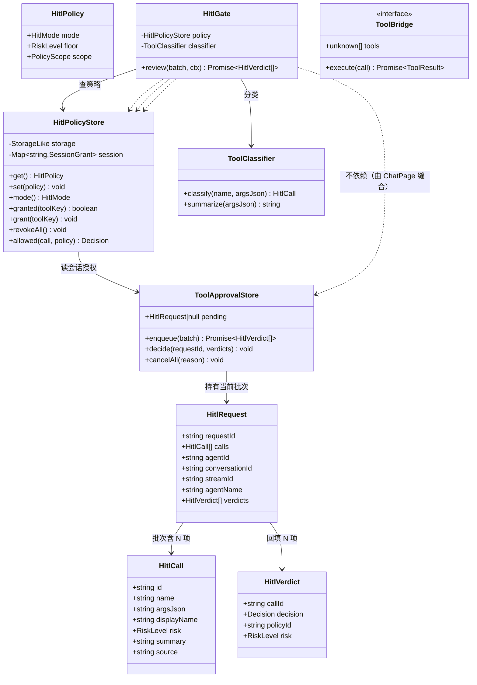
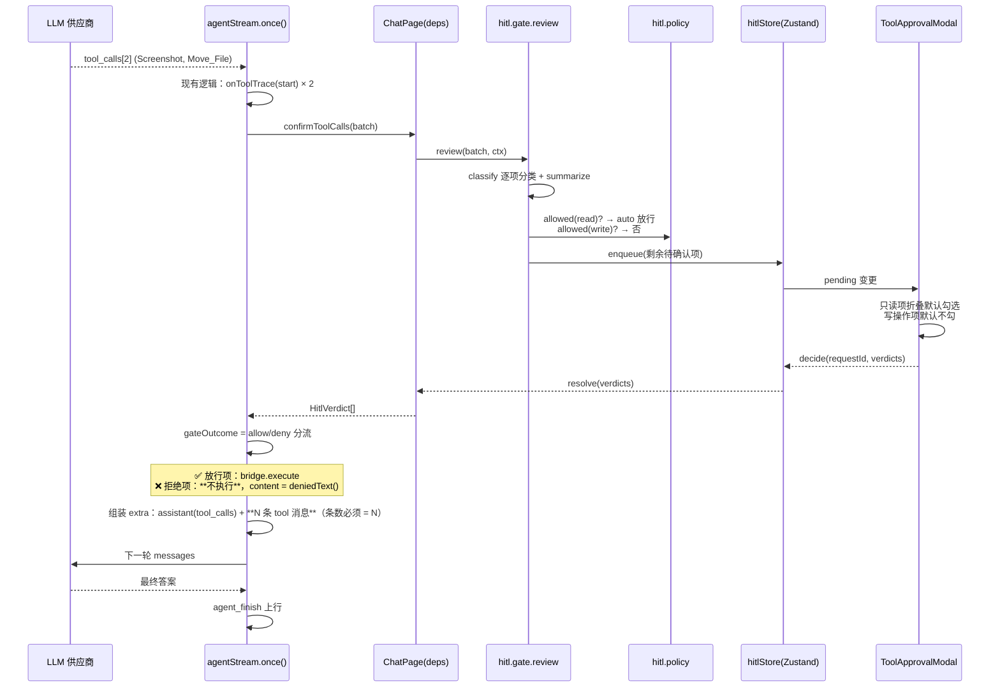
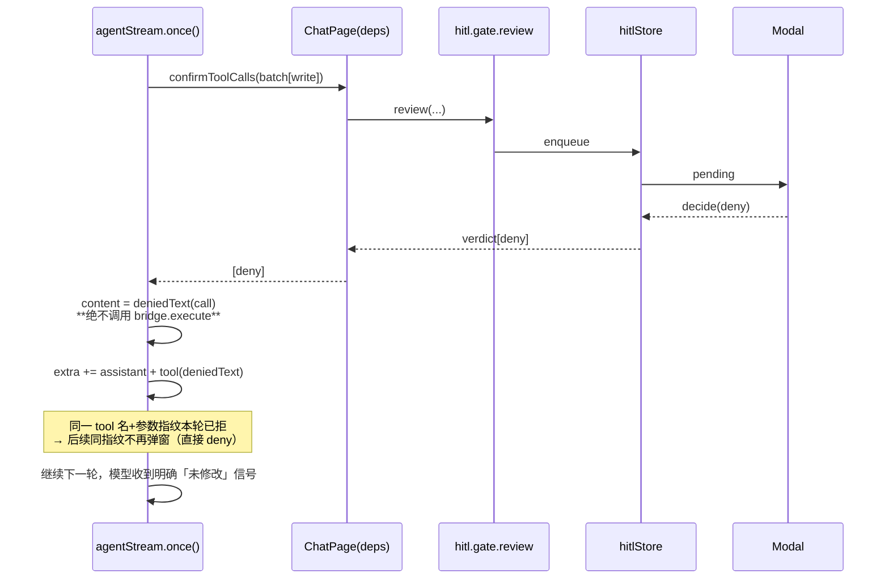
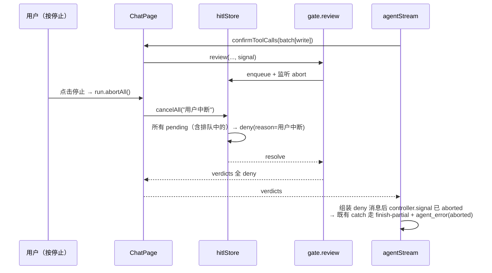
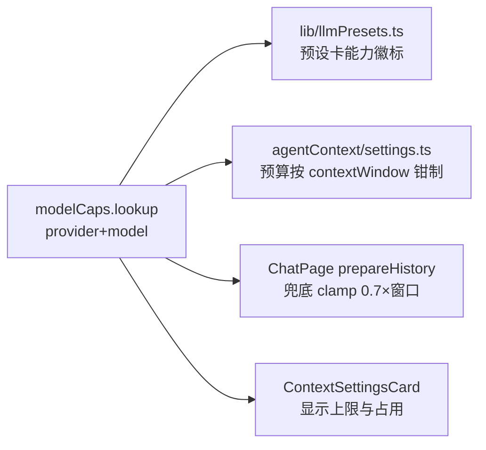
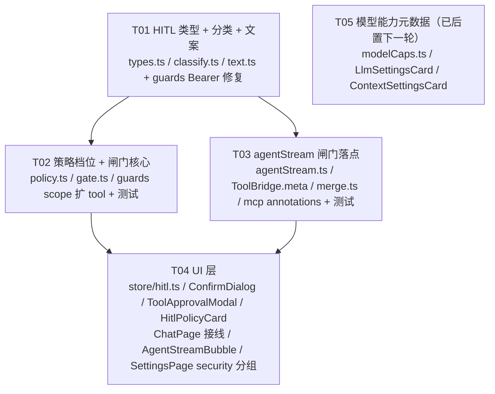

# 和鸣 HITL 人工确认层 · 架构设计与任务分解

- 设计时间：2026-10-21
- 基线版本：`d.18.1.5.0`（`D:/Heming`，main，HEAD `80e9e96`）
- 上游输入：`docs/research/2026-10-20-competitive-analysis-v2.md`（R1 HITL 权限层 ★★★★★，R3 多模型对比 ★★★★☆）
- 目标读者：工程师（照此可直接开工）

---

## 0. 结论先行

**落点唯一**：`packages/web/src/lib/agentStream.ts` 的 `once()` 循环里，`calls` 拿到之后、`bridge.execute` 之前，插一个 `deps.confirmToolCalls` 钩子。**agentStream 里只留这一个调用点，其余判断全在新模块 `lib/hitl/`**。

**四条硬约束（不可违反）**

| # | 约束 | 理由 |
|---|---|---|
| 1 | **拒绝时不得调用 `bridge.execute`** | 否则闸门形同虚设，`self_mcp_enable` / `delete_file` 直接落盘 |
| 2 | **被拒的 tool_call 也必须回一条 `role:"tool"` 消息** | 少一条供应商就 400。`assistant.tool_calls` 有 N 项时 `tool` 消息必须恰好 N 条 —— 所以**不能过滤 `calls` 数组**，只能替换 `content` |
| 3 | **拒绝文案必须显式声明「文件未被修改」** | Cline 已验证的坑：模型不知道被拒，会基于从未落盘的内容继续构造编辑参数，越改越偏 |
| 4 | **闸门异常时按 `deny`，不是 `allow`** | 「不失败」与「不执行」是两件事，见下 |

### 0.0 ★★ 「不失败」的真实含义（2026-10-22 修订，初版措辞有歧义）

初版这里写的是「闸门任何异常都不得让整轮对话失败」——**这句话本身对，但很容易被读成「异常 = 放行」**，
工程师正是这么实现的（`gate.ts` 曾写 `catch → verdicts = allow`）。**已修正措辞。**

**「闸门不得让整轮对话失败」= 模型总能收到一条 `tool` 消息，不等于「工具总能执行」。**

`deny` 同样满足「不失败」：

| | deny 时会发生什么 | 整轮崩了吗 |
|---|---|---|
| 工具执行 | 不执行 | — |
| 模型收到 | 一条 `role:"tool"` 消息，内容是「未执行 + 原因」 | — |
| 对话继续 | ✅ 模型据此换策略 | ✅ **不崩** |
| 危险操作 | **没被执行** | ✅ |

而 `allow` 的代价：UI 一坏（ChatPage 渲染异常 / `enqueue` 抛错 / store 初始化失败），
**所有待确认的危险工具被静默放行**。而恰恰是「UI 坏了」的时刻，最不该让危险操作裸奔。

**这与超时兜底同一口径**：超时也按 `deny`（§3.2.1）。

**推论（实现必须遵守）**：闸门里**任何「拿不到明确裁决」的情况都按 deny**，
包括：`ask` 抛错、`ask` 返回长度不匹配（缺项补 deny）、`batch.calls[i]` 取不到、
`confirmToolCalls` 抛错。**不允许留任何 `?? { kind: "allow" }` 兜底。**

**不加新依赖**。全部用现有的 zustand / React / vitest，闸门本体是纯逻辑（不 import React，可单测）。

### 0.1 为什么需要 HITL —— 用我们自己的代码链路说话

抽象论述说服力有限。看一条**我们代码里真实存在的链**：

```
self_mcp_add_server（加一个 MCP 服务）
  → self_mcp_enable（启用它）
    → 那个 MCP 的所有工具
      → write_file / delete_file / PowerShell …
```

**这条链今天全程无阻。** 模型可以自己给自己装工具、启用它、然后用它的工具写文件跑命令——
**中间没有任何一环需要用户点头**。

而这五个 `self_mcp_*` 工具在 §5.1 分类表里是 **danger** 等级。这不是「我们比较严苛」，
是**这条链的必然要求**：任何一环被放行，闸门就白设了。

HITL 的价值就是让这条链的**每一环都要用户点头**。同一时刻，
Registry 接入（下一轮）会再加一条：`装一个第三方包 → self_mcp_enable 启用它 → 其工具任意执行`。
两条链叠起来，闸门是从「没有必要」变成「必须有」。

### 0.2 已拍板的决策（2026-10-22 更新）

| # | 事项 | 决定 |
|---|---|---|
| 1 | 默认档位 | **`guarded`**（只读不问、写入必问） |
| 2 | `auto` 全放行档 | ❌ **不做，枚举值删掉** —— 见下方理由 |
| 3 | 接口区手改风险等级 UI | ❌ 不做 |
| 4 | 并发多弹窗 | **队列化单槽** |
| 5 | HITL 设置卡位置 | **独立 `security` 分组**（不是挂在 `model` 分组下） |
| 6 | T05 模型能力元数据 | **整体后置下一轮**（P1，与 HITL 无依赖） |

**为什么删掉 `auto` 档（这是组合攻击，不是风险偏好问题）**：

上面那条链加上 Registry 之后：

```
Registry 装一个包（供应链风险，用户只看到了包名）
  → self_mcp_enable 启用它          ← 若 auto 档，这里也免确认
    → 那个 MCP 的所有工具           ← 写文件/跑命令，全部免确认
```

也就是说，**`auto` 档会让「用户随手装了个包」变成「任意代码可静默执行」**。
更糟的是它与 Registry 的**组合攻击**：`auto` 把「装包」这个低风险动作，
变成「任意代码可静默执行」的高风险动作，中间**没有任何一环会停下**。

而用户开启 HITL 的动机恰恰是「我要一条安全边界」。给他一个一键关掉边界的档位，
是**误触即失效**的设计——`guarded` 档不会误触，`auto` 档会。

`trusted` 档（会话内记住允许）已经完整覆盖了「我不想被打扰」的需求，且有会话边界兜底。
去掉 `auto` 的成本：一个枚举值 + 一个分支。

**`security` 分组为什么独立**：安全设置需要**被看见**。混在 `model` 分组里，
用户找 MCP 权限设置时根本不会想到要去模型分组看。而且下一轮 Registry 的「安装策略」
也大概率归到安全分组，现在独立出来正好。
→ **实现要求**：改 `SettingsPage.tsx` 的 `SETTINGS_TABS` 新增 `{ id: "security", label: "安全" }`，
`HitlPolicyCard` 挂在该分组下。**不是**挂在 `model` 分组里。

---

## 1. 实现方案

### 1.1 核心技术挑战

| 挑战 | 难点 | 对策 |
|---|---|---|
| **闸门插在哪** | `agentStream.ts` 是可测纯逻辑，UI 交互不能引 React | 走 `TriggerDeps` 依赖注入，范式照抄现有 `onToolTrace` / `prepareHistory` |
| **并行批量确认** | 一轮 N 个 `tool_calls`（现状 `Promise.all` 并发 execute），逐个弹窗不可用 | 闸门接收**整批 calls**，返回一个 batch 级决策弹窗；只读项折叠默认放行 |
| **拒绝后模型继续幻觉** | 模型把「拒绝」当成「工具失败但可能已部分生效」 | 专门的 `deniedText()` 文案生成器 + 拒绝项的 `ok:false` + 同指纹重试不再弹窗 |
| **只读/写分类** | MCP 工具名按名字匹配无法区分参数（`presets.ts:47-51` 已踩过这个坑） | 优先读 MCP 规范 `annotations.readOnlyHint`；无标注一律按 **write**（白名单制，宁可多问） |
| **策略持久化 vs 会话授权** | 「本会话内允许」不该落盘（下次启动就失效才有意义） | 落盘策略走 localStorage（复用 `StorageLike`）；会话授权走内存 `Map`，进程退出即失 |
| **中断时确认框悬空** | 用户按停止，闸门的 promise 永不 resolve → 整轮挂死 | 闸门请求句柄带 `AbortSignal`，abort 时立即 resolve 为 deny |

### 1.2 框架与选型

零新增依赖。选型理由：

- **纯逻辑闸门 + DI**（而非 Redux/Zustand 直连）：`agentStream.ts` 现有 511 行全是纯函数 + `deps` 注入，测试用裸对象驱动（见 `agentStream.test.ts`）。保持一致才能加测试。
- **Zustand 只管 UI 侧**：pending 请求队列是 React 组件要订阅的响应式状态，放 `store/hitl.ts`。闸门本体**不 import store**。
- **审计复用 `selfEdit/guards.ts` 的 `appendAudit`**：不新建第二套留痕设施，`AuditEntry.scope` 扩一个 `"tool"` 成员即可。

### 1.3 架构分层

```
┌─ ChatPage.tsx ────────────────── React 层（唯一接线点） ──────────┐
│  confirmToolCalls: 调 hitlStore.enqueue(batch) → await Promise      │
│  hitlStore 变更 → ToolApprovalModal 渲染 → decide(id, decision)   │
└───────────────────────────────────────────────────────────────────┘
                                    │ 纯逻辑调用（无 React）
┌─ agentStream.ts once() ── deps.confirmToolCalls(calls, ctx) ──────┐
│  拿到 batchVerdicts → 逐项决定：放行 execute / 回填 deniedText      │
└───────────────────────────────────────────────────────────────────┘
┌─ lib/hitl/ ───────────────── 纯逻辑层（零 React 依赖） ──────────┐
│  classify.ts  风险分类 + 参数摘要      gate.ts   闸门核心         │
│  policy.ts    策略档位 + 会话授权       text.ts   回传模型文案     │
│  types.ts     全部类型                                       │
└───────────────────────────────────────────────────────────────────┘
```

**依赖方向严格单向**：`hitl/` 不知道 agentStream 的存在，`agentStream` 只认 `TriggerDeps` 的类型签名，`ChatPage` 负责把三者缝起来。

---

## 2. 文件清单

```
packages/web/src/
├─ lib/
│  └─ hitl/                                  【新增】
│     ├─ types.ts                            类型定义（决策/批次/风险/工具描述）
│     ├─ classify.ts                         风险分类 + 参数摘要提取
│     ├─ classify.test.ts                    分类与摘要的单测
│     ├─ text.ts                             回传模型的文案（denied / allowedOnce）
│     ├─ text.test.ts                        文案关键短语断言（含「未被修改」）
│     ├─ policy.ts                           策略档位 + 会话授权 + localStorage 持久化
│     ├─ policy.test.ts                      档位判定 + 授权生命周期
│     ├─ gate.ts                             闸门：整批 calls → 整批 verdict
│     ├─ gate.test.ts                        批量/放行/拒绝/中断/重试去重
│     └─ index.ts                            对外出口
│  ├─ agentStream.ts                         【改】once() 内插 confirmToolCalls
│  ├─ agentStream.test.ts                    【改】新增 HITL 相关用例
│  ├─ selfEdit/
│     │  └─ guards.ts                        【改】AuditEntry.scope 加 "tool"；**Bearer 正则加 i 标志（§5.1.1，本轮必修）**
│     └─ tools.ts                            【改】工具清单补 riskHint 元数据（12 项）
│  ├─ mcp/
│     │  └─ types.ts                         【改】McpTool 加 annotations.readOnlyHint
│     └─ store.ts                            【改】读取工具时透传 annotations
│  └─ modelCaps.ts                           【新增】模型能力元数据表
│     └─ modelCaps.test.ts
├─ store/
│  ├─ hitl.ts                                【新增】pending 批次 + 决策动作（Zustand）
│  └─ hitl.test.ts
├─ components/
│  ├─ ToolApprovalModal.tsx                  【新增】批量确认弹窗
│  ├─ ToolApprovalModal.test.tsx
│  ├─ HitlPolicyCard.tsx                     【新增】策略设置卡 + 审计视图
│  ├─ HitlPolicyCard.test.tsx
│  ├─ AgentStreamBubble.tsx                  【改】ToolTraceList 增「已拒绝」态
│  ├─ LlmSettingsCard.tsx                    【改·T05 后置】模型能力徽标 + 上下文上限
│  └─ ContextSettingsCard.tsx                【改·T05 后置】预算按上下文窗口钳制
├─ pages 侧：
│  ├─ components/ChatPage.tsx                【改】confirmToolCalls 接线 + 挂 Modal
│  └─ components/SettingsPage.tsx            【改】★ 新增独立 security 分组（不是 model）
└─ components/LlmSettingsCard.test.tsx       【改·T05 后置】新增能力表用例
```

**本轮（T01-T04）实际涉及：14 个新增 + 8 个改写**。
标「T05 后置」的三项属下一轮（见 §9 的 T05 小节，977 行起）。

---

## 3. 数据结构与接口

### 3.1 类型定义（`lib/hitl/types.ts`）



**关键接口签名**（工程师照抄）

```ts
// lib/hitl/types.ts
export type RiskLevel = "read" | "write" | "danger";
/** ★ 只有这四个，不要加 "auto"（全放行档已删，理由见 §0.2） */
export type Decision = "allow" | "allow-session" | "deny" | "auto-pass";
/** ★ 只有三档 */
export type HitlMode = "strict" | "guarded" | "trusted";
export type PolicyScope = "per-agent" | "global";

export interface HitlCall {
  id: string;              // 模型给的 tool_call id
  name: string;            // OpenAI 格式工具名
  argsJson: string;
  displayName: string;     // 给人看：中文动作 + 目标
  risk: RiskLevel;
  summary: string;         // 参数摘要（一行，不含密钥）
  source: "mcp" | "self" | "chart" | "tone" | "unknown";
}

export interface HitlBatch {
  streamId: string;
  conversationId: string;
  agentId: string;
  agentName: string;
  calls: HitlCall[];
}

export interface HitlVerdict {
  callId: string;
  decision: Exclude<Decision, "auto-pass">;  // auto-pass 由 gate 内部消解，不外传
  reason?: string;
}

/** agentStream 侧看到的最终结果：一项 tool_call 对一条。 */
export type GateOutcome =
  | { kind: "allow"; call: HitlCall }
  | { kind: "deny";  call: HitlCall; reason?: string };
```

**`ToolBridge` 扩展 —— ★ 方案 B：`meta` 挂在 `tools[]` 的每个工具对象上**（2026-02-22 定）

```ts
// lib/agentStream.ts
export interface ToolBridge {
  tools: unknown[];
  execute: (call: { name: string; arguments: string }) => Promise<{ text: string; ok: boolean }>;
}
```

**采用「协议层 + 剥除层」两段结构**（这是方案 B 能安全工作的前提）：

```
① 协议层：tools[] 里的每个工具对象**携带** meta —— 我们的内部表示
② 剥除层：发往供应商前**剥掉 meta** —— 对外表示
```

**为什么这样能安全**：meta 跟着工具对象走，**不会出现「按名字查找找不到 meta」**，
且 `mergeToolBridges` 的 `flatMap(b => b.tools)` **零改动**（元数据天然透传）。

**★ 剥除发生在哪个位置（关键，已定）**：

**剥除发生在 `agentStream.ts` 里 `deps.getTools()` 的调用点、`streamChat` 之前**——
即 `once()` 内拿到 `bridge` 之后立刻剥，**不是**在 `getTools()` 返回处。

理由：`getTools()` 的返回值**可能被别处复用**（本轮虽没有，但要给后人留余地）。
在返回处剥会破坏复用；而 `agentStream` 的调用点是**单一出口**，不会漏。

```ts
// agentStream.ts once() 内
const bridge = deps.getTools?.(m.agentId) ?? null;
// ★ 剥除 meta：tools[] 内部带着它走协议层，到这里剥掉再发供应商
const wireTools = bridge ? stripToolMeta(bridge.tools) : [];
```

**验收测试（A/B 两方案都必须有这条）**：

```ts
it("发给 LLM 的 tools 数组不含 meta", () => {
  expect(JSON.stringify(stripToolMeta(bridge.tools))).not.toContain('"meta"');
});
```

> **这是方案 B 防线唯一的依靠** —— 剥除一旦漏了，就是把我们的内部元数据发给外部服务方。
> 严格端点可能直接报错；宽松端点会静默收下（更糟：内部实现细节泄漏给第三方）。
> **所以这条测试不是「可选的额外检查」，是方案 B 的必要组成。**

**`merge.ts` 的 meta 相关改动：不需要**（方案 B 的定义就是零改动）。

### 3.2 策略档位语义

| 档位 | 语义 | 只读工具 | write | danger |
|---|---|---|---|---|
| `strict` | 全部询问 | 问 | 问 | 问 |
| `guarded`（**默认**） | 只读放行 | 放行 | 问 | 问 |
| `trusted` | 同 `guarded`，但**本会话授权**生效 | 放行 | 首次问，会话内放行 | 问 |

**只有三档。** 初版设计里的 `auto`（全放行）**已删掉**，理由见 §0.2——
它与 `self_mcp_*` / Registry 组合后会让「随手装个包」变成「任意代码静默执行」。

```ts
// ★ 枚举只有三个值，工程师不要加 auto
export type HitlMode = "strict" | "guarded" | "trusted";
```

`floor` 字段：低于此风险的一律不问（`guarded` 下即 `read`）。

**注意 `danger` 在三档里都要问**——没有任何一档会放行 `danger`。
`self_mcp_*` 五个工具、以及一切命中危险词正则的第三方工具，任何时候都要用户点头。

### 3.2.0 ★ `cancelAll` 的裁决口径（2026-10-22 裁决，QA 提出）

**`cancelAll(reason)` 必须把「当前 pending」与「排队中的全部批次」都 resolve 成
`deny`，且每项带 `reason`（如「用户中断」）。**

```ts
// ⚠️ 两个都要做，缺一个都会出问题
for (const [requestId, item] of waiters) {
  waiters.delete(requestId);
  item.resolve(/* 该批全部项 */, reason);   // ① 当前批次
}
for (const item of queue) {
  item.resolve(/* 该批全部项 */, reason);    // ② 排队中的批次 —— 少了这行会挂死
}
queue.length = 0;
set({ pending: null });
```

**① 为什么必须带 `reason`（而不是给「空裁决」）**：

空裁决（`resolve([])`）在闸门层确实**安全**——`byCallId` 查不到就补 `deny`，
安全结果一样。但**用户看到的理由是错的**：
用户按了停止，弹窗却说「未收到确认结果」——**这会让用户困惑**，
而且丢掉了「用户中断」这个语义。

区分三件事：

| 情形 | 用户看到的 | 模型收到的 | 语义 |
|---|---|---|---|
| 用户点「拒绝」 | 「你拒绝了」 | 带用户反馈 | 用户明确说了不 |
| **用户按停止** | 「已中断」 | `reason=用户中断` | **人没来得及** |
| 超时 | 「已超时」 | `reason=未在时限内响应` | 人不在 |

模型需要区分「人说不」与「人没应答」：前者可以改参数重试，
后者更可能是走开了，继续重试只是浪费 token。

**② 为什么排队中的批次也必须 resolve（这是实测过的真 bug）**：

只 `resolve` 掉 `waiters`（当前批次）而 `queue.length = 0` 清空队列，
会让**排队中那些批次的 promise 永不 resolve** →
`confirmToolCalls` 那个 await 永远挂着 → **整轮工具循环卡死，用户按停止都没用**。

**队列里任何被丢弃的项，其 promise 都必须被 resolve。**
「清空数组」不等于「清理」——前者只是丢掉引用，promise 仍然悬着。

> 这条与 §0.0 那条「兜底方向决定错误可见性」是同一个道理：
> **丢掉一个悬空的 promise 是最坏的处理方式**——不崩、不动、只是永远停在那里。

### 3.2.1 确认超时兜底（2026-10-22 拍板）

**`HITL_CONFIRM_TIMEOUT_MS = 300_000`（5 分钟），超时按 `deny` 处理。**

```ts
// lib/hitl/types.ts
/** 用户不点确认时的兜底：超时即拒绝。5 分钟。 */
export const HITL_CONFIRM_TIMEOUT_MS = 300_000;
```

**为什么必须有超时（两条理由，第二条更实际）**：

1. 安全：超时不执行 = 安全；超时自动放行 = 不安全。
2. **可用性**：确认框会**阻塞 `toolBridge.execute`**，而 `execute` 在 `agentStream` 的工具循环里被
   `await`。不设超时的话用户走开 → 那个流**永远挂着**，除了 `abortAll` 没有任何办法收口，
   **整轮生成卡死**。这不是「体验问题」，是「应用卡住」。

**5 分钟的取值依据**：
- 太短（< 30s）会打断「用户正在读参数并思考」的正常过程
- 太长（> 10min）会让卡死的会话要等很久才收口，且用户早就忘了弹窗是什么
- 5 分钟是「读完参数 + 决定」的舒适上限

**★ 超时与用户主动拒绝必须区分开**，回传给模型的文案不同：

| 情形 | 语义 | `deniedText` 的差异 |
|---|---|---|
| 用户点「拒绝」 | **用户说不** | 带用户反馈（若有），明确「用户拒绝了本次操作」 |
| 超时 | **没人应答** | 明确「用户未在 5 分钟内响应，视为未授权」，**不带任何反馈语义** |

理由：模型需要区分「人明确拒绝了」和「人没来得及」。前者可以改参数重试，
后者更可能是「用户走开了」，继续重试只是浪费 token。

**超时计时器必须清理**：`decide` / `cancelAll` 正常发生时 `clearTimeout`，
否则会留下悬挂定时器（测试里会表现为「单测绿、运行时句柄泄漏」）。

### 3.2.2 确认弹窗的分组规则（2026-10-22 拍板，降误批准率）

**只读工具折叠进「其它工具」分组，写操作默认展开。**

主理人提出这条时的理由比我原来想的强得多，值得原样记录：
> 「一堆看起来无害的只读工具会抬高用户的批准倾向。」

Cline 的 `AutoApprovalSettings` 里 `editFiles: true`（默认放行）正是**反面教材**：
**默认放行的东西，用户就不会再看。** 我们反过来做——**默认展开的必须是写操作**。

```
┌ 待确认工具 ────────────────────────┐
│ ⚠ 写操作（默认展开，需逐项判断）      │  ← danger 红色高亮
│   □ fs__write_file    D:/a.md       │
│   □ fs__delete_file   D:/b.md       │
│                                     │
│ ▸ 其它工具（折叠，默认不展开）        │  ← 含全部 read，不给「看起来无害」的暗示
│                                     │
│ [仅本次允许] [本会话内允许] [拒绝]    │
└─────────────────────────────────────┘
```

→ 已写入共享约定第 14 条：**凡是「点一下就生效」的都必须摆出来**。
折叠与默认放行都是「用户不会看」的等价物。


**默认 `guarded` 的理由**：延续 `presets.ts` 已有的只读白名单思路——用户不该被 `Screenshot` 之类的调用打断，但任何写操作必须过闸。

### 3.3 回传模型的文案（`lib/hitl/text.ts`）

这是**本设计最重要的一段代码**。Cline 的坑就在这里。

```ts
/** 拒绝后回给 tool 消息的内容。必须显式声明「未被修改」。 */
export function deniedText(call: HitlCall, reason?: string): string;
```

必含的四个短语（`text.test.ts` 逐条断言）：

1. `用户拒绝了本次工具调用：${displayName}`
2. `【该操作未执行，文件与系统状态未被修改】` —— 硬声明，防幻觉
3. `不存在部分写入或中间状态` —— 防「可能写了一半」的推断
4. `不要基于该操作"已完成"的假设继续构造后续参数或重试同一调用` —— 直接把正确行为告诉模型

放行文案（`allow-session` 时追加提示，让模型知道用户已授权，避免反复确认同一类操作）：

```ts
export function allowedText(call: HitlCall, decision: Decision): string;
```

含 `用户已授权本次调用，可以继续；但不要把授权扩大到本次参数之外的操作。`

---

## 4. 程序调用时序

### 4.1 批量确认（主路径，`guarded` 档，一轮 2 个调用：1 只读 + 1 写入）



### 4.2 拒绝 + 中断





### 4.3 agentStream 改造点（唯一落点，`once()` 循环内）

现状（第 417-454 行）：

```ts
for (const call of calls) { deps.onToolTrace?.(... "start") }
const results = await Promise.all(calls.map((c) => bridge!.execute(...)));
calls.forEach((call, i) => { deps.onToolTrace?.(... "end") });
extra = [...extra, {role:"assistant", content:roundText, tool_calls: calls},
  ...calls.map((call, i) => ({role:"tool", tool_call_id: call.id, content: results[i]?.text ?? ""}))];
```

改造后（**结构不变，只在 execute 前插一段、results 组装处改为分流**）：

```ts
for (const call of calls) { deps.onToolTrace?.(... "start") }

// ↓↓↓ 新增：闸门。未注入 confirmToolCalls 时 outcomes = 全部 allow（行为与现在完全一致）
const outcomes: GateOutcome[] = deps.confirmToolCalls
  ? await deps.confirmToolCalls(calls, { agentId: m.agentId, agentName: m.name, streamId, conversationId })
  : calls.map((call) => ({ kind: "allow", call: toHitlCall(call) }));

const results = await Promise.all(outcomes.map(async (o) => {
  if (o.kind === "deny") return { text: deniedText(o.call, o.reason), ok: false };
  return bridge!.execute({ name: o.call.name, arguments: o.call.argsJson });
}));

calls.forEach((call, i) => { /* end 轨迹，结果不变 */ });

extra = [...extra,
  { role: "assistant", content: roundText, tool_calls: calls },
  ...calls.map((call, i) => ({           // ← 条数恒等于 calls.length，一条都不能少
    role: "tool" as const,
    tool_call_id: call.id,
    name: call.function.name,
    content: results[i]?.text ?? "",
  })),
];
```

> `results` 的类型不变（仍是 `{text, ok}[]`），所以第 434-444 行的 `onToolTrace(end)` 完全不用改。**改造面被压到最小**。

**`TriggerDeps` 新增可选成员**：

```ts
/**
 * 工具执行前的人工确认闸门（设计 §3）。返回的数组**长度与顺序必须与 calls 一致**。
 * 抛错 → 一律按全放行处理（闸门故障不得阻断生成）；缺省 → 全放行（行为与未接入时完全一致）。
 */
confirmToolCalls?: (
  calls: ToolCall[],
  ctx: { agentId: string; agentName: string; streamId: string; conversationId: string },
) => Promise<GateOutcome[]>;
```

### 4.4 中断协作（关键，防止挂死）

⚠️ **注意**：`TriggerDeps` 里**没有** `AbortSignal`（现有的 `controller` 是 `once()` 内部的局部变量，`deps` 拿不到）。所以中断协作**不走 signal**，走 store 侧的显式取消：

```
ChatPage 的停止按钮 / 组件卸载
   → run.abortAll()                    // 既有逻辑：controller.abort()
   → useHitlStore.getState().cancelAll("用户中断")   // ★ resolve 成「全 deny + reason=用户中断」
                                                     //   且**排队中的批次也要 resolve**（否则挂死）
```

`hitlStore.cancelAll` 内部遍历 pending resolver，逐个 `resolve(全 deny(reason))` 并清空 `pending`。这样 `gate.review` 的 await 立即解开，`confirmToolCalls` 返回 deny，`once()` 组装完 deny 消息后 `controller.signal.aborted` 已为真 → 既有 catch 走 `finish-partial` + `agent_error(aborted)`，**不需要改 agentStream 的中断路径**。

`gate.review` 另加一道自检：调用时若 `pending` 已存在且被标记 `aborted`（store 侧 `cancelledAt` 有值），直接返回全 deny 不排队。避免「中断后弹窗又冒出来」。

### 4.5 模型能力元数据（第二目标，消费链）



---

## 5. 分类表与文案细节

### 5.1 风险分类优先级（`classify.ts`）

```
1. 桥自带 meta.risk           （最高优先：作者显式声明）
2. 内置前缀表（见下）          ← ★ 顺序已调整，见下方说明
3. MCP annotations：只能收紧，不能放宽（§5.2）
4. 危险词正则命中 → danger
5. 兜底 → write   ← 关键安全默认，绝不兜底成 read
```

> **⚠️ 与初版设计的顺序差异（重要）**：初版把 `annotations.readOnlyHint` 放在优先级 2、
> 内置表放 3。**现已对调**。原因见 §5.2：`annotations` 是**服务端自述且规范明令不可信**，
> 它的正确用途是「把不确定的往上抬」（→ danger），而不是「把写操作往下压」（→ read）。
> 若不调序，`readOnlyHint:true` 会抢在内置表之前把 `self_mcp_*` 压成 read，
> 那正是最不能放行的一组工具。

**内置前缀表（工具名与代码逐字一致，共 15 个）**

已核对 `selfEdit/tools.ts`（12 个）、`charts/tools.ts`（2 个）、`tone/detector.ts`（1 个）：

| 精确工具名 | 风险 | 说明 |
|---|---|---|
| `self_memory_list` | read | 列自己的记忆 |
| `self_skill_list` | read | 列自己的技能 |
| `self_mcp_list` | read | 列自己的 MCP 服务 |
| `tone_detect` | read | 纯计算，检测 AI 写作痕迹（`tone/detector.ts:386`，`TONE_TOOL_PREFIX="tone_"`） |
| `chart_types` | read | 返回图表类型清单，无写存储 |
| `chart_render` | read | 只把数据变成图，不写存储 |
| `self_memory_write` | write | |
| `self_memory_remove` | **write**（不是 danger） | ★ **有意为之**，见下方说明 |
| `self_skill_create` | write | |
| `self_skill_update` | write | |
| `self_mcp_add_server` | **danger** | 见 §0 的连锁链 |
| `self_mcp_enable` | **danger** | |
| `self_mcp_disable` | **danger** | |
| `self_mcp_update_server` | **danger** | |
| `self_mcp_remove_server` | **danger** | |

> **`self_memory_remove` 为什么是 write 而不是 danger**：内置表在优先级 2，**先于**危险词正则（优先级 4）命中。
> 正则里的 `*remove*` 本会把它抬成 danger，但内置表先命中就停在 write。
> **这是有意的判断，不是优先级写错了**：它删的是**智能体自己的一条记忆**，
> 不是用户的文件；`self_mcp_remove_server` 才是真正动执行环境。
> 表格里写清楚这点，否则后来者会以为「漏判成 write 是 bug」而「修」它。

> **注意**：初版设计里写的 `self_memory_read` / `self_memory_search` / `self_memory_delete`
> **三个工具在代码里不存在**（已 grep 确认），是口头转述的旧口径残留。
> 写死一个不存在的名字会让测试永远绿、运行时永不命中——**静默失效**。已删除。

**危险词正则（仅在内置表未命中时生效）**

`read` 意图启发 → read：`*get*` `*list*` `*read*` `*fetch*` `*query*` `*search*` `*view*`

`*delete*` `*remove*` `*kill*` `*exec*` `*run*` `*powershell*` `*registry*` `*format*` `*write*` `*move*` `*click*` `*type*` → **danger**

> 这两条只作用于**第三方的 MCP 工具**（我们的 15 个全部在内置表命中，永远走不到这里）。
> 它们是给 Registry 装来的、工具名千奇百怪的服务器用的。

#### 参数摘要 `summarize(argsJson)`

参数摘要是**全新的展示面**——把工具参数显示在确认弹窗给用户看。所以它必须是**安全边界的一部分**，
不能想当然认为「掩码已经做过了」。行为表（**测试逐条锁定**）：

| 输入 | 期望摘要 | 说明 |
|---|---|---|
| `{path: "D:/docs/a.md"}` | `D:/docs/a.md` | 常规 |
| `{path: "D:/x.md", token: "Bearer abcdefghijklmnop"}` | token → `***` | **本轮修既有 bug 后才成立**，见下 |
| `{url: "https://u:pw@host/mcp"}` | `https://***@host/mcp` | 抹掉 URL userinfo |
| `{query: "密码是 hunter2000"}` | `***` | 现有中文口令规则已覆盖（`guards.ts:38`） |
| `{foo: 1, bar: 2}` | `{"foo":1,"bar":2}` 截断到 80 字符 | 无已知字段 |

规则：

- 优先读 `path` / `file` / `url` / `query` / `name` / `server` 字段
- 命中 `SENSITIVE_PATTERNS`（`selfEdit/guards.ts:25` 已导出，直接复用）→ 该字段值替换为 `***`
- **URL 字段额外处理**：抹掉 `//` 与 `@` 之间的 userinfo（**本轮不改全局敏感模式**——
  Registry 的 URL 不含用户凭据，改全局是过度设计；但 userinfo 本就不该出现在摘要里，
  这是**摘要函数自己的职责**）
- 无已知字段 → `JSON.stringify(args).slice(0, 80)`

### 5.1.1 ★ 本轮要改的既有文件：`selfEdit/guards.ts`

**我实测复现了两个漏检**（node 直接跑 `SENSITIVE_PATTERNS`，非推测）：

```
Bearer abcdefghijklmnop  →  命中: false   ← HTTP 认证的标准写法漏检
bearer abcdefghijklmnop  →  命中: true
BEARER abcdefghijklmnop  →  命中: false
```

**根因**：`guards.ts:31` 的 `/(bearer\s+[A-Za-z0-9._-]{16,})/` **缺 `i` 标志**。
而 `Bearer` 正是 HTTP `Authorization` 头的标准写法——**恰恰是最该拦的那种漏了**。

**为什么本轮必须修**：这个正则在改动前只用于「拦不让写进记忆/技能」，
用户看不到；**参数摘要是新的展示面**，把参数原文显示在确认弹窗上。
掩码漏了 `Bearer`，等于 **HITL 自己造了一条把用户 token 显示出来的泄露路径**——
安全功能的展示面反而成了泄露面。

**修法**（一行）：

```ts
// guards.ts:31
- /(bearer\s+[A-Za-z0-9._-]{16,})/,
+ /(bearer\s+[A-Za-z0-9._-]{16,})/i,
```

**补测试**（`selfEdit/selfEdit.test.ts`）：`Bearer <token>` / `BEARER <token>` / `bearer <token>`
**三种写法必须全部命中**（我实测过前两种都漏，只小写命中）。

**只改这一条正则，不动其他敏感模式**——本轮不顺手做范围外的清理。

### 5.2 ★ MCP `annotations` 的单向规则（规范已查实）

主理人已查实并转达：`annotations.readOnlyHint` **确实存在于 MCP 协议 schema**
（`ToolAnnotations` 定义在 `schema/2025-03-26/schema.json`），客户端 `tools/list` **能收到它**。
所以技术上可以依赖这个字段。**但依赖它的方式必须非常克制。**

规范原文（逐字）：

> For trust & safety and security, clients **MUST** consider tool annotations to be
> **untrusted** unless they come from trusted servers.

字段与默认语义：

```ts
interface ToolAnnotations {
  readOnlyHint?: boolean;     // 默认 false —— 不声明即视为「非只读」
  destructiveHint?: boolean;  // 默认 true  —— 不声明即视为「可能破坏」
  idempotentHint?: boolean;   // 默认 false
  openWorldHint?: boolean;    // 默认 true
}
```

**规范本身就是「不声明就是写操作」的悲观默认**。这与我们 HITL 设计里
「`ToolBridge.meta` 缺省 → 按 `write` 处理」**完全一致**——
我们的默认不是「我们觉得安全」，而是**跟规范对齐**。

**但「默认悲观」不等于「声明就可信」。** 关键区分：

| | 默认值 | 声明的效力 |
|---|---|---|
| **不声明** | 悲观（write/danger） | — |
| **声明 `readOnlyHint: true`** | — | ⚠️ **这是服务端的自述，不可信** |

一个写恶意代码的 MCP 作者完全可以给自己的 `delete_everything` 标 `readOnlyHint: true`。
拿它**自动放行**等于把安全边界交给对方的自觉。

**所以规则是单向的**：

```
✅ annotations 可以「收紧」：把 write/danger 往上抬
❌ annotations 不能「放宽」：绝不把 danger/write 往下压成 read 从而自动放行
```

落到实现（`classify.ts` 的第 3 步）：

```ts
// 伪代码 —— 注意没有 "if (readOnlyHint) return 'read'" 这一支
if (annotations?.readOnlyHint === false || annotations?.destructiveHint === true) {
  return "danger";           // ← 只往上抬
}
// 缺省、以及 readOnlyHint:true，都继续往下走：落到 write 兜底
```

**唯一的例外**：我们**自己的** 15 个内置工具不适用这条——
它们全部在优先级 2 的内置表里就命中了，永远走不到 annotations 这一步。
内置表的权威性来自「我们自己写的代码」，不是来自服务端自述。

#### ★ 实测证据：真实服务器 100% 会带 annotations（2026-10-22）

主理人对内置 Windows-MCP（包内启动，20 个工具）做了实测：

```
工具数: 20    带 annotations 的: 20    ← 全部都带
样例: { name: "App",
        annotations: { destructiveHint: true, idempotentHint: false,
                       openWorldHint: false, readOnlyHint: false, title: "App" } }
第一个工具的完整键: _meta, annotations, description, inputSchema, name, title
```

**这条实测把「防御 annotations」从理论必需变成了现实必需**：

1. **不是「理论上有」，是实际 20/20 全带。** 所以 `tools/list` 解析**必须能接住这个字段**——
   不能因为不认它就丢弃整个工具对象（那会让 Registry 服务器的**所有工具都查不到**，
   进而全部落入「未知工具 → 兜底 write」——虽然结果恰好是安全的，但用户会看到
   一堆本该只读的工具反复弹窗，误以为产品有问题）。
2. **它自己都承认有破坏性**：这个控制桌面的工具集 `destructiveHint: true`、
   `readOnlyHint: false`。而按我们**初版**的判定逻辑（`readOnlyHint === true → read`），
   一个恶意服务器只要把 `readOnlyHint` 改成 `true`，它的 `delete_file` / `run_command`
   就静默放行了。**这就是 §5.2 那条单向规则的现实绕过路径。**
3. **两个展示用途可用**（不参与判定）：
   - `annotations.title`（如 `"App"`）比工具名更好读 → 用作确认弹窗的友好名
   - `openWorldHint` — 同样不可信，不能拿来放行，但可作为提示文案的一部分

#### 判定等级的唯一依据：**工具名与描述**（规范原文）

MCP 规范对「客户端不知道该怎么办」给出的指引就是这两样：

> Instead, **use the tool name and description**.

所以 `classify.ts` 的 `riskOfName()` 只吃工具名，`classifyCall()` 才在名称启发不够时读描述；
`annotations` **只进入展示层**，不进入判定层。

**Registry 侧必须复用同一份判定函数**（主理人 2026-10-22 明确要求）：
`lib/registry/risk.ts` **import `lib/hitl/classify.ts`**，不写第二套。
两套必然漂移，而漂移的后果是「有的服务器绕过确认、有的不绕过」——
这是最难在测试里发现的一类 bug（两条路径都不报错，只是行为不一致）。

> **实现注记**：`risk.ts` 对 `classify.ts` 的依赖是**运行时的类型依赖，不是硬 import**。
> 若工程师的 T01 尚未落地，`risk.ts` 应留一个**注入点**
> （`rateInstall(entry, option, { classify })`），而不是硬 import 一个还不存在的文件。
> T01 落地后把注入换成直接 import 即可，签名不变。

**用户体验的缓解**由 `trusted` 档承担（会话内授权），而不是靠放松分类。
详见 Registry 设计文档 §7 的「按服务器整体授权」方案。

### 5.3 同指纹拒绝去重

`gate` 维护 `Set<string>`（key = `streamId + toolName + hash(argsJson)`）：

- 命中已拒绝指纹 → 直接 `deny`（reason=`本轮已拒绝过相同调用`），**不再弹窗**
- 每个新 `streamId` 清空（`gate.review` 收到新 streamId 时重置）
- 目的：堵死「模型被拒后反复重试同一个调用」把用户烦死的路径，也顺带省 token

---

## 6. 文件接口清单（逐文件说明）

| 文件 | 导出 | 要点 |
|---|---|---|
| `lib/hitl/types.ts` | `RiskLevel` `Decision` `HitlMode` `HitlCall` `HitlBatch` `HitlVerdict` `GateOutcome` `PolicyScope` | 纯类型，零运行时 |
| `lib/hitl/classify.ts` | `classifyCall(name, argsJson, source?)` `summarizeArgs(argsJson)` `riskOfName(name)` | 无外部依赖（除 `guards.SENSITIVE_PATTERNS`） |
| `lib/hitl/text.ts` | `deniedText(call, reason?)` `allowedText(call, decision)` `GIT_UNCHANGED` 常量 | 四个必含短语提为常量便于测试 |
| `lib/hitl/policy.ts` | `HITL_KEY` `HitlPolicyStore` `DEFAULT_HITL_POLICY` | 复刻 `SelfEditStore` 的构造/容错风格 |
| `lib/hitl/gate.ts` | `createHitlGate(deps)` → `{ review(batch) }` | 批内分流：先 auto 消解，再把剩余项一次性交给 UI |
| `lib/hitl/index.ts` | 上述全部再导出 | 与 `lib/mcp/index.ts` 同一风格 |
| `store/hitl.ts` | `useHitlStore` `usePendingHitl` | 状态：`pending: HitlRequest \| null`；动作：`enqueue` `decide` `cancelAll` |
| `components/ToolApprovalModal.tsx` | `ToolApprovalModal({ request, onDecide })` | 焦点管理 + Esc + 遮罩点击，参照 `FilePreviewModal` / `GroupCreateModal` |
| `components/HitlPolicyCard.tsx` | `HitlPolicyCard({ policyStore, storage })` | 档位单选 + `floor` 下拉 + 审计列表（复用 `readAudit`） |

**`store/hitl.ts` 关键实现**（UI 桥，不引 React 到 lib）：

```ts
interface HitlState {
  pending: HitlRequest | null;
  /** 登记一批待确认项，返回决策。UI 侧 decide/cancelAll 负责 resolve。 */
  enqueue: (batch: HitlBatch) => Promise<HitlVerdict[]>;
  decide: (requestId: string, verdicts: HitlVerdict[]) => void;
  cancelAll: (reason: string) => void;
}
```

`enqueue` 内部维护 `pending resolver` 的 `useRef`（模块级 `Map`，避免 Zustand 序列化问题）。

**★ 并发语义：队列化单槽（2026-10-22 裁决，QA 发现本文档曾与此矛盾）**

同时只允许**一个** `pending`。第二个请求**排队**等第一个决定完（顺序按到达），
**不与当前的合并成一个弹窗**。

理由：**两个智能体同时要工具时，合并会让用户面对一批「不属于同一个动作」的调用**
——分不清哪个是哪来的；排队则一次只问一件事。
**一轮多个 tool_call 的批量确认由 `gate.review` 在单次 `enqueue` 内解决**（批内一次弹窗），
与「多轮之间的并发」是两个不同层次的问题，不要混。

两批各自 resolve 自己的裁决，互不串味。

---

## 7. 待明确事项

> **前 5 条已于 2026-10-22 由主理人拍板完毕**，结论汇总在 §0.2。下表保留决策与理由，
> 工程师照 §0.2 实现，不要按「默认口径」列的旧建议做。

| # | 事项 | 状态 / 决定 | 影响面 |
|---|---|---|---|
| 1 | **默认档位** | ✅ **已定：`guarded`** | 一行常量 |
| 2 | **`auto`（全放行）档是否要做** | ✅ **已定：不做，枚举值删掉。** 组合攻击理由见 §0.2 | 枚举值 + 一个分支 |
| 3 | **`risk` 元数据由谁声明** | ✅ **已定：`self_*` 在 `SELF_TOOLS` 加 `riskHint`；接口区手改 UI 不做** | `tools.ts` |
| 4 | **并发多 agent 同时要确认** | ✅ **已定：队列化单槽** | `store/hitl.ts` |
| 5 | **HITL 设置卡位置** | ✅ **已定：独立 `security` 分组**（改 `SETTINGS_TABS`，不挂 `model` 下） | `SettingsPage.tsx` |
| 6 | **审计保留条数** | 复用 `AUDIT_MAX = 300`，不新设 | 零改动 |
| 7 | **拒绝的 tool_call 是否要落库成消息** | **不落库**（`ToolTrace` 是纯前端）。用户要看历史走 `agent_finish` 的最终文本 | 无 |
| 8 | **`agentStream` 之外是否还有别的工具执行落点** | ✅ 已核查：`ToolBridge.execute` 的执行点只有 `agentStream.ts:427` 一处（`merge.ts:35` 是路由不是执行）。**无第二落点**，闸门一次插全 | 已确认 |
| 9 | **`selfEdit/guards.ts` 的 `AuditEntry.scope` 扩 `"tool"`** | 确认要做。安全功能不留痕等于没做 | `guards.ts` |
| 10 | **`guards.ts` 的 `Bearer` 正则缺 `i` 标志** | ✅ **本轮必修**（我已实测复现漏检）。参数摘要是新展示面，漏检等于 HITL 自己造了一条 token 泄露路径。见 §5.1.1 | `guards.ts:31` |
| 11 | **模型能力表的数据源**（T05，已后置） | 静态表 + 前缀匹配 + 用户覆盖层，**不联网**。定价标注「参考价」 | `modelCaps.ts` |

---

## 8. 共享约定（工程师必须遵守）

```text
1. 语言：全部中文。注释、UI 文案、错误提示、测试断言描述一律中文。
2. lib/hitl/** 零 React 依赖：不得 import react / react-dom / zustand / 任何 store。
   依赖注入走参数（构造 gate 传 policy + classifier）。
3. lib/hitl/** 不得 import agentStream（会循环）。ToolBridge 类型用 import type，
   或在 hitl/types.ts 里局部声明最小形状。
4. agentStream.ts 只允许新增一个 deps 成员 + 一处调用点。禁止在其中写 if(风险) 之类判断。
5. 向后兼容铁律：
   - 不注入 confirmToolCalls → 行为与现在**逐字节等价**（现有 agentStream.test.ts 全绿）。
   - 不注入 deps.confirmToolCalls 且 confirmToolCalls 抛错 → 一律按全放行。
   - ToolBridge.meta 缺省 → 按 write 处理（安全默认），不是按 read。
6. 错误处理：闸门任何异常都不得让整轮对话失败（对齐 executeToolCall「永不抛」的口径）。
7. 时间：所有时间戳用 Date.now() 毫秒；持久化 key 一律带 .v1 版本后缀。
8. 测试：web 包 vitest + @testing-library/react；组件测试用 getByRole/getByText，
   禁止 testid（本仓现状如此）。
9. 状态：一律 Zustand，文件放 packages/web/src/store/。禁止在组件里 new 全局单例。
10. 注释要写「为什么」，不写「做了什么」。本仓现有注释是这个风格，照抄。
11. ★ 正则一律**不加 g 标志**。SENSITIVE_PATTERNS 会被 some() 遍历，
    带 g 的正则因 lastIndex 残留表现为「第一次命中、第二次不命中」——
    症状是「单测绿、运行时偶发漏」，极难排查。（我已实测复现：true/false/true 交替）
12. ★ 工具名必须与代码逐字一致。写一个不存在的名字（如 self_memory_search）
    会让测试永远绿、运行时永不命中——**静默失效**，比报错更难查。
    本轮 15 个工具名见 §5.1，已 grep 确认。
13. ★ 分档枚举只有三个：strict / guarded / trusted。不要新增第四档（§0.2）。
14. ★ **凡是「点一下就生效」的都必须摆出来。** 折叠与「默认放行」都是「用户不会看」的等价物。
    所以确认弹窗里**写操作默认展开**、只读工具折叠进「其它工具」分组（§3.2.2）。
    Cline 的 `editFiles: true` 默认放行是反面教材。
15. ★ `annotations` 只进展示层，不进判定层。判定只依据**工具名与描述**（规范原文）。
    真实服务器 20/20 都带 annotations，所以它一定会被解析到——必须防它被误信（§5.2）。
16. ★ 确认超时 `HITL_CONFIRM_TIMEOUT_MS = 300_000`，超时按 deny 收口。
    与用户主动拒绝的**回传文案必须不同**（§3.2.1）。定时器必须 `clearTimeout`，否则句柄泄漏。
```

---

## 9. 任务列表（**本轮 4 个任务：T01-T04**）

> **T05（模型能力元数据）已整体后置下一轮**（2026-10-22 主理人拍板）。
> 理由：本轮已有 HITL + MCP Registry 两件事，工程量已不小；T05 是 P1、与 HITL 无依赖，
> 后置不影响本轮交付完整性。下一轮做「多模型同题对比」时正好需要它铺路。
> **T05 的完整规格保留在下方 T05 小节，作为下一轮的输入。**



---

### T01 · HITL 类型 + 分类 + 回传文案 【P0】

**目标**：把「哪些工具危险」「参数怎么用人话说」「拒绝时怎么告诉模型」三件事定死，全部为纯函数、可单测、不依赖任何后续模块。

**改哪些文件**
- 新增 `packages/web/src/lib/hitl/types.ts`
- 新增 `packages/web/src/lib/hitl/classify.ts`
- 新增 `packages/web/src/lib/hitl/classify.test.ts`
- 新增 `packages/web/src/lib/hitl/text.ts`
- 新增 `packages/web/src/lib/hitl/text.test.ts`
- 改 `packages/web/src/lib/selfEdit/guards.ts` —— **`Bearer` 正则加 `i` 标志**（§5.1.1）
- 改 `packages/web/src/lib/selfEdit/selfEdit.test.ts` —— 补 `Bearer` 命中用例

**要做什么**
1. `types.ts`：按 §3.1 逐类型落齐，含中文注释说明每个字段的口径来源。
   **`HitlMode` 只有 strict/guarded/trusted 三个值**（§0.2）。
2. `guards.ts`：`/(bearer\s+[A-Za-z0-9._-]{16,})/` → 加 `i` 标志。**只改这一条**，
   不动其他敏感模式（本轮不顺手做范围外清理）。
3. `classify.ts`：`riskOfName`（§5.1 **15 个工具名逐字对齐 + 危险词正则**）、
   `classifyCall`（**五步优先级，注意内置表在 annotations 之前**）、
   `summarizeArgs`（按 §5.1 行为表，含 URL userinfo 抹除）。
4. `text.ts`：`deniedText` 必须含 §3.3 的四个短语，抽成 `MUST_CONTAIN` 常量数组供测试导入。

**验收标准**
- `classify.test.ts` 覆盖 **15 个内置工具**（12 个 `self_*` + `chart_types`/`chart_render`/`tone_detect`）风险分类全部正确：
  - 三个 list + `tone_detect` + 两个 chart = **read**
  - `self_memory_write` / `self_memory_remove` / `self_skill_create` / `self_skill_update` = **write**
  - `self_mcp_*` 五个 = **danger**
  - 未知工具 = **write**（不是 read）
  - `fs__delete_file` / `win__PowerShell` = danger（走危险词正则）
  - **回归用例**：`self_memory_remove` 必须是 **write 不是 danger**（锁住 §5.1 的优先级判断）
- `summarizeArgs` **逐条断言 §5.1 的 5 行行为表**，特别是：
  - `{url:"https://u:pw@host/mcp"}` → `https://***@host/mcp`
  - `{path:"D:/x.md", token:"Bearer abcdefghijklmnop"}` → token 为 `***`（**依赖本任务第 2 条的修复**）
- `guards` 测试：`Bearer <token>` / `BEARER <token>` / `bearer <token>` **三种写法全部命中**
- `text.test.ts` 对 `deniedText` 断言 `MUST_CONTAIN` 每个短语都出现

**依赖**：无

---

### T02 · 策略档位 + 闸门核心 【P0】

**目标**：把「策略存哪、会话授权活多久、整批 calls 怎么变成整批 verdict」做成可注入、可测的纯逻辑。

**改哪些文件**
- 新增 `packages/web/src/lib/hitl/policy.ts`
- 新增 `packages/web/src/lib/hitl/policy.test.ts`
- 新增 `packages/web/src/lib/hitl/gate.ts`
- 新增 `packages/web/src/lib/hitl/gate.test.ts`
- 新增 `packages/web/src/lib/hitl/index.ts`
- 改 `packages/web/src/lib/selfEdit/guards.ts` —— `AuditEntry.scope` 联合类型加 `"tool"`

**要做什么**
1. `policy.ts`：`HitlPolicyStore`，**照抄 `SelfEditStore` 的构造签名与 try/catch 容错风格**（读 → 规整 → 回落默认）。
   - `get/set/mode/granted/grant/revokeAll/allowed(call, policy)`
   - 会话授权存模块内 `Map`（**不落盘**），key = `${scope}:${agentId}:${toolName}`
2. `gate.ts`：`createHitlGate({ policy, ask })` → `{ review(batch) }`
   - `ask: (pending: HitlCall[]) => Promise<HitlVerdict[]>` —— **注入的就是 ChatPage 里的 `hitlStore.enqueue`**
   - 批内分流：`policy.allowed()` 判 auto 的直接放行；剩余项**一次性**交给 `ask`
   - 同指纹拒绝去重（§5.2）
   - `ask` 返回长度/顺序不匹配 → 补齐缺失项为 deny（**绝不执行未确认项**）
3. `guards.ts`：`scope: "memory" | "skill" | "mcp" | "tool" | "other"`（只加联合成员，`appendAudit`/`readAudit` 逻辑不动）

**验收标准**
- `policy.test.ts`：损坏 JSON → 回落默认；`trusted` 档下 write 首次问、授权后放行、`revokeAll` 后再问；`sessionGrant` 换 `agentId` 不串味。
- `gate.test.ts`：`guarded` 档下一批 `[read, write]` → `ask` 只收到 1 项、返回 2 个 outcome 且顺序与输入一致；`ask` 抛错 → 全部按 allow；`ask` 返回长度不匹配 → 缺失项补齐为 deny；同指纹第二次 → 不调 `ask`。
- 现有 `selfEdit/selfEdit.test.ts` 保持全绿（scope 只是加了个成员）。

**依赖**：T01

---

### T03 · agentStream 闸门落点 【P0】

**目标**：在 `ToolBridge.execute` 之前插闸门，**且保证「不改现有行为」**。

**改哪些文件**
- 改 `packages/web/src/lib/agentStream.ts`（`ToolBridge` 加 `meta?`；`TriggerDeps` 加 `confirmToolCalls?`；`once()` 插 §4.3 那段）
- 改 `packages/web/src/lib/agentStream.test.ts`
- 改 `packages/web/src/lib/selfEdit/merge.ts`（聚合 `meta`，与 `execute` 同套路由）
- 改 `packages/web/src/lib/selfEdit/tools.ts`（`ToolSpec` 加 `riskHint` 字段 + `SELF_TOOLS` **12 项**逐条赋值，见 §5.1 表）
- 改 `packages/web/src/lib/mcp/types.ts`（`McpTool` 加 `annotations?: { readOnlyHint?: boolean; destructiveHint?: boolean; idempotentHint?: boolean }`）
- 改 `packages/web/src/lib/mcp/store.ts` —— **已核实无需改动**：`setTools` 是 `tools.map((t) => ({ ...t }))` 展开存储，`annotations` 加进 `McpTool` 类型后会自动透传，`tools()` 返回时也带。只在 `schemas` 层无约束的前提下确认一遍即可（不必改代码）

**要做什么**
1. `agentStream.ts` 只改三处，**逻辑判断一行都不许加**。`results` 类型保持 `{text, ok}[]`，让 `onToolTrace(end)` 那段零改动。
2. `confirmToolCalls` 抛错 / 返回长度不匹配 → 降级为全放行（配 `console.warn`，与 `agentStream.ts:413` 现有告警风格一致）。
3. `merge.ts` 的 `meta` 聚合：命中哪个桥的 `tools` 就用哪个桥的 `meta`；都没有 → `undefined`（下游按 write 处理）。
   **若多个桥都声明了同名工具的 meta，后者不能静默覆盖前者** —— 写 `console.warn` 并保持第一个
   （复用已有的 `listsName()`，`merge.ts:42`，不新增查找逻辑）。
4. `SELF_TOOLS` 加 `riskHint`，与 §5.1 表格逐条对齐（**`self_mcp_*` 五个全部 danger**，
   `self_memory_remove` 是 **write 不是 danger**）。
5. ★ **`annotations` 的用法只有一个方向：收紧，不能放宽**（§5.2）。
   `readOnlyHint === true` **不得**把工具压成 `read` 从而自动放行；
   缺省一律按 `write`（与 MCP 规范的悲观默认一致）。
   `annotations.readOnlyHint === false` 或缺省 → 仍是 `write`；
   若同时 `destructiveHint !== false` → **升到 `danger`**。
   `annotations.title` 可用作确认弹窗的**友好名**（仅展示）。

**验收标准**
- **现有 `agentStream.test.ts` 一条都不许改断言、不许改预期输出，全部原样通过**（这是向后兼容的硬证明）。
- 新增用例：不注入 `confirmToolCalls` → 行为与原来完全一致；注入并全拒绝 → `bridge.execute` **调用次数为 0**，且回灌的 `tool` 消息**条数等于 `calls.length`**；部分放行 → 只放行项被 execute。
- **annotations 单向性用例**：构造一个 `annotations: { readOnlyHint: true }` 的 MCP 工具 → **必须仍被判为 write 或更高，绝不是 read**。
- ★ **`tools[]` 纯净性用例**（无论最终选 A 还是 B 都必须有这条）：
  `JSON.stringify(bridge.tools)` 的结果**不含 `meta` 键**。
  这条测试在方案 A 下是「结构上不可能漏」的结构性保证，在方案 B 下是**防线唯一的依靠**。
- `merge.test.ts`（若存在；无则新建）：`meta` 按名字正确路由。

**依赖**：T01

---

### T04 · UI 层：确认弹窗 + 策略卡 + 接线 【P0】

**目标**：把闸门接到 React 上——这是本轮**唯一**引入 UI 的任务，一次做完，避免半成品界面。

**改哪些文件**
- 新增 `packages/web/src/store/hitl.ts`
- 新增 `packages/web/src/store/hitl.test.ts`
- 新增 `packages/web/src/components/ToolApprovalModal.tsx`
- 新增 `packages/web/src/components/ToolApprovalModal.test.tsx`
- 新增 `packages/web/src/components/HitlPolicyCard.tsx`
- 新增 `packages/web/src/components/HitlPolicyCard.test.tsx`
- 改 `packages/web/src/components/ChatPage.tsx`（`deps.confirmToolCalls` 接线；挂 `<ToolApprovalModal>`；`abortAll` 路径调 `cancelAll`）
- 改 `packages/web/src/components/AgentStreamBubble.tsx`（`ToolTraceList` 增「已拒绝」态；红点 + `已拒绝` 文案 + 显示回传文案）
- 改 `packages/web/src/components/SettingsPage.tsx` —— ★ **新增独立 `security` 分组**（已拍板，见 §0.2 第 5 条）：
  ```ts
  const SETTINGS_TABS = [
    { id: "profile", label: "个人资料" },
    { id: "model", label: "模型" },
    { id: "security", label: "安全" },   // ← 新增，HitlPolicyCard 挂这里
    { id: "appearance", label: "外观" },
    { id: "navigation", label: "导航" },
    { id: "about", label: "关于" },
  ] as const;
  ```
  内容区加 `{tab === "security" && <HitlPolicyCard ... />}`。
  **不是**挂在 `model` 分组下。理由：安全设置需要**被看见**，混在模型分组里用户根本想不到去那儿找。
  下一轮 Registry 的「安装策略」也归到这一组。

**要做什么**
1. `store/hitl.ts`：`pending` 单槽 + resolver 数组（**并发 enqueue 并入同一批次**，已拍板队列化单槽）。
   `decide(requestId, verdicts)` 必须校验 `requestId` 匹配，防止过期批次误 resolve。
2. `ToolApprovalModal`：
   - 焦点：打开时聚焦「拒绝」（安全默认焦点在保守选项上）
   - Esc = 拒绝全部；遮罩点击 = 拒绝全部
   - **★ 写操作（write/danger）默认展开**，逐项勾选；`danger` 红色高亮 + 显示 `summary`
   - **★ 只读工具（read）折叠进「其它工具」分组，默认不展开**（§3.2.2 降误批准率）
   - 三个按钮：`仅本次允许` / `本会话内允许此工具` / `拒绝`
   - 批量：顶部有 `全部允许` / `全部拒绝`
   - **档位只有三个**（strict / guarded / trusted），UI 上**不要出现 auto 选项**（§0.2）
   - **★ 超时倒计时**：`HITL_CONFIRM_TIMEOUT_MS = 300_000`，超时按 deny 收口（§3.2.1）
3. `ChatPage`：
   ```ts
   // 模块作用域（组件外）创建一次，避免每次触发重建导致会话授权失效
   const hitlGate = createHitlGate({
     policy: new HitlPolicyStore(),          // 会话授权在实例里，跨触发保持
     ask: (pending) => useHitlStore.getState().enqueue(pending),
   });

   // deps 里：
   confirmToolCalls: async (calls, ctx) => {
     try {
       return await hitlGate.review(toHitlBatch(calls, ctx));
     } catch (e) {
       console.warn("HITL 闸门异常，按放行处理", e);
       return calls.map((c) => ({ kind: "allow", call: toHitlCall(c) }));
     }
   }
   ```
   中断协作见 §4.4：`abortAll` 路径额外调 `useHitlStore.getState().cancelAll("用户中断")`。**注意 `hitlGate` 必须在组件外或 `useRef` 里创建**——若每次渲染新建，`policy` 内的会话授权 Map 会丢，「本会话内允许」就退化成「仅本次允许」。
4. `AgentStreamBubble`：deny 项在轨迹里**必须可见**（用户要能确认「我真的拒绝了」）。`status` 联合类型加 `"denied"`。

**验收标准**
- `hitl.test.ts`（★ **排队，不是合并** —— 见 §6）：
  - 并发两次 `enqueue` → **只有一个 pending**，第二次进队列；
    断言「第一批 `decide` 之后 `pending.requestId` 才变化」
  - 两批各自 resolve 自己的裁决，互不串味
  - `decide` 用错 `requestId` 必须被忽略（不能 resolve 别人的等待者）
  - **★ `cancelAll` 时排队中的批次也必须被 resolve**（不能只清 `queue` 数组——
    那样它们的 promise 永不 resolve → 整轮挂死。这是实测过的真 bug）
- `ToolApprovalModal.test.tsx`：打开即聚焦拒绝；Esc → 拒绝全部；`仅本次允许` 只勾选中项；焦点在弹窗内循环；**写操作默认展开、只读工具默认折叠**；**超时后按 deny 收口且文案与主动拒绝不同**。
- `HitlPolicyCard.test.tsx`：切档位写盘；审计列表能读出批准/拒绝记录；**UI 上只有三档，没有 auto 选项**。
- `SettingsPage.test.tsx`：**`security` 分组存在且可切到**，`HitlPolicyCard` 在该分组下（不在 `model` 下）。
- `ChatPage.test.tsx`：不回归（现有用例全绿）。

**依赖**：T02、T03

---

### T05 · 模型能力元数据表 【P1】—— **已整体后置下一轮**

> **2026-10-22 主理人拍板：T05 不在本轮执行。**
> 理由：本轮已有 HITL（T01-T04）+ MCP Registry 两件事，工程量已不小；
> T05 是 P1 且与 HITL 无依赖，后置不影响本轮交付完整性。
> 下一轮做「多模型同题对比（R3）」时正好需要它铺路。
>
> **本节保留完整规格作为下一轮的输入**，工程师本轮**不要动手**。

**目标**：零外部依赖维护一张能力表（上下文窗口上限 / 是否支持函数调用 / 是否支持视觉 / 是否支持思考 / 定价），先在**上下文预算**与**设置页**两个消费点落地，为后续多模型对比铺路。

**改哪些文件**
- 新增 `packages/web/src/lib/modelCaps.ts`
- 新增 `packages/web/src/lib/modelCaps.test.ts`
- 改 `packages/web/src/components/LlmSettingsCard.tsx`
- 改 `packages/web/src/components/LlmSettingsCard.test.tsx`
- 改 `packages/web/src/components/ContextSettingsCard.tsx`
- 改 `packages/web/src/components/ContextSettingsCard.test.tsx`（若已存在；否则只改前者）

**要做什么**
1. `modelCaps.ts`：
   ```ts
   export interface ModelCapability {
     contextWindow: number;      // 上下文窗口上限
     maxOutput: number;
     supportsTools: boolean;      // 是否支持函数调用
     supportsVision: boolean;     // 是否支持视觉
     supportsReasoning: boolean;  // 是否支持思考过程
     pricing?: { input: number; output: number };  // 每百万 token，单位：元
   }
   export function lookupCapability(provider: LlmProvider, model: string): ModelCapability | null;
   export function resolveCapability(profile: LlmProfile): ModelCapability;  // 含用户覆盖层
   ```
   - 覆盖 `llmPresets.ts` 现有 7 个预设对应的模型（`claude-sonnet-5` / `deepseek-chat` / `moonshot-v1-8k` / `glm-4-flash` / `qwen-plus` / `Qwen/Qwen2.5-7B-Instruct` / `qwen2.5:7b`）
   - 匹配顺序：用户覆盖层 → 精确 id → 前缀规则 → 家族启发 → `null`
   - 用户覆盖层存 `localStorage`（键 `heming.modelCaps.v1`），UI 可手改
2. `ContextSettingsCard`：预算输入框按 `contextWindow` 钳制（默认取 60%），并显示「当前预算 X / 模型上限 Y」
3. `LlmSettingsCard`：预设项旁显示能力徽标（🎯 函数调用 / 👁 视觉 / 💭 思考）；未知模型显示「能力未知」并给出手动填写入口
4. 定价文案必须带「参考价，以服务商账单为准」（见待明确 #8）

**验收标准**
- `modelCaps.test.ts`：7 个预设模型全部命中非 `null`；未知模型返回 `null`；前缀匹配（如 `deepseek-reasoner` → 命中 deepseek 家族且 `supportsReasoning=true`）；用户覆盖层优先级最高。
- 现有 `LlmSettingsCard.test.tsx` / `ContextSettingsCard.test.tsx` 全绿。

**依赖**：T02（与 HITL UI 同属消费侧，可与 T04 并行，但排在后面收口）

---

## 10. 验收总表

| 维度 | 硬标准 |
|---|---|
| **向后兼容** | 不注入 `confirmToolCalls` 时 `agentStream.test.ts` 零改动通过 |
| **闸门有效性** | 全拒绝场景下 `bridge.execute` 调用次数 = 0 |
| **协议正确性** | `tool` 消息条数恒等于 `assistant.tool_calls` 条数（否则供应商 400） |
| **防幻觉** | `deniedText` 四个必含短语齐全，`text.test.ts` 逐条断言 |
| **批量可用** | 一轮 N 个调用 → 弹窗次数 = 1（不是 N） |
| **不挂死** | 中断时弹窗立即关闭，整轮走既有 `agent_error(aborted)` 收口 |
| **可审计** | 批准与拒绝都写 `guards.appendAudit`，`scope="tool"` |
| **安全默认** | 未知工具 / 无 `meta` 的桥 → `write`（必问），绝不 `read` |
| **annotations 单向** | `readOnlyHint:true` **不得**让工具变 `read` 自动放行；只允许收紧到 `danger` |
| **工具名逐字对齐** | 15 个内置工具名与代码一致（§5.1）。写不存在的名字 = 静默失效 |
| **掩码无漏检** | `Bearer` / `BEARER` / `bearer` 三种写法全部命中（`guards.ts` 本轮修） |
| **摘要抹 userinfo** | `{url:"https://u:pw@host/mcp"}` → `https://***@host/mcp` |
| **正则无 g 标志** | `SENSITIVE_PATTERNS` 任何一条都不得带 `g`（否则 `some()` 遍历时 `lastIndex` 残留 → 间歇漏检） |
| **档位只有三档** | `strict` / `guarded` / `trusted`。UI 与枚举都**不得出现 auto** |
| **设置卡位置** | 独立 `security` 分组，**不在** `model` 分组下 |
| **零新依赖** | `packages/web/package.json` 的 `dependencies` **不得增加任何条目** |
| **中文** | UI 文案、注释、测试描述全中文 |
