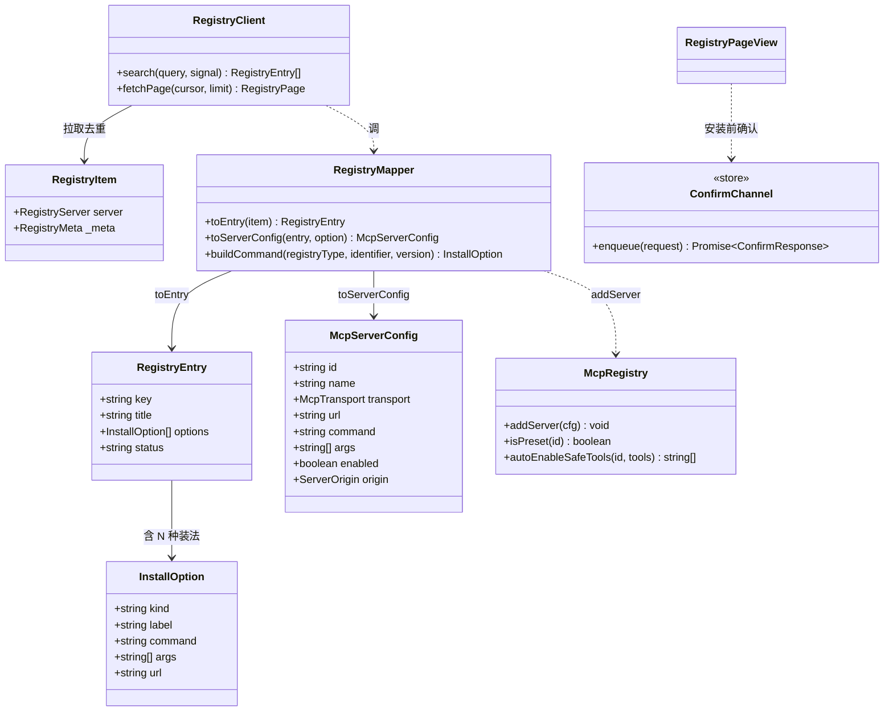
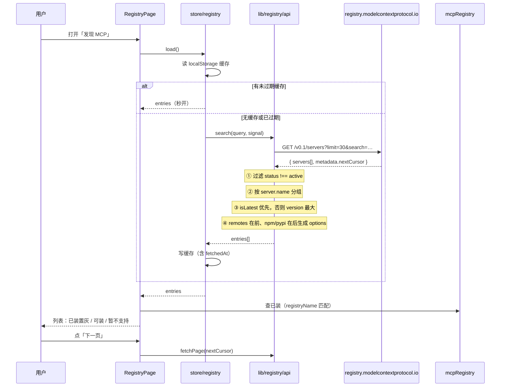
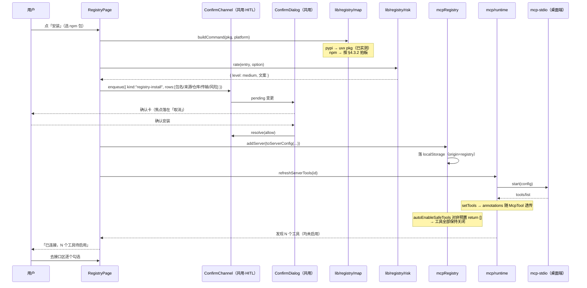
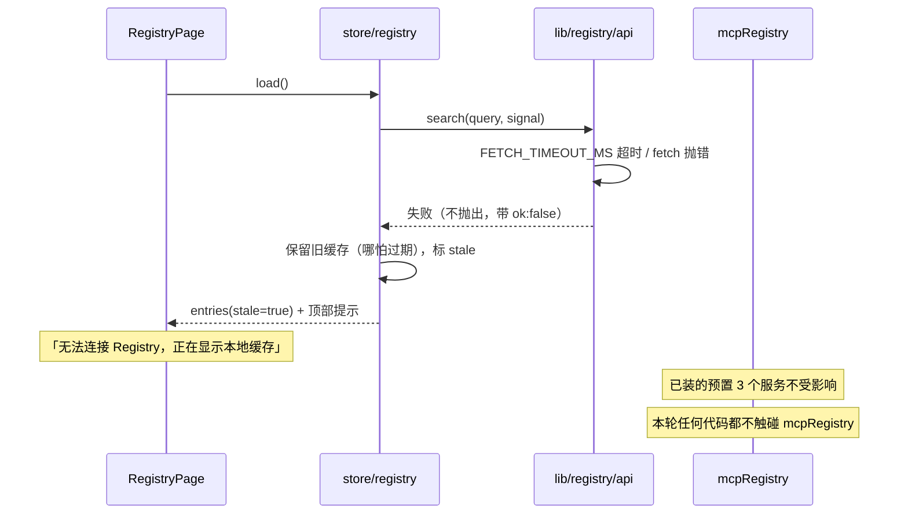
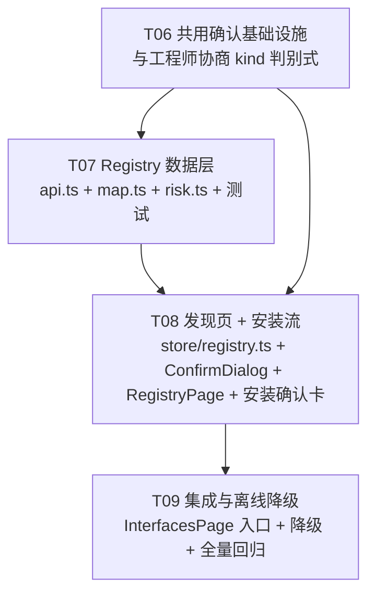

# 和鸣 MCP Registry 接入 · 架构设计与任务分解

- 设计时间：2026-10-22
- 基线版本：`d.18.1.5.0`（`D:/Heming`，main）
- 上游输入：`docs/research/2026-10-21-hitl-architecture.md`（HITL 设计，**本轮不改其任何内容**）
- 本轮范围：**MCP 官方 Registry 接入 + 一键安装**。HITL 由工程师并行实现中，本设计只与它**共用确认基础设施**，不触碰其文件。
- 目标读者：工程师（照此可直接开工）

---

## 0. 我实测出来的、与转述不一致的 6 处事实（**以本文为准**）

主理人转述的 API 事实有 6 处与实测不符。这些不是细节，每一条都会让工程师写出跑不通的代码，**务必按本文的实测值写**。

| # | 转述的说法 | 实测结果 | 后果 |
|---|---|---|---|
| 1 | 字段是 `registry_type` | **是 `registryType`（驼峰）** | 按 snake_case 写 → 所有包类型判为未知 → 全被过滤掉 → 列表全空 |
| 2 | 未提及去重 | **`server.name` 严重重复**：`limit=30` 实测只有 **19 个唯一名**；`limit=60` 里 `isLatest=true` 仅 37 条 | 不去重 → 列表里同一个服务出现 4 次，用户以为 bug |
| 3 | 未提及 `search` | **`?search=<关键词>` 实测可用** | 漏了这个参数就得自己拉全量做前端过滤，而 Registry 不给总数、只有游标 |
| 4 | 「`nuget`/`mcpb`/`oci` 需过滤」 | 实测 100 条里 `registryType` **只有 `npm` / `pypi` / `oci`**，其中 `oci` 占比 0（15 个包里 0 个 oci） | 过滤逻辑仍要写（数据会变），但**不能只测 oci 一个分支** |
| 5 | 「`readOnlyHint` 可用于只读自动放行」 | **规范原文：`annotations` 是 untrusted hint，`readOnlyHint` 默认 `false`，`destructiveHint` 默认 `true`** | 直接拿 `readOnlyHint:true` 就自动放行 = 把安全边界交给第三方自述，**等于没有闸门** |
| 6 | 「`npx`/`uvx` 拉起与现有 PATH 补全兼容」 | `mcp-stdio.js` 是 `shell:false`。实测：`uvx` 裸名可跑通；**`npx` 两种写法都跑不通**（ENOENT / EINVAL），详见 §4.3 | pypi 类无碍；**npm 类当前无法启动**，阻塞项见 §4.3.2 |

**第 5 条是本次最重要的发现**，§5 整节在讲它。

### 0.1 第二批实测（2026-10-22，来自产品经理 + 我自己复核）

| 数字 | 影响 |
|---|---|
| **82% 是 remote-only**（282 个 latest 中 231 个只有 `remotes`） | → **本轮只做 remote 分支**即覆盖绝大多数 |
| **13% 的 remote 声明 `headers[]`**（147 个 remote 里 19 个，2026-10-22 我自己实测复核） | → 「填 API Key」要有，但**有就用、没有就隐藏**，不是常驻输入框 |
| 实测 15 个端点：声明 `streamable-http` 的**无鉴权时 4/4 连通**，10/15 返回 401/403 | → 鉴权是主要障碍，不是协议 |
| **URL 模板变量极少**（3/883） | → 要能提示，但不做复杂替换 |
| `limit` **上限 100**（超了返回 422） | → 分页常量别设太大 |
| `version` 参数支持 `latest` / `2025-09-29`（日期快照） | → **Registry 有版本历史**，将来做回滚不用我们自己存 |

**★ 范围决策（2026-10-22 主理人拍板）：本轮只做 remote 分支。**
理由是**零依赖承诺** —— 主理人核实内置运行时里既没有 Node 也没有 uv
（`resources/runtime/mcp-env/Scripts/` 只有 `uvicorn.exe`），
做本地包等于要向用户说「请自己装 Node/uv」。而 82% 覆盖率让这个取舍代价很小。

**★ 一个实测推翻了「按 type 过滤」**：有服务声明 `sse`，实测对它发 GET 得 **405**、
发 POST（我们的模式）**200 正常返回 result** —— 它其实是 streamable-http，声明写错了。
所以**不按 `type` 预先过滤**，只做 URL 合法性检查，交给连接时实测
（我们的 `httpClient` 本来就同时声明 `Accept: application/json, text/event-stream`，两种都试）。

**★ `websiteUrl` 字段名核实过了**：确实存在于 `server` 对象内，
且实测 60 条里 **46 条有值**（比我最初判定的「大量为 null」高得多 —— 那个判断来自更早的小样本）。

---

## 1. 实现方案

### 1.1 核心技术挑战

| 挑战 | 难点 | 对策 |
|---|---|---|
| **版本去重** | Registry 每条记录是「某服务的某个版本」，同一服务重复 2-4 次 | 按 `server.name` 去重，优先取 `isLatest:true`；同组内取 `version` 最大的 |
| **不污染预置** | `isPreset()` 是**按固定 id 判定**的（`DEFAULT_PRESET_SERVERS.some(presetServerId(p.id)===id)`），Registry 服务的 id 天然不匹配 → 判定为非预置 → 走用户分支。**但 `seedDefaults()` 只在列表为空时执行**，Registry 装完列表就不空了，不会被塞预置 | Registry 装出的 id 前缀 `mcp-registry-`，并额外在 `McpServerConfig` 加 `origin` 字段显式区分 |
| **只读白名单** | 现有 `autoEnableSafeTools` **对非预置直接 return []**（`store.ts:186`）——这正好是我们要的 | **不改这个行为**。Registry 服务器天然「工具全默认不启用」，安全默认已由现有代码保证 |
| **供应链风险** | 开放注册中心，任何人能发包 | 安装前确认卡 + `annotations` 不作自动放行依据（§5） |
| **离线降级** | 断网时 Registry 拉不到，预置 3 个必须照常 | Registry 拉取**完全独立**于 MCP 注册表，失败只影响「发现页」，不触碰已装服务 |
| **Windows spawn** | `shell:false`；`uvx` 裸名可用，**`npx` 不可用**（§4.3） | pypi 写裸 `uvx`；npm 类的处理按 §4.3.2 拍板 |

### 1.2 框架与选型

**零新依赖**（硬约束，已核实可行）：

| 需求 | 用什么 | 备注 |
|---|---|---|
| HTTP 拉取 | 原生 `fetch` | 项目已在 `lib/api.ts` / `mcp/httpClient.ts` 使用 |
| JSON 解析 | 原生 `JSON.parse` | |
| 状态 | 已有 `zustand` | 新增 `store/registry.ts` |
| 列表分页 | 自己写游标循环 | 无虚拟滚动库 |
| 缓存 | `localStorage`（`StorageLike` 注入，**可单测**） | 复用 `selfEdit/guards.ts` 与 `mcp/store.ts` 的同一模式 |

**E2E 合规**：Registry 数据是公开元数据，不含用户数据，**明文拉取、明文缓存**，不走 WS、不进 E2E 信封。

### 1.3 分层

```
components/RegistryPage.tsx        发现页（搜索/筛选/安装）
        │  调 enqueue → 复用 HITL 的确认基础设施
        ▼
store/hitl.ts（工程师正在建）        ← 共用：pending 单槽 + resolver
        │
components/ConfirmDialog.tsx       ← 共用：Modal 骨架（焦点/Esc/遮罩）
        │                            HITL 填工具内容，Registry 填安装内容
        ▼
lib/registry/                      ← 新增，纯逻辑、零 React、零 store
   api.ts      拉列表（游标分页 + 去重 + search）
   map.ts      Registry server → McpServerConfig（含 Windows .cmd 处理）
   risk.ts     安装风险评级（供确认卡展示）
```

---

## 2. 文件清单

```
packages/web/src/
├─ lib/registry/                              【新增·共用基础设施】
│  ├─ types.ts                                Registry 原始响应类型 + 内部类型
│  ├─ api.ts                                  拉列表/游标/去重/search/超时
│  ├─ api.test.ts
│  ├─ map.ts                                  → McpServerConfig 映射 + 命令生成
│  ├─ map.test.ts                             含 Windows .cmd 用例
│  ├─ risk.ts                                 安装风险评级（供应链）
│  └─ risk.test.ts
├─ store/
│  ├─ registry.ts                             【新增】发现页状态 + 缓存
│  └─ registry.test.ts
├─ components/
│  ├─ ConfirmDialog.tsx                       【新增·共用】确认弹窗骨架
│  ├─ ConfirmDialog.test.tsx
│  ├─ RegistryInstallCard.tsx                 【新增】安装前确认卡内容
│  ├─ RegistryInstallCard.test.tsx
│  ├─ RegistryPage.tsx                        【新增】发现页
│  ├─ RegistryPage.test.tsx
│  └─ InterfacesPage.tsx                      【改】加「从 Registry 浏览」入口
└─ lib/mcp/
   ├─ types.ts                                【改】McpServerConfig 加 origin/registryName
   └─ store.ts                                【改】coerceServer 透传新字段

packages/web/src/lib/registry/                  ← 全部零 React 零 store 零新依赖
```

共 **11 个新增文件、3 个改写文件**。

> ⚠️ **不碰的文件**：`lib/hitl/**`、`store/hitl.ts`、`components/ToolApprovalModal.tsx`、`lib/agentStream.ts`、`store/chat.ts`、`ChatPage.tsx`。工程师正在实现 HITL，本轮并行施工必须零交叉。

---

## 3. 数据结构与接口

### 3.1 Registry 原始响应（**实测字段，驼峰**）

```ts
// lib/registry/types.ts —— 与实测 JSON 一一对应，字段名不许改
export interface RegistryPackage {
  /** ⚠️ 实测是驼峰 registryType，不是 registry_type */
  registryType: "npm" | "pypi" | "oci" | "nuget" | "mcpb" | (string & {});
  identifier: string;
  version?: string;
  transport?: { type: "stdio" | "sse" | "streamable-http" };
  /** 实测存在但多数为 null；实测 15 个包里 4 个有值 */
  packageArguments?: { type?: string; [k: string]: unknown }[] | null;
  environmentVariables?: Record<string, string> | null;
  runtimeHint?: Record<string, unknown> | null;
  registryBaseUrl?: string | null;
}

export interface RegistryRemote {
  type: "streamable-http" | "sse";
  url: string;
}

export interface RegistryServer {
  /** 反向域名，唯一键，如 "io.github.foo/mcp-bar" */
  name: string;
  title?: string;          // ⚠️ 实测大量为 null，展示名要 fallback 到 name 尾段
  description?: string;
  version?: string;
  repository?: { url: string; source: string; subfolder?: string };
  websiteUrl?: string | null;
  icons?: { src: string; mimeType?: string }[] | null;
  packages?: RegistryPackage[];
  remotes?: RegistryRemote[];
}

export interface RegistryItem {
  server: RegistryServer;
  _meta: {
    "io.modelcontextprotocol.registry/official": {
      status: string;          // 实测 120 条全为 "active"，但仍要过滤
      statusChangedAt?: string;
      publishedAt?: string;
      updatedAt?: string;
      isLatest: boolean;       // ⚠️ 实测并非每条都有 true；去重靠它
    };
  };
}

export interface RegistryPage {
  servers: RegistryItem[];
  metadata: { nextCursor?: string; count?: number };
}
```

### 3.2 内部类型

```ts
/** 去重后的一个可安装服务（跨版本合并）。 */
export interface RegistryEntry {
  /** 用 server.name 作稳定 key（装过的服务据此判「已安装」）。 */
  key: string;
  title: string;              // title ?? name 尾段（实测 title 常为 null）
  description: string;
  repoUrl?: string;
  websiteUrl?: string;
  status: string;
  /** 我们支持的可选安装方式；无则为空数组（界面据此显示「暂不支持」）。 */
  options: InstallOption[];
  /** 原始最新版本的 version（展示用）。 */
  latestVersion?: string;
}

export type InstallTransport = "http" | "stdio";

export interface InstallOption {
  kind: InstallTransport;
  /** 面向用户的一行说明，如 "npm · @scope/pkg@1.2.3"。 */
  label: string;
  /** stdio：生成后的可执行命令（Windows 已带 .cmd）；http：服务 URL。 */
  command?: string;
  args?: string[];
  url?: string;
  /** npm/pypi 原生类型；oci/nuget/mcpb 为 undefined（不支持）。 */
  registryType?: string;
  version?: string;
}
```

### 3.3 映射到内部配置



---

## 4. 关键实现细节

### 4.1 拉列表与去重（`lib/registry/api.ts`）

```ts
export const REGISTRY_BASE = "https://registry.modelcontextprotocol.io/v0.1";
/** 实测 ?search= 可用；未传 search 时 Registry 按 name 字母序返回。 */
export const REGISTRY_PAGE_SIZE = 30;
/** 去重后一页最多返回多少条给 UI（原始页里重复的太多）。 */
export const ENTRY_PAGE_SIZE = 20;
/** 单次请求超时。断网/被墙时不能无限转圈。 */
export const FETCH_TIMEOUT_MS = 12_000;
```

**去重算法**（实测这是必需步骤，不是优化）：

```
1. 拉一页（?limit=30&cursor=X&search=Y）
2. 逐条过滤：_meta.official.status !== "active" → 丢弃
3. 按 server.name 分组
4. 组内选代表：isLatest === true 的优先；否则取 version 字符串最大的
5. 每个代表产出 RegistryEntry（含所有可用 options）
6. 返回 { entries, nextCursor: metadata.nextCursor }
```

**`options` 的构造规则**：

| 来源 | 支持 | 生成 |
|---|---|---|
| `remotes[].type === "streamable-http"` | ✅ | `{kind:"http", url, label:"远程 · streamable-http"}` |
| `remotes[].type === "sse"` | ✅ | `{kind:"http", url, label:"远程 · SSE"}`（httpClient 的 Accept 已含 sse） |
| `packages[].registryType === "npm"` | ⚠️ **受阻，见 §4.3.1** | `npx -y <id>@<ver>`（**当前不可用**） |
| `packages[].registryType === "pypi"` | ✅ | `uvx <id>@<ver>`（**已实测跑通**） |
| `packages[].registryType === "oci"` | ❌ | 跳过 |
| `packages[].registryType === "nuget"` / `"mcpb"` | ❌ | 跳过 |

**远程优先于 stdio**：`options.unshift(remote)`。理由——远程不需要在本机装包，断网也能用，供应链风险面小得多。这条排序规则同时决定 UI 默认选哪个。

**`options` 为空数组时**：RegistryEntry 仍返回，界面显示「暂不支持本机安装」+ 展示描述与仓库地址。**不要隐藏**——用户要知道自己错过了什么。

### 4.2 映射到 McpServerConfig（`lib/registry/map.ts`）

```ts
export function registryServerId(key: string): string {
  // 反向域名含 "/" 与 "."，且 OpenAI 工具名只允许 [a-zA-Z0-9_-]
  // —— 统一 slug 成 mcp-registry-<slug>，与 presetServerId 的 `mcp-` 前缀区分开
  return `mcp-registry-${slugPart(key)}`;
}
```

> 复用 `lib/mcp/bridge.ts` 已有的 `slugPart()`——它对非 ASCII 会转短哈希，且我们已在用同一套命名规则，不重复造。

```ts
export function toServerConfig(entry: RegistryEntry, option: InstallOption): McpServerConfig {
  return {
    id: registryServerId(entry.key),
    name: entry.title,
    transport: option.kind,
    url: option.url,
    command: option.command,
    args: option.args,
    // 新装的服务默认不自动连接：先让用户看到工具清单再开。
    // ⚠️ 现有 enabledTools 集合默认也是空的，工具仍然全部关闭。
    enabled: true,
    origin: "registry",          // ← 新增字段
    registryName: entry.key,     // ← 新增字段（用于判「已安装」）
    createdAt / updatedAt 由 store 填
  };
}
```

**`McpServerConfig` 新增两个可选字段**（`types.ts` + `store.ts` 的 `coerceServer` 各加一行）：

```ts
/** 来源：内置预置 / 用户手填 / Registry 装。界面据此标注与决定能否删除。 */
export type ServerOrigin = "preset" | "manual" | "registry";
export interface McpServerConfig {
  // ...原有字段不动...
  origin?: ServerOrigin;        // 缺省视为 "manual"（兼容旧数据）
  registryName?: string;        // Registry 的 server.name，已安装判定用
}
```

**为什么加 `origin` 而不是靠 id 前缀判断**：id 前缀是可以被用户手填撞上的，`origin` 是显式声明。而且 `coerceServer` 已经在做字段级白名单，**不加这个字段它会被直接丢掉**——必须同步改 `coerceServer`。

### 4.3 ★★ Windows 上的 stdio 启动：实测结论（2026-10-22 更新，推翻初版推测）

> **本节结论（2026-10-22 二次修订）**：`uvx` 走**逻辑名**（不进 PATHEXT 解析），
> `npx` 必须进 PATHEXT 解析（它在 Windows 上是 `.cmd`）。详见 §4.3.4。

初版这里写的是「`.cmd` 必须显式写出，`uvx.exe` 是推测，待验证」。
**两条都已被实测取代。** 实测环境：Node v22.22.2，`shell:false`：

```
spawn("npx")       → ERR ENOENT      ← 找不到
spawn("npx.cmd")   → ERR EINVAL      ← 找到了，但被 Node 拒绝执行
spawn("uvx")       → OK  uvx 0.12.5
spawn("uvx.exe")   → OK  uvx 0.12.5
```

#### 4.3.1 pypi 类：写裸 `uvx` 即可 ✅

`uvx` 的真身是 `.exe`，Node 的 `spawn` 会自己解析 PATHEXT 补 `.exe`。
且我们的 `mcp-stdio.js` 的 `buildChildEnv` 已经把 `~/.local/bin` 与
Python Scripts 目录加进 PATH（现有 Scrapling 预置就是用 `uvx` 启动的，实测能跑通）。

→ **命令模板用 `uvx <identifier>`，不写 `uvx.exe`，与现有预置保持一致。**
初版的「Windows 上必须 `uvx.exe`」是**多余且与预置不一致**的写法，已废弃。
**待明确 #1 关闭。**

#### 4.3.2 ★ npm 类：**当前无法启动**（阻塞项，待拍板）

`npx` 的真身是 `npx.cmd`（同目录下还有 `npx` shell 脚本与 `npx.ps1`）。**两种写法都跑不通**：

- 写 `npx` → ENOENT（PATH 里没有无扩展名的可执行文件）
- 写 `npx.cmd` → **EINVAL**（Node 明确拒绝执行 `.cmd`）

**根因**：Node 的安全加固（对应 CVE-2024-27980）—— Node ≥ 18.20.2 / 20.12.2 / 21.7.3 起，
`spawn` 遇到 `.cmd` / `.bat` 会**直接抛 EINVAL 拒绝执行**，不再走 shell 解析。

我实测了两个绕过方案：

| 方案 | 做法 | 实测 | 结论 |
|---|---|---|---|
| A | `shell: true` + `npx.cmd` | OK（10.9.7） | ❌ **绝对排除** |
| B | `node <npm>/bin/npx-cli.js -y <pkg>` | OK | ✅ 可行 |

**方案 A 排除的理由（不是偏好，是安全约束）**：
`mcp-stdio.js` 的文件头明写「不使用 shell 拼接参数（shell:false）」。
开 shell 等于把**命令注入面**打开——而 Registry 装的是**任意第三方包**，
攻击面比我们自己写的预置大一个量级。**不能为了「跑通」而破这条**。

**方案 B 的可行性**：绕开 `.cmd`，用 `node` 直接跑 npx 的 JS 入口：

```ts
// 需要在桌面端侧解析 npx-cli.js 的绝对路径（buildChildEnv 已补的 PATH 里可推）
spawn(process.execPath, [npxCliPath, "-y", spec])
```

但这要求改桌面端主进程（`bundled-runtime.js` / `mcp-stdio.js`），
而本轮我原本规划**不碰桌面端**。

> ⚠️ **`mcp-stdio.js:13` 那条注释是错的**（原文：「Windows 下 `.cmd` 由调用方写成 `npx.cmd` 之类」）。
> 按实测，写 `npx.cmd` 会 EINVAL。这条注释会误导后来者，建议本轮顺手更正——
> **但它属于桌面端文件，需你确认是否纳入本轮**。

#### 4.3.3 三个方案待你拍板（阻塞 T07 的一部分）
| 方案 | 做法 | 代价 |
|---|---|---|
| **A** | T07 先只支持 pypi + remote，npm 类标「暂不支持」 | 首版覆盖面小，但零风险、**T07 可立刻开工** |
| **B** | 同步改桌面端，加 `npx-cli.js` 启动路径 | 覆盖完整，但本轮要动桌面端主进程 |
| **C** | 先做 A，把 B 单独列一个任务 | 分两步，交付顺序清晰（**我倾向这个**） |

**架构师倾向 C**：`api.ts` / `risk.ts` / `map.ts` 的主体**都不依赖这个决定**，
只有 `map.ts` 里 npm 分支要留空并抛「暂不支持」，**T07 今天就能全部写完并跑通**。
B 涉及的桌面端改动我单独列任务，交给你决定是否这轮做。

### 4.4 ★★ 包名白名单（安全项，优先于一切）

**`packages[].identifier` 与 `version` 都是 Registry 里的外部输入。**
而 npm 类服务器要用 `npx` 起，`npx` 在 Windows 上是 `.cmd` 批处理，
Node 22 的 `shell:false` 不能直接 spawn 批处理（§4.3.2）→ 只能 `shell:true` → **命令注入面**。

**所以：包名白名单比「怎么跑 .cmd」更重要** —— 它挡的是注入本身，不是兼容性。

```ts
// lib/registry/map.ts

/**
 * 允许的包名字符集：字母、数字、@ / . _ -
 *
 * 为什么这么紧：npm 包名本身就只用这些字符（见 npm 命名规范），
 * 而 shell 元字符（空格 引号 ; & | > < ` $ ( ) { } [ ]）**一个都不在集合里**。
 * 白名单通过 = 不可能注入；这不是「转义干净」，是「根本没法构造注入串」。
 */
const SAFE_IDENTIFIER = /^[A-Za-z0-9@/._-]+$/;
/** 版本号额外允许 + （语义化版本里的预发布标记，如 1.0.0-beta.1） */
const SAFE_VERSION = /^[A-Za-z0-9.+-]+$/;
/** 长度上限，与 mcp-stdio.js 的 isValidCommand（≤512）对齐 */
const MAX_IDENTIFIER = 200;

export interface RejectReason { field: string; value: string; reason: string }

export function validatePackage(pkg: RegistryPackage): RejectReason | null {
  if (pkg.identifier.length > MAX_IDENTIFIER) return { field:"identifier", value:pkg.identifier.slice(0,40), reason:"包名过长" };
  if (!SAFE_IDENTIFIER.test(pkg.identifier)) return { field:"identifier", value:pkg.identifier, reason:"包名含不允许的字符" };
  if (pkg.version && !SAFE_VERSION.test(pkg.version)) return { field:"version", value:pkg.version, reason:"版本号含不允许的字符" };
  return null;
}
```

**校验时机：在「映射」阶段就拒，不是启动时才拒。**
理由：拒绝一个恶意包名**不应该以「安装失败」的形式出现**，而应该在用户点安装之前
就明确告诉他「这个包名不合法」。放到启动时才拒，用户已经装了一半。

**UI 必须显示被拒的具体值**（截断到 40 字符），否则用户无法判断是哪个包有问题。

**同时要校验 `packageArguments` / `environmentVariables`**（Registry 里确实有这两个字段，
我实测 100 条里有 4 个带值）：

- `packageArguments` → **本轮直接丢弃，不映射进 args**。理由：它同样是外部输入，
  且结构未定义。**宁可不支持，不要猜。**
- `environmentVariables` → **本轮直接丢弃**。理由：它能往子进程环境注入任意变量
  （包括 `PATH`、`NODE_OPTIONS` 之类），**风险面比 args 更大**。

> 这两个字段在实测样本里出现率低（100 条里 4 个带 `packageArguments`），
> 但「低频」不等于「安全」——Registry 是开放注册中心，随时可能有包带这些字段。
> **丢弃的成本是「少数包装不了」，放开的成本是「任意环境变量注入」。**

### 4.5 ★ `mcp-stdio.js` 加可执行名解析（PATHEXT）

主理人拍板：`uvx` 用**逻辑名**（不进解析），**`npx` 必须进 PATHEXT 解析**。

理由与主理人的判断一致：
- **Registry 装 npm 类服务器必然需要 `npx`**，而 `npx` 在 Windows 上是 `.cmd` → **必须解析**
- **`uvx` 不用**：Registry 装的东西需要用 uv 拉运行时下载，所以 uv 一定在；
  不需要下载的 MCP 也不会是 uvx 形态。且现有 Scrapling 预置已用 `uvx` 跑通，**保持既有行为不动**。

```js
// packages/desktop/mcp-stdio.js —— 新增
/**
 * 按 PATHEXT 解析可执行名：依次试 原名 / 原名.exe / 原名.cmd / 原名.bat
 * 取第一个在 PATH 中真实存在的。
 *
 * 为什么需要：Node ≥18.20.2 对 `shell:false` spawn `.cmd` 直接抛 EINVAL
 * （CVE-2024-27980 加固）。而 Windows 上 npx 的真身就是 npx.cmd。
 *
 * 注意：解析结果是 `.cmd` 时**仍然不能 shell:false**——
 * 那条限制针对的是「Node 不允许 spawn 批处理」，不是「文件名」。
 * 本函数只负责「找到正确的文件名」，能否 spawn 由调用方与运行平台决定。
 */
```

**这个函数只做「找文件」，不做「决定要不要开 shell」。** 两件事必须分开：
把「找到 npx.cmd」与「允许 shell:true」耦合在一起，会让后人手一滑就把 shell 打开。

**降级路径**：解析不到 → 明确提示「需要安装 Node.js（含 npx）」，而不是让 spawn 报 ENOENT
（用户看不懂「spawn npx ENOENT」是什么意思）。

**测试**（`mcp-stdio.test.js`，desktop 包用 `node --test`）：
纯函数部分（`resolveExecutable(cmd, pathEntries, existsFn)`）可注入 `existsFn` 做单测：
原名存在 → 原名；只有 `.exe` → `.exe`；只有 `.cmd` → `.cmd`；都不存在 → `null`。

### 4.6 安装流程

```
用户在 RegistryPage 点「安装」
  → buildInstallPreview(entry, option)        纯函数，产出待展示信息
  → ConfirmChannel.enqueue({                  ★ 复用 HITL 的确认通道
        kind: "registry-install",
        title, rows: [{包名/来源/作者/仓库/传输/认证标记}], risk
     })
  → 用户确认
  → registry.addServer(toServerConfig(...))   写入本地配置
  → refreshServerTools(serverId)              走既有 runtime.ts
  → 成功：提示「已连接，发现 N 个工具，工具默认未启用」
  → 失败：保留配置 + 明确原因（用户可在接口区重试/删除）
```

**关键：装完的工具默认全部关闭。** 这不是需要额外做的功能，而是**现有代码已经保证的**——`store.ts:186` 的 `autoEnableSafeTools` 对非预置直接 `return []`，且 `MCP_ENABLED_TOOLS_KEY` 默认空。**Registry 接入不需要写任何「启用工具」的代码**，这是本设计最省事的一处。

### 4.7 `filesystem` 预置的处置（待主理人拍板）

主理人实测发现：`presets.ts:86` 的 `filesystem` 预置用 `command: "npx"`，
**在 Windows 上从来跑不通**（§4.3.2），且 `args` 里**硬编码了 `D:/Heming`**（主理人本机路径）。

这解释了它为什么标 `verified: false` 且「不预置任何自动启用」——**它是个从未验证过的示例**。

| 选项 | 做法 | 代价 |
|---|---|---|
| **1** | 修好（改 PATHEXT 路径 + 路径让用户填） | 变平台相关；两件事都要处理 |
| **2** | **删掉**（架构师倾向） | 真正需要文件 MCP 的用户可在接口区自己加 |
| **3** | 保留但移出预置列表，变成接口区的添加入口示例 | 仍要修好才能用 |

**架构师倾向选项 2**，理由：

1. **预置列表是用户第一眼看到的东西**，放一个跑不通的示例会直接损害信任
2. 修好它需要处理「平台相关命令名 + 路径要用户填」两件事，
   而 T07 正好要做 PATHEXT 解析 —— **在那时做才对**
3. 我们的内置能力已覆盖文件读写（`self_mcp_*` + `wiki-fs.js` + `chart-fs.js`）

**但这是产品决策，请主理人定。** 若选 1 或 3，请给具体口径。

> 无论选哪个，**`mcp-stdio.js:13` 那条注释都是错的**：
> 原文「`.cmd` 由调用方写成 `npx.cmd` 之类」按实测会 EINVAL。**建议本轮更正**。


### 4.8 ★ `risk.ts` 必须复用 `lib/hitl/classify.ts`（不写第二套判定）

工程师的 `classify.ts` 已落盘（253 行，经主理人审定并要求改三处）：
`resolveRisk` 里**彻底移除 `readOnlyHint` 分支**；参数摘要抹 URL userinfo；
`sourceOf` 对真实 MCP 裸名不生效（真实工具名是 `"App"`，没有 `服务__工具` 前缀——
那是我们**内部**的命名空间，模型看到的是裸名），**改由调用方传入准确的 source**。

```ts
// lib/hitl/classify.ts 已有的口径（审定版）
export function resolveRisk(name: string, hints?: HitlRiskHints): RiskLevel {
  if (hints?.risk) return hints.risk;   // 作者显式声明（我们的 riskHint），可信
  return riskOfName(name);               // 其余一律按名字+描述判
}
```

**`risk.ts` 直接 import 这两个函数，不自己写一套。** 三条理由：

1. 工程师的判定里已含**我们的 15 个内置工具表**（Registry 服务器用不到，但共用一份省事）
2. **两套判定必然漂移** —— 而漂移的后果是「有的服务器绕过确认、有的不绕过」，
   这是**安全问题**不是风格问题（而且这类 bug 不报错，只是行为不一致，极难在测试里发现）
3. 工程师的 `DANGER_WORDS` / `READ_WORDS` 已过审

**`risk.ts` 只做 Registry 特有的四件事**：

| 职责 | 说明 |
|---|---|
| 解析 Registry 的 `annotations` | **只取 `title` 做展示**，不参与判定 |
| 判断传输类型是否支持 | npm/pypi → stdio；`oci`/`nuget`/`mcpb` → 过滤掉 |
| 过滤 `status !== "active"` | §5.5 |
| 包名字符集白名单校验 | §4.4，安全项 |

**调用约定**：`resolveRisk(toolName, { displayName: annotations?.title })`
—— `displayName` 进 `hints` 只影响展示（`displayNameOf`），**不影响 `resolveRisk`**。

### 4.9 安装前确认卡展示什么（供应链风险）

| 行 | 内容 | 数据来源 |
|---|---|---|
| 服务名 | `entry.title` | `title ?? name` |
| **来源** | `server.name`（反向域名，**唯一可信的身份**） | 必显示 |
| 仓库 | `repository.url` | 实测存在；`source` 字段一并显示（如 `github`） |
| 官网 | `websiteUrl` | 实测**大量为 null**，无则整行不显示 |
| 传输 | 远程 URL 或 `npm · 包名@版本` | |
| 官方状态 | `_meta.official.status` | ⚠️ 见 §5.3，**不等于安全背书** |
| **风险提示** | §5 的评级文案 | |

**风险评级（`lib/registry/risk.ts`）**：

| 级别 | 条件 | 文案 |
|---|---|---|
| `low` | 远程 http + status=active | 「该服务在你的系统上不安装任何代码，连接远程地址。」 |
| `medium` | npm/pypi stdio | 「安装后该服务以本机进程运行，可读写文件、执行命令。装它等于把本机权限交给它的作者。」 |
| `high` | status ≠ active，或来源域名与仓库域名不一致 | 「该条目未标记为活跃，或注册来源域名与仓库地址不一致，请确认你信任它。」 |

**域名一致性检查**：`server.name` 的第一段（如 `io.github`）vs `repository.url` 的 host。不一致 → `high`。这是唯一能自动做的供应链信号，**但它只是弱信号**，UI 必须说明「通过不代表安全」。

---

## 5. ★ 核心设计：Registry 服务器如何天然受 HITL 保护

主理人的设想是「`annotations.readOnlyHint` 可用于只读自动放行、写入必问，Registry 服务器就天然受保护」。**方向对，但直接这样做会让闸门失效。**

### 5.1 规范原文（四处，逐字核实）

**★ 最完整的一处**（主理人 2026-10-22 亲自 fetch，
`schema/2025-06-18/schema.json` 的 `ToolAnnotations.description` 原文）：

> "NOTE: all properties in ToolAnnotations are **hints**.
> They are not guaranteed to provide a faithful description of
> tool behavior (**including descriptive properties like `title`**).
> **Clients should never make tool use decisions based on ToolAnnotations
> received from untrusted servers.**"

**注意括号里那句**：规范把 **`title` 也算进去了** ——
所以连 `annotations.title` 都不权威，它只是「**服务器自称的名字**」，
只能用于展示（让确认弹窗好读一点），**不能当权威名称**。

**两版规范都明确禁止**（2025-06-18 用 "should never"，2025-12-11 用 "MUST consider untrusted"）。
另有一处给出正向指引：**"Instead, use the tool name and description."**
—— 这就是我们的判定依据。

MCP 官方博客（2026-03-16《Tool Annotations as Risk Vocabulary》）补充说明了默认值的用意：

```ts
interface ToolAnnotations {
  title?: string;
  readOnlyHint?: boolean;     // default: false
  destructiveHint?: boolean;  // default: true
  idempotentHint?: boolean;   // default: false
  openWorldHint?: boolean;    // default: true
}
```

规范页原文：

> For trust & safety and security, clients **MUST** consider tool annotations to be **untrusted** unless they come from trusted servers.

Google 的 MCP 文档说得更直接：

> Most clients treat these hints as **untrusted**, but they can be used to decide when a confirmation prompt might be sent to a user.

社区讨论里的原始质疑（MCP 联合创始人 Justin Spahr-Summers 在评审时提出）：

> The information itself, **if it could be trusted**, would be very useful, but how does a client make use of this flag knowing that it's not trustable?

### 5.2 结论：**不能用于自动放行，只能用于收紧**

`readOnlyHint` 是**工具作者对自己行为的自述**。一个写恶意代码的 MCP 作者完全可以给自己的 `delete_everything` 标上 `readOnlyHint: true`——Registry 是开放注册中心，任何人都能发包。

**因此分类规则是单向的**：

```
✅ 可以：annotations 收紧风险（把默认的 write/danger 往上抬）
❌ 不可以：annotations 放宽风险（把 danger 降成 read 从而自动放行）
```

落到 HITL 的 `classify.ts`（**工程师正在实现，我不动他的文件，这里只给规则**）：

| 工具来源 | `readOnlyHint` | 分类结果 |
|---|---|---|
| 内置预置（`isPreset()` 为真） | 任意 | **按现有 `presets.ts` 白名单**，忽略 annotations |
| Registry 装的（`origin === "registry"`） | `true` | **仍按 `write`**（自述不可信） |
| Registry 装的 | `false` / 缺省 | 按 `write`；若同时 `destructiveHint !== false` → **升到 `danger`** |
| Registry 装的 | `readOnlyHint:true` **且** 用户手动在接口区勾了「信任此服务器的只读标注」 | 按 `read`（显式信任，用户知情） |

**所以真正的联动是**：Registry 服务器**默认全部工具都要过闸门**（= 强保护），而不是「只读自动放行」（= 弱保护）。这比主理人设想的更严格，理由就是上面那三处规范原文。

> **注**：主理人后续查实了 `ToolAnnotations` 确实在 MCP 协议 schema 里
> （`schema/2025-03-26/schema.json`），且**规范的悲观默认与我们一致**——
> `readOnlyHint` 默认 `false`、`destructiveHint` 默认 `true`，
> 即「不声明就是写操作、就是可能破坏」。
> 也就是说我们的「缺省按 write」**不是额外加的保守，是跟规范对齐**。这一点值得写进代码注释。
> 但「默认悲观」≠「声明就可信」，所以上面的单向规则不变。

### 5.3 ★ 授权粒度：按服务器整体授权（缓解「体验偏烦」）

主理人指出的问题很真实：**大多数第三方 MCP 服务器不声明 annotations**
（那是作者的额外工作量），所以实际效果是「Registry 服务器的工具默认全部走确认」。
一个工具 dozen 个的服务器，用户会被弹窗淹没。

**方案：把授权粒度从「单个工具」提到「单个服务器」。**

| 粒度 | 评价 |
|---|---|
| 逐工具授权（HITL 现有） | ❌ 心智模型是「我信任这个 MCP 的某个工具」——**用户脑子里没有这个概念** |
| **按服务器整体授权** | ✅ 心智模型是「我信任这个 MCP」——**这才是用户真实的判断** |

用户装了一个 MCP，意图是「我信任它能干什么」，不是「我信任它的 `write_file` 工具」。
逐工具授权既烦人又没意义——用户点疯了之后的结果和直接授权整台服务器一样，但过程痛苦十倍。

**具体设计**：

1. 确认弹窗在服务器有多个待确认工具时，**顶部多一个「本会话内允许这台服务器的全部工具」按钮**（替代逐个勾选）
2. 会话授权的 key 从 `toolName` 改为 **`serverId`**（HITL 的 `HitlPolicyStore.granted()` 加一个层级）
3. 落盘策略**不做**「永久信任这台服务器」——**只到会话级**。理由：服务器可以被作者更新（Registry 上同一服务有多个版本，我们按 `isLatest` 装），永久信任等于把未来版本的权限也一起签了。要永久信任必须由用户在接口区逐工具勾，**且勾的是具体工具名，不随版本变**。

**为什么不做「永久信任整台服务器」**：这是 §0.2 那条链的最后一环。
`self_mcp_add_server` 加一个包 → 用户点了「永久信任这台服务器」→ 该服务器**下一个版本**新增了
`delete_all_files` 也自动免确认。作者更新 + 用户永久信任 = 静默提权。
会话级授权有天然的时间边界，这是刻意的摩擦。

### 5.4 ★ 安装确认永远询问，不受任何档位影响（2026-10-22 拍板）

**`HitlMode` 的三档（strict / guarded / trusted）都不作用于 Registry 安装确认。**

理由：它是**供应链决策**，不是工具执行。档位管的是「这次工具调用要不要问」，
而安装是「要不要让一段第三方代码进入本机」——性质不同，不该被同一个旋钮影响。

**特别是 `guarded` 也不放行安装。** 这一点很容易被后人「顺手」改掉
（看到「guarded = 只读放行」就以为安装也归它管），所以要在 `ConfirmDialog` 的
实现注释里写明。**待拍板时我已在设计里写死这条。**

同理，安装确认**不受 §5.3 的「本会话内允许这台服务器」影响** ——
那个按钮是给「工具执行」的，安装确认卡上**不提供**该选项。

### 5.5 `_meta.official.status: "active"` 的含义

实测 120 条全部是 `active`。它表示「该条目当前未被下架」，**不是**「通过安全审核」。UI 里必须写清楚：

> 活跃标记只表示该条目未被下架，不代表已通过安全审核。

**不要给它加权**，`active` 只用来判断「要不要展示」，不参与风险评级。

---

## 6. 时序图

### 6.1 发现页：拉列表 → 去重 → 展示



### 6.2 安装：确认卡 → 写入 → 连接 → 工具默认关闭



### 6.3 离线降级



**降级要点**：Registry 拉取失败**绝不能影响已装 MCP 的连接与调用**。二者除了「安装那一刻」没有交集——`autoConnectAll` 走 `registry.enabled` 的服务，与 Registry 目录无关。

---

## 7. 与 HITL 的复用关系

主理人给的判断（纯逻辑决策模型可复用、UI 骨架可复用但内容不同）**我同意，且要更精确一点**：

| 层 | 复用 | 理由 |
|---|---|---|
| `store/hitl.ts` 的 **pending 单槽 + resolver 机制** | **完全复用**，不新建 store | 这是一套成熟的双向等待原语。为 Registry 再写一个 `store/registryConfirm.ts` 等于把同一个坑（中断/并发/过期 requestId）踩两遍 |
| `ConfirmDialog.tsx` **Modal 骨架** | **完全复用**：遮罩、Esc、焦点陷阱、焦点落点 | 三层焦点管理（打开落点/循环/Tab 顺序）是本仓最易写错的部分，只能有一份 |
| **决策模型**（allow / deny / 理由） | **复用** `ConfirmRequest` / `ConfirmResponse`，Registry 只是新增 `kind` 判别式 | 一个判别式联合比两个近似类型安全 |
| **内容区** | **分开** | 工具确认展示「工具名 + 参数 + 风险」；安装确认展示「包名 + 来源 + 仓库 + 供应链风险」。字段几乎不重叠，硬塞一个组件只会变成一堆 `if (kind === ...)` |
| `lib/hitl/text.ts` 的**拒绝文案** | **不适用** | 那套文案是为模型读的（「文件未被修改」）；Registry 拒绝是给人看的，直接取消即可 |

**具体落地**（**依赖工程师 T04 产出，我不动**）：

```ts
// store/hitl.ts 增加（由工程师在实现时一并纳入，或 Registry 侧开工前先协商）
export type ConfirmRequest =
  | { kind: "tool-call";   payload: HitlCall[] }
  | { kind: "registry-install"; payload: RegistryInstallPreview };

export type ConfirmResponse =
  | { decision: "allow" }
  | { decision: "deny"; reason?: string };
```

> ⚠️ **这是本设计唯一的跨任务耦合点**。若工程师的 `store/hitl.ts` 已经把 payload 写死成 `HitlCall[]`，Registry 侧需要**一次性窄改**（加 `kind` 判别式）。
> **建议：先让工程师把 `enqueue` 的参数类型改成 `unknown` 或引入 `kind` 判别式**，这样两边都能接。**这属于对工程师已排期任务的一处前置建议，请主理人裁决是让他现在改，还是我这边开工时再协商。**（列为待明确 #2）

---

## 8. 任务列表（4 个任务，Registry 相关）

> HITL 的 T01-T05 已派给工程师，不在此列。**T06 是与 HITL 的唯一耦合点**。



---

### T06 · 共用确认基础设施对齐 【P0·阻塞项·极小】

**目标**：把 HITL 的确认通道从「只装得下工具调用」放宽到「装得下任意确认请求」。这是 Registry 唯一的外部依赖。

**改哪些文件**
- 改 `packages/web/src/store/hitl.ts`（**工程师正在新建**——若他已建好则只做窄改）
- 改 `packages/web/src/components/ToolApprovalModal.tsx` → **拆出** `components/ConfirmDialog.tsx`（骨架）+ `ToolApprovalModal.tsx`（工具内容区）
- 新增 `packages/web/src/components/ConfirmDialog.test.tsx`

**要做什么**
1. `enqueue` 参数改为判别式联合（§7 的 `ConfirmRequest`）
2. `ConfirmDialog` 承载：遮罩点击 = deny、Esc = deny、焦点循环、打开时焦点落在**取消/拒绝**上
3. `ToolApprovalModal` 退化为「`kind === "tool-call"` 时的内容区」，逻辑与视觉不变

**验收标准**
- `ToolApprovalModal.test.tsx` 原有用例**不改断言**全部通过（视觉与行为无变化）
- 新增：焦点在弹窗内循环；Esc 与遮罩都产生 `{decision:"deny"}`；`kind:"registry-install"` 的请求也能正常 resolve

**依赖**：**HITL T04**（工程师必须先建好 `store/hitl.ts` 与 `ToolApprovalModal.tsx`）
**风险**：**这是两个任务并行的唯一交叉点**。若工程师的 `enqueue` 签名已定死，窄改范围必须控制在一个文件内。

---

### T07 · Registry 数据层（纯逻辑）【P0】

**目标**：把「拉 Registry」与「Registry 条目 → 内部配置」两件事做成零 React、零 store、可单测的纯函数。**本任务零 UI。**

**实现顺序（按主理人 2026-10-22 指定，安全项优先）**

| 步 | 内容 | 为什么这个顺序 |
|---|---|---|
| 1 | **包名字符集白名单**（§4.4） | **安全项**。挡的是命令注入，不只是兼容性 |
| 2 | `types.ts`（驼峰字段） | 类型先定，否则后面全在猜字段名 |
| 3 | `api.ts`（拉列表 + 游标 + 去重） | 独立，无依赖 |
| 4 | `map.ts`（映射，**含第 1 步的白名单调用**） | 白名单在这里落地 |
| 5 | `risk.ts`（**复用 `lib/hitl/classify.ts`**，只加 Registry 特有逻辑） | 依赖 4 |

**改哪些文件**
- 新增 `packages/web/src/lib/registry/types.ts`
- 新增 `packages/web/src/lib/registry/api.ts`
- 新增 `packages/web/src/lib/registry/api.test.ts`
- 新增 `packages/web/src/lib/registry/map.ts`
- 新增 `packages/web/src/lib/registry/map.test.ts`
- 新增 `packages/web/src/lib/registry/risk.ts`
- 新增 `packages/web/src/lib/registry/risk.test.ts`
- 改 `packages/web/src/lib/mcp/types.ts`（`McpServerConfig` 加 `origin` / `registryName`）
- 改 `packages/web/src/lib/mcp/store.ts`（`coerceServer` 透传这两个字段）
- 改 `packages/desktop/mcp-stdio.js`（加 PATHEXT 可执行名解析，§4.5）
- 改 `packages/desktop/mcp-stdio.test.js`（解析函数单测，`node --test`）
- 改 `packages/web/src/lib/mcp/presets.ts` + `presets.test.ts`（`filesystem` 预置处置，见 §4.7）

**要做什么**
1. **`map.ts` 的白名单**：`validatePackage(pkg)` 校验 `identifier` / `version` 字符集（§4.4）；
   **`packageArguments` 与 `environmentVariables` 本轮直接丢弃**，不映射进 args/env。
2. `api.ts`：`REGISTRY_BASE` / `REGISTRY_PAGE_SIZE=30` / `ENTRY_PAGE_SIZE=20` / `FETCH_TIMEOUT_MS=12000`；
   `fetchPage(cursor, limit, signal)` + `search(query, signal)`；去重四步（§4.1）；
   **超时用 `AbortController` 自己实现**（不引依赖）
3. `map.ts`：`registryServerId`（复用 `mcp/bridge.ts` 的 `slugPart`）/
   `buildCommand(pkg, platform)` / `toServerConfig(entry, option)` / `buildInstallPreview(entry, option)`
   —— **pypi 写裸 `uvx`；npm 走逻辑名 `npx`，实际文件名由 `mcp-stdio.js` 的 PATHEXT 解析负责**
4. `risk.ts`：**复用 `lib/hitl/classify.ts` 的 `resolveRisk` / `riskOfName`，不自己写一套**（§4.8）
5. `mcp/store.ts` 的 `coerceServer` **必须同步改**——它做字段白名单，不加就丢
6. **`mcp-stdio.js` 加 `resolveExecutable(cmd, pathEntries, existsFn)`**：依次试
   原名 → `.exe` → `.cmd` → `.bat`，取第一个存在的。**只做「找文件」，不做「决定要不要开 shell」**。
7. **`filesystem` 预置处置**（见 §4.7）

**验收标准（锁死实测结论，防回归）**
- `map.test.ts`：
  - **★ 包名白名单（安全项，最重要）**
    - `@scope/pkg`、`pkg-name`、`a.b_c` → 通过
    - `pkg; rm -rf /`、`pkg name`、`pkg&&whoami`、`pkg|cat`、`$(id)`、`` pkg`id` `` → **全部拒绝**
    - 超长（>200）→ 拒绝
    - `version` 含非法字符（`1.0.0; x`）→ 拒绝
    - **被拒时返回的 `reason` 必须能看出是哪个字段、哪个值（截断 40）**
  - `platform="win32"` + pypi → 裸 `uvx`（**不写 `uvx.exe`**，与现有预置一致）
  - `platform="linux"` + npm → 逻辑名 `npx`
  - `oci` / `nuget` / `mcpb` → `buildCommand` 返回 `null`
  - **`packageArguments` / `environmentVariables` 被丢弃**（断言产物里不含它们）
  - remote 选项排在 `options[0]`
  - `toServerConfig` 产出 `origin:"registry"` 与 `registryName`
  - **registry 注入测试**：`coerceServer({...,origin:"registry",registryName:"x/y"})` 往返后两字段**不丢**
- `api.test.ts`：用**真实抓取样本**做 fixture，断言
  - `registryType` 驼峰被正确识别（**加一条：若写成 snake_case 应识别为未知并被过滤**）
  - 去重：19 唯一名 / 30 条的样本 → `entries.length === 19`
  - `isLatest` 优先于 `version` 更大
  - `status !== "active"` 被丢弃
  - `search` 参数正确拼进 query
  - `fetch` 抛错 / 超时 → 返回 `{ok:false, error}` 而**不是 reject**
- `risk.test.ts`：远程 = low；npm/pypi = medium；status 非 active = high；
  `name` 域名与 `repository.url` 不一致 = high
- `mcp-stdio.test.js`（`node --test`）：`resolveExecutable` 纯函数注入 `existsFn`——
  原名存在→原名；只有 `.exe`→`.exe`；只有 `.cmd`→`.cmd`；都不存在→`null`
- **全量回归**：`pnpm test` 全绿；`tsc --noEmit` 无错；`package.json` 的 `dependencies` **零新增**

**依赖**：无（不依赖 T06）

---

### T08 · 发现页 + 安装流 【P0】

**目标**：唯一的新页面 + 安装确认卡。**页面视觉参照 `InterfacesPage.tsx`**，不重新发明。

**改哪些文件**
- 新增 `packages/web/src/store/registry.ts`
- 新增 `packages/web/src/store/registry.test.ts`
- 新增 `packages/web/src/components/RegistryInstallCard.tsx`
- 新增 `packages/web/src/components/RegistryInstallCard.test.tsx`
- 新增 `packages/web/src/components/RegistryPage.tsx`
- 新增 `packages/web/src/components/RegistryPage.test.tsx`

**要做什么**
1. `store/registry.ts`：`entries` / `nextCursor` / `loading` / `error` / `stale` / `search`；缓存写 `localStorage`（`heming.mcpRegistry.v1`，注入 `StorageLike` 以便单测），TTL 6 小时
2. `RegistryPage`：
   - 搜索框（防抖 400ms）→ `search(query)`
   - 分类：远程 / stdio / 暂不支持
   - 每行：图标、名称、描述、来源 `server.name`、传输方式、风险徽标、已装置灰
   - 「安装」→ 打开 T06 的确认通道（`kind:"registry-install"`），payload 由 `buildInstallPreview` 产出
3. `RegistryInstallCard`：**风险文案必须包含 §4.9 的每一行**，且「活跃标记不代表安全审核」这句必须出现

**验收标准**
- `registry.test.ts`：TTL 内直接用缓存不发请求；过期后重新请求；请求失败保留旧缓存并置 `stale:true`；**断网时 `load()` 不抛错**
- `RegistryPage.test.tsx`：搜索防抖；已装行不可点安装；`options` 为空的行显示「暂不支持」而非隐藏
- `RegistryInstallCard.test.tsx`：medium 风险文案出现「以本机进程运行」；high 出现「不一致」；**所有情况都出现「不代表已通过安全审核」**
- **确认弹窗集成**：一台服务器有 ≥2 个待确认工具时，**顶部出现「本会话内允许这台服务器的全部工具」**（§5.3）；
  点它之后该服务器的工具在本会话内不再弹窗

**依赖**：T06、T07

---

### T09 · 集成入口 + 离线降级 + 回归 【P0】

**目标**：接进入口 + 端到端降级验证。**这层必须最后做**，因为它要连到真实链路。

**改哪些文件**
- 改 `packages/web/src/components/InterfacesPage.tsx`（加「从 Registry 浏览」按钮 → 打开发现页）
- 改 `packages/web/src/components/NavRail.tsx` **仅在决定把发现页做成独立导航项时**（倾向**不做**，做成接口区内的二级面板）
- 新增 `packages/web/src/lib/registry/registry.integration.test.ts`
- 改 `CHANGELOG.md` + `packages/web/src/generated/changelog.ts`（本仓惯例，见最近提交 `chore: 忽略 vite/vitest 运行时临时文件，同步 changelog 产物`）

**要做什么**
1. 入口放在接口区顶部（不在导航轨新开一页——Registry 浏览是接口区的延伸，不是独立主页）
2. **降级验证**（§6.3）：断网 → 发现页显示本地缓存 + 提示，已装的预置 3 个服务照常连接与调用
3. **安全联动验证**：装一个 Registry 服务器 → 连接成功 → 确认它的工具**全部处于「未启用」** → 即使模型请求也用不了（因为 `enabledTools` 为空）→ 用户手动启用后，HITL 闸门对写操作**必须弹窗**（`readOnlyHint:true` 也不例外，见 §5.2）
4. **安装失败路径**：Registry 装完连不上 → 配置保留 + 明确原因 + 接口区可重试/删除

**验收标准**
- 断网场景：`registry.load()` 不抛；已装预置服务 `autoConnectAll` 正常；已装 Registry 服务若此前成功过，不受影响
- 安装 Registry 服务后，`registry.enabledTools()` 对该服务返回 **0 个工具**（除非用户手动开了）
- 全量回归：`pnpm test` 全绿；`tsc --noEmit` 无错
- **`packages/web/package.json` 的 `dependencies` 无任何新增**

**依赖**：T08

---

## 9. 待明确事项

| # | 事项 | 默认口径（未拍板前按此实现） | 影响 |
|---|---|---|---|
| 1 | **Windows 上 `uvx` 的真实可执行名** | ✅ **已关闭**。实测 `spawn("uvx")` 与 `spawn("uvx.exe")` **都能跑通**（Node 自动补 `.exe`）。命令模板用 `uvx <identifier>`，与现有 Scrapling 预置一致 | 已定 |
| 1b | **★ npm 类在 Windows 上无法启动** | ❌ **新增阻塞项，待你拍板**（方案 A/B/C，见 §4.3.3）。实测 `npx` → ENOENT、`npx.cmd` → EINVAL（Node CVE-2024-27980 加固拒绝执行 `.cmd`）。我倾向 **C**（先 A，B 单列任务） | **阻塞 T07 部分** |
| 1c | **`mcp-stdio.js:13` 的注释是错的** | 原文「`.cmd` 由调用方写成 `npx.cmd`」按实测会 EINVAL。**是否本轮顺手更正**？它属于桌面端文件 | 需你确认 |
| 2 | **`store/hitl.ts` 的 `enqueue` 签名要不要现在放宽** | ✅ **已拍板：现在就放宽**。签名接受**规范化的调用描述**（非原始 `ToolCall`），Registry 也能用。等 Registry 真要接时不用再动 HITL 接口 | 已定 |
| 3 | **发现页做独立导航项还是接口区二级面板** | ✅ **已拍板：接口区二级面板**。导航轨已 7 项，再加会挤 | 已定 |
| 4 | **`remotes` 里多个 URL 怎么选** | ✅ **已拍板：取第一个 + UI 可切换** | 已定 |
| 5 | **Registry 服务的工具是否给「一键全启用」按钮** | **不做**。理由：第三方服务器的工具默认全关是现有代码的安全保证，加了「一键全开」等于把这个保证变成一个按钮的事。逐个勾选是刻意的摩擦 | 不做 |
| 6 | **缓存 TTL 定多久** | 6 小时。Registry 更新不频繁，但断网降级需要旧数据 | T08 一处 |
| 7 | **是否给 Registry 目录页显示下载量/流行度** | **不做**。Registry API **不提供热度数据**（实测 `metadata` 只有 `nextCursor` 与 `count`）。要排序只能按 `name` 字母序 | 不做 |
| 8 | **`readOnlyHint` 的「用户手动信任」开关放哪** | **不做**。§5.3 的「按服务器整体授权」已覆盖；再加一个逐工具的信任开关是重复且矛盾的 | 不做 |
| 9 | **授权粒度** | ✅ **已定：按服务器整体授权，会话级**。不做永久信任整台服务器（作者更新 = 静默提权）。见 §5.3 | 已定 |
| 10 | **HITL 的 `auto` 全放行档** | ✅ **已定：已删**。见 HITL 设计 §0.2 | 已定 |
| 11 | **安装确认是否受档位影响** | ✅ **已定：不受任何档位影响，永远询问**。它是供应链决策不是工具执行。见 §5.4 | 已定 |
| 12 | **只读工具在确认弹窗里的呈现** | ✅ **已定：折叠进「其它工具」分组，写操作默认展开**。降误批准率——「一堆看起来无害的只读工具会抬高批准倾向」。见 HITL 设计 §3.2.2 | 已定 |

---

## 10. 验收总表

| 维度 | 硬标准 |
|---|---|
| **零新依赖** | `packages/web/package.json` 的 `dependencies` **不得增加任何条目** |
| **字段名正确** | `registryType`（驼峰）。测试必须有「snake_case 应被判为未知并过滤」的断言 |
| **去重** | 实测样本 30 条 → 19 entries，必须一致 |
| **Windows 可用** | pypi 写裸 `uvx`（实测通过）。npm 类按 §4.3.2 拍板处理。**platform 可注入**，否则测不到 |
| **安全默认** | Registry 服务器的工具**默认全部未启用**（不写任何启用代码，靠 `store.ts:186` 现有逻辑） |
| **annotations 不放宽** | `readOnlyHint:true` **不得**让 Registry 服务器的工具自动放行；只允许收紧（→ danger） |
| **授权粒度** | 「本会话内允许**这台服务器**」可用；**不做永久信任整台服务器**（作者更新 = 静默提权） |
| **不做「一键全启用」** | 见待明确 #5 |
| **离线可用** | 断网时发现页显示缓存且不抛错；已装服务连接与调用完全不受影响 |
| **E2E 合规** | Registry 数据是公开元数据，明文拉取明文缓存，**不走 WS、不进 E2E 信封** |
| **不碰 HITL** | 除 T06 的协商性窄改外，不修改任何 `lib/hitl/**` 与 `agentStream.ts` |
| **并行安全** | T07 不依赖 T06，可与工程师的 HITL T01-T04 完全并行施工 |
| **中文** | UI 文案、注释、测试描述全中文 |
